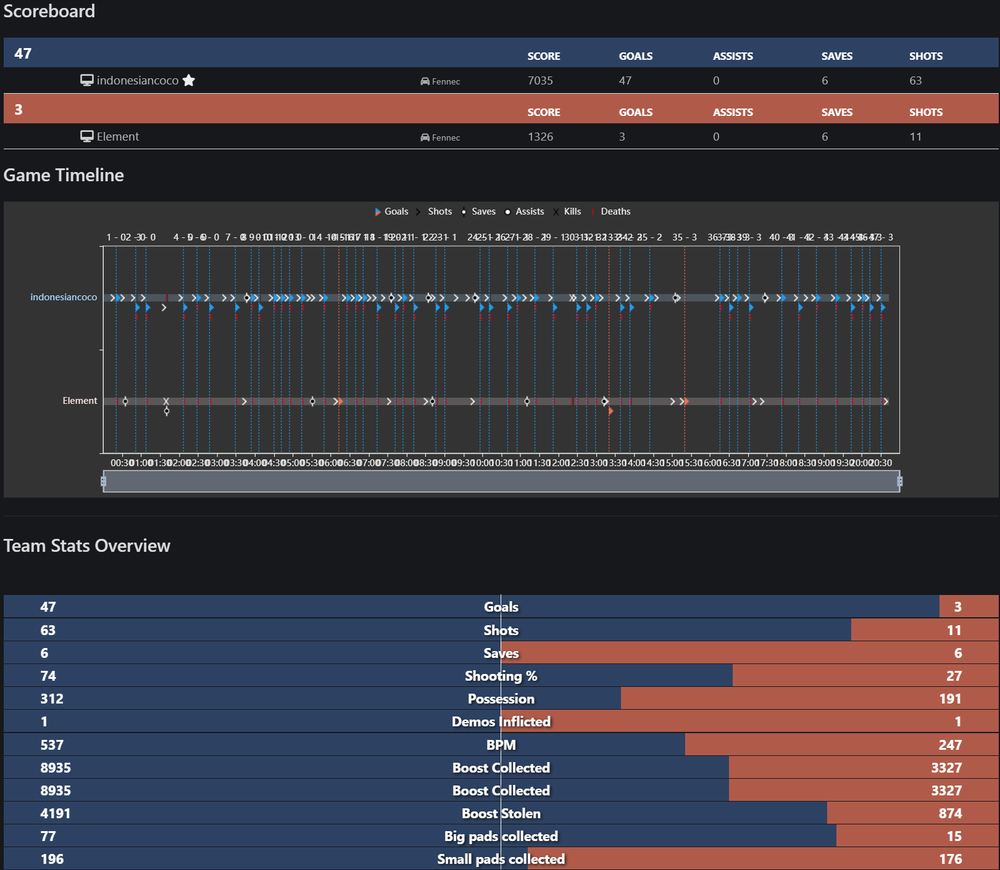

# Indonesian Coconut: PPO Rocket League Bot


Indonesian Coconut is a reinforcement-learning–driven Rocket League bot built using RLGym and a discrete lookup-table action space. Unlike continuous-control agents that rely on large action vectors and dense motor precision, Indonesian Coconut operates with a compact, interpretable discrete action representation while still achieving high-level mechanical behaviors such as controlled air-dribbles, flip resets, pressure-aware flicks, possession-safe dribbling, and adaptive defensive rotations.

The bot is trained using a specialized multi-component reward architecture designed to optimize not only for raw shot power or ball velocity, but for decision quality and possession stability. The reward system embeds concepts such as challenge anticipation, dribble retention, controlled aerial touches, boost-energy budgeting, and goal-probability shaping. This allows Indonesian Coconut to behave more like a human competitive player—with deliberate buildup, safe dispossession, and well-timed mechanical execution—rather than a purely greedy offense-maximizer.

## Performance Evaluation

| Opponent | Opponent rank | Checkpoint | Score (goals) | p-value | Replay |
|---|---|---|---:|---:|---|
| **Nexto** | Grand Champion | `PPO_POLICY_V4_E2G1.pt` | **42–11** | 1.1 × 10⁻⁵ | [ballchasing](https://ballchasing.com/replay/dcdad7bc-640d-4eb7-bfd8-f0634e49cd30) |
| **Element** | Champion | earlier V3 checkpoint | **47–3** | 1.9 × 10⁻¹¹ | [ballchasing](https://ballchasing.com/replay/41b8d475-dc5a-4488-9144-a2c86c9a649b) |

p-values are exact one-sided binomial tests on goals (each goal an independent
50/50 trial under the null hypothesis that the two bots are equally strong).
Against Nexto, E2G1 also out-shot it 65–16. In headless RocketSim evaluation,
E2G1 beats Element 567–33 over 600 kickoff games.

To benchmark policy quality, Indonesian Coconut was evaluated against Element, an established S-tier bot in the RLBot competitive scene. Using a binomial scoring model to assess statistical significance:

The RLGYM community requires a score of 42-28 or better to determine statistical significance (p < 0.05) where each goal is treated as an independent Bernoulli trial.

Indonesian Coconut achieved a decisive result of: **47–3**

This exceeds the statistical significance threshold by a wide margin, providing strong evidence that Indonesian Coconut’s learned policy is overwhelmingly stronger across the full distribution of 1v1 play. See match statistics [here](https://ballchasing.com/replay/41b8d475-dc5a-4488-9144-a2c86c9a649b)


### Clips: (Embeds may not show, see the `docs/highlights` folder.)


https://github.com/user-attachments/assets/57cf83a8-4c07-4a37-a772-93fef701ebf2


https://github.com/user-attachments/assets/49f86ce6-2b4b-4267-82a7-db21556acf5b


https://github.com/user-attachments/assets/cefad133-b74c-486b-b30f-dd77667ad50c


https://github.com/user-attachments/assets/b92510e0-8aa3-4cf7-b44c-de3fc798cf06


https://github.com/user-attachments/assets/4e93f69f-e207-4752-bf58-08e614870379


https://github.com/user-attachments/assets/cb4de19f-d744-4262-949c-cc7a6b2d71c8


https://github.com/user-attachments/assets/51c9a929-da8c-4328-8bf6-856f14cc8c4f


## Project layout

`master` holds the Python (RLGym v2 + rlgym-ppo) training stack and the live
RLBot submission. **The new Rust bot** (indococo-ppo framework, same rewards and
obs, RLBot v5 native binary) is on the
[`indococo-ppo`](https://github.com/SentientPlatypus/indonesian_coconut/tree/indococo-ppo)
branch, which uses these files from `master`:

- `rlbot_submission/policies/1v1.pt` as its warm start and h2h reference;
- `v4_env.py`, `loop_config.py`, `rewards/` and `rl_math/` to regenerate its reward parity fixture;
- `eval_match.py` (and `v4_env.py`, `loop_config.py`) for the h2h evals.

```
rlbot_submission/        Live RLBot submission (1v1/2v2/3v3 policies). Do not modify.
freestyler_v4.py         V4 trainer, driven by the self-improving loop (LOOP.md)
v4_env.py                Env, rewards and obs from a config dict (trainer + evaluator)
loop_config.py           Config schema + hill-climb knobs for the loop
curriculum_mutators.py   Curriculum state setters (air dribbles, flip resets, ...)
opponent_pool.py         Frozen-opponent pool for training (optional)
eval_match.py            Headless RocketSim h2h evaluator (candidate vs opponent .pt)
rsv_renderer.py          RocketSimVis renderer, used by the trainer
rewards/                 Reward functions
    customRewardsGYM.py    Core shaping rewards
    freestyleMechs.py      Freestyle-mechanic rewards (flicks, air dribbles, flip resets, ...)
    team_rewards.py        2v2/3v3 team-play rewards
    zero_sum.py            Zero-sum wrapper
rl_math/                 Geometry helpers (ball trajectory, goal solid angle)
tools/                   Loop, eval and analysis scripts (see LOOP.md, EXPERIMENTS.md)
collision_meshes/        RocketSim arena collision data (required at runtime)
checkpoints_to_test/     Exported loop policies; the eval yardstick panel (LOOP.md, tools/exp_panel.sh)
data/checkpoints/V3/     The 17.9B V3 policy: freestyler_v4's fallback start point
assets/, docs/highlights/  README images and highlight clips
LOOP.md, EXPERIMENTS.md  The self-improving loop and the experiment log
Rlgym-v2-to-rlbot-v5/    Submodule: RLBot v5 deploy template (Element opponent for evals)
RocketSimVis/            Submodule: the visualizer rsv_renderer.py talks to
```

The RLBot v5 server and GUI are not vendored. Get them from <https://rlbot.org>
(or <https://github.com/RLBot/core/releases> and <https://github.com/RLBot/gui/releases>).
RLArenaCollisionDumper (<https://github.com/ZealanL/RLArenaCollisionDumper>)
is only needed to regenerate `collision_meshes/`.

Removed in the 2026-10 cleanup and still in git history: the V3 trainer
(`freestyler.py`), `train_template.py`, `archive/`, the old `indonesiancoco/`
RLBot v4 bot (superseded by `rlbot_submission/`), and the vendored RLBot binaries.

## EC2 instance (in the works)
`ssh -i ~/.ssh/indococo.pem ubuntu@54.167.88.183`
`claude --resume f32d1785-1247-4ed7-b147-94f6b080671f`

`tmux new -s indococo`
`tmux attach -t indococo`

