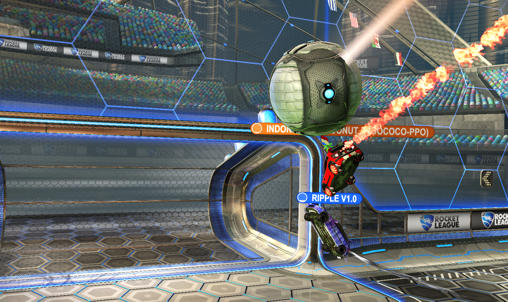
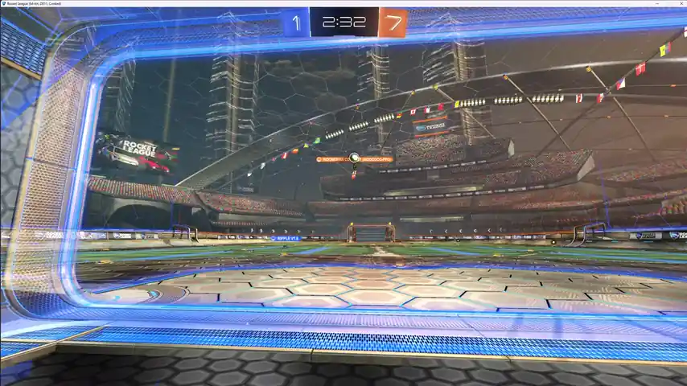

# Indonesian Coconut: Rocket League PPO bot (Rust)


<p align="center"></p>

Indonesian Coconut is a 1v1 Rocket League bot trained with PPO on a discrete 90-action lookup table. On this branch it runs on [indococo-ppo](https://github.com/SentientPlatypus/indococo-ppo), a Rust stack built on RocketSim and Burn. It rewards goals, ball velocity toward goal, aerial touches/distance, flip resets, air dribble bumps, demos, boost management, and possession, and trains with self-play against a league of frozen past checkpoints and ported public bots (FR4, Galactus, Megabyte and others), in 1B-step stages with mid-evals every 50M steps, keep-best promotion, and cosine LR decay. indococo-ppo trains about 1.7x faster than upstream rlgymppo_rs (40.8k → 70.1k steps/s on one L4 with TF32 + bf16 critic; see [its benchmark](https://github.com/SentientPlatypus/indococo-ppo#speedup-at-a-glance)).

See the following table for benchmark matches.

## Bots beaten

These are real RLBot matches (separate from sim eval numbers elsewhere in this README).

| Bot | Rank | Checkpoint that beat it | Date beaten | Score | Replay |
|---|---|---|---|---|---|
| Ripple v1.1 | Pro | ST8 (`checkpoints_to_test/st8_8666M.bpk`, 8666.3M steps) | 2026-11-05 | 17-1 | [ballchasing](https://ballchasing.com/replay/2fc5fa80-2a16-4905-84b4-c175f72743dc) |
| Ripple v1.0 | SSL | ST8 (`checkpoints_to_test/st8_8666M.bpk`, 8666.3M steps) | 2026-11-06 | 16-3 | [ballchasing](https://ballchasing.com/replay/3be4d259-2550-4ea9-8b78-91c496f819dd) |
| Nexto | Grand Champion | E2G1 (`PPO_POLICY_V4_E2G1.pt`, Python policy) | 2026-09-30 | 42-11 | [ballchasing](https://ballchasing.com/replay/dcdad7bc-640d-4eb7-bfd8-f0634e49cd30) |
| Necto | Champion | pending | pending | pending | pending |
| Element | Diamond | V3 checkpoint (Python policy) | 2025-12-28 | 47-3 | [ballchasing](https://ballchasing.com/replay/41b8d475-dc5a-4488-9144-a2c86c9a649b) |

## Repository layout

| Path | What it is |
|---|---|
| [`indococo_ppo_bot/`](indococo_ppo_bot/README.md) | The Rust bot: rewards (one module each, with parity tests against Python), obs/actions, the trainer (`train`, `import`, `export`, `record`) and the RLBot client. **Start here.** |
| `rlbot_indococo_ppo/` | RLBot v5 package: `bot.toml`, Linux and Windows binaries, `weights/actor.bpk`. |
| [`checkpoints_to_test/`](checkpoints_to_test/README.md) | Candidate policies as `<name>.bpk` (`adb_832M.bpk`, `430M.bpk`) with results. To test one, copy it over `rlbot_indococo_ppo/weights/actor.bpk` and restart the bot. |
| [`docs/experiments/`](docs/experiments/REPORT.md) | Research report of every training experiment (R0–R3), with figures, data extracts and `make_figures.py`. |
| `collision_meshes/` | RocketSim soccar meshes. The trainer loads them from the repo root; the RLBot binary embeds them. |
| `assets/` | README images. |

## Quick start

```sh
cd indococo_ppo_bot
cargo test --release                       # unit + 33 reward parity tests
cargo build --release --features torch,cuda --bin indococo-train
```

Training, warm start, critic warm-up, evals and deploy are covered in
[`indococo_ppo_bot/README.md`](indococo_ppo_bot/README.md).

## External tools

- **RLBot v5 server and GUI**, to run `rlbot_indococo_ppo/` in matches:
  <https://rlbot.org> (download page) or
  <https://github.com/RLBot/core/releases> and
  <https://github.com/RLBot/gui/releases>.
- **RLArenaCollisionDumper**, only to regenerate `collision_meshes/` (for
  example after a Rocket League map update):
  <https://github.com/ZealanL/RLArenaCollisionDumper>. Run it with Rocket
  League open and copy the `.cmf` files into `collision_meshes/soccar/`.
