# Teaching a PPO Rocket League bot flip resets and air dribble bumps: experiment report

*indonesian_coconut, `indococo-ppo` branch. Training runs of Oct 30 – Nov 1, 2026 on one NVIDIA L4. All times are America/New_York (ET).*

Every number below comes from the run logs on the training box (`~/ippo_runs`), copied into [`data/`](data/). Anything that was not logged says **not recorded**. [`make_figures.py`](make_figures.py) rebuilds every figure from `data/`, and [`extract_data.py`](extract_data.py) rebuilds `data/` from a copy of `~/ippo_runs`.

## Abstract

We moved the 1v1 bot from the Python rlgym-ppo stack to **indococo-ppo**, a Rust PPO framework forked from VirxEC/rlgymppo_rs. It runs about 1.7× faster than upstream: 70.1k vs 40.8k steps/s on one L4. Then we ran five rounds of experiments aimed at two mechanics the community says separates top bots, **flip resets** and **air dribble bumps**.

- **R0.** Continuing from the Python policy `1v1.pt` gave a peak at 430–531M steps of 60–62% against `1v1.pt` (400 games). That fell to 44.8% at 600M under plain self-play with a constant learning rate.
- **R1.** Adding an opponent pool, cosine LR decay and keep-best fixed the drift. All three R1 arms beat 430M about 63.5% over 1000 games. The targeted rewards did not change behaviour: ADB-832M is the strongest bot, with pool score 84.7, but bumps went down.
- **Bug.** The flip-reset detector missed 80–90% of real resets, because RocketSim reports wheels-on-ball as `on_ground`. With a per-tick detector, the true baseline is about 0.06–0.08 resets per car-minute. Almost all of those come from a setter that resets the car passively, and **no checkpoint has ever used a reset**.
- **R2.** A use-weighted reset reward (FR2) made a stronger bot: 57.2% against ADB-832M over 1000 games. But it still learned no resets: 0.051/min and 0 uses.
- **R3.** FR3, a staged reset curriculum with potential-based wheel-alignment shaping, never left level 0. Run 3 (41.5M steps) held about 1% success on the easiest level, below the 7.3% a car with no input gets. Run 4 (easier level 0, aerial terms zeroed in curriculum episodes, entropy 0.025) held about 5% against an 18% no-input baseline and was stopped at 895.6M so the air rewards could be audited first.
- **R4.** AUD reworked the four air dribble terms to pay only goalward progress, with decay and caps. Warm-started from ADB-832M, its 1131.6M final beat ADB-832M **64.6%** over 1000 games with pool score **87.0**. There was no control arm, so part of that gain is just 300M more steps.
- **R5.** FR4 put the FR3 run-4 reset curriculum on top of the AUD rewards (1131.6M → 1431.6M). It is the strongest bot so far: **63.3%** vs ADB-832M, **53.2%** vs AUD-final, pool **87.1** (Nexto 89.8). The curriculum still never left level 0 (about 4% success against 18% for no input), and **no checkpoint has used a reset**.
- **R6.** FR5 cloned a discrete scripted reset expert (52–55% at level 0) into the policy, then ran PPO in 25M-step chunks with BC refreshes (1431.6M → 1731.6M). The skill now survives PPO in the curriculum: 27.4% level-0 success greedy, against 1.9% for FR4 and 17.9% for no input, with ~90% of resets used. It still gets **0 uses in real play**. The final h2h/pool evals accidentally scored the warm start (44.8% vs FR4, pool 82.8; see §9.5), re-run on a fresh export: 1731.6M scores 44.9% vs FR4, 46.6% vs AUD, pool 83.0, 82.8% vs Nexto. Not shipped.
- **R7.** FR6 started from FR4-final plus BC and anchored every BC refresh to the fixed FR4-final (1431.6M → 2631.6M, 15% reset practice). Its final is the **first checkpoint to use resets in play**: 4 uses in 300k `rates_fr3.toml` steps (0 goals after), all from curriculum-style spawns. Strength held level with FR4: **48.0%** vs FR4-final, 47.6% vs AUD-final (1000 games), pool 85.0 (Nexto 85.8). Shipped as `fr6_2632M.bpk` (keep rule: uses > 0 and ≥ 48% vs FR4).

## 1. Setup

### 1.1 Framework and hardware

- **Hardware:** EC2 g6.8xlarge with one NVIDIA L4 (24 GB) and 32 vCPUs.
- **Framework:** [indococo-ppo](https://github.com/SentientPlatypus/indococo-ppo), a GPL-2.0 fork of VirxEC/rlgymppo_rs. It uses RocketSim for physics, Burn/LibTorch for the networks, and a LibTorch CUDA backend.
- **Bot crate:** `indococo_ppo_bot/` on this branch. It holds the rewards, obs and actions, the trainer, and the RLBot client. It pulls the framework as a pinned Cargo git dependency.

**Throughput benchmark.** 1v1, a 7.8M-parameter actor+critic, 2 epochs, 100k steps/iteration, 50k minibatch, 512 games, 24 threads, idle L4, from scratch (`data/sps_benchmark.csv`):

| Stage | Config | steps/s | learn s/iter |
|---|---|---|---|
| base | upstream rlgymppo_rs (Burn CUDA f32) | 40.8k | 1.88 |
| 0 | update magnitudes on the GPU | 43.8k | 1.76 |
| 0 | + fusion | 43.3k | 1.76 |
| 1 | LibTorch f32 | 37.6k | 2.24 |
| 1 | LibTorch TF32 | 57.9k | 1.29 |
| 2 | **TF32 + bf16 critic (used for every run)** | **70.1k** | 1.03 |
| 2 | TF32 + bf16 critic + policy | 80.7k | 0.79 |
| 2 | Burn CUDA + bf16 both | 72.1k | 0.80 |

A bf16 policy raised KL from 0.0012–0.0022 to 0.010 and the clip fraction from 1–2% to 6%, so the policy stays f32. Throughput during the real runs, from `Throughput/overall` (min / median / max over 0.5M-step means):

| Run | min | median | max |
|---|---|---|---|
| R0 e8b2_1v1 | 38.1k | 70.5k | 77.7k |
| X0 | 41.2k | 66.6k | 75.2k |
| FR | 48.7k | 66.7k | 75.6k |
| ADB | 43.4k | 66.7k | 75.1k |
| FR2 | 19.7k | 61.3k | 71.8k |

The lows come from eval loops that shared the CPUs.

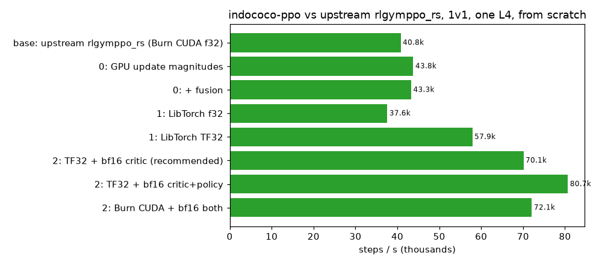

### 1.2 Observations, actions, network, PPO

- **Observations:** RLGym v2 `DefaultObs` in the 1v1 layout, 92 floats, with `air_time_since_jump` clamped at 1.25 s. This matches `1v1.pt` and what rlgym_compat feeds the deployed bot.
- **Actions:** the 90-entry `LookupTableAction`, with tick skip 8.
- **PPO** (`config/train.toml` and the experiment templates): 100k steps/iteration, minibatch 50k, 2 epochs, γ 0.995, λ 0.95, entropy coefficient 0.01, and LR 1e-4 for both nets in R0/R1 and 5e-5 in R2/R3. Self-play includes old versions.
- **Warm start:** R0 imported `1v1.pt`. Its max |logit diff| against Python fp64 is 7.4e-9, with the same argmax.

### 1.3 The E8B2 reward base

All rounds build on the E8B2 reward set (`indococo_ppo_bot/config/e8b2_1v1.toml`). It has one Rust module per term and 33 parity tests against the Python classes. Weights:

| term | w | term | w | term | w |
|---|---|---|---|---|---|
| goal | 1200 | possession | 68 | contact_quality | 250 |
| goal_prob | 40 | energy | 3 | front_bump_setup | 24 |
| ball_travel | 10 | boost_keep | 5 | safe_boost | 16 |
| vel_ball_to_goal | 12 | boost_change | 8 | shadow_space | 18 |
| goal_dist | 3 | aerial_boost | 14 | pressure_flick | 36 |
| speed_to_ball | 1 | aerial_distance | 40 | high_ball | 18 |
| face_ball | 1 | airdribble | 40 | range_carry | 28 |
| touch | 6 | airdribble_seq | 55 | clear_path | 42 |
| wall_pop | 7 | flick | 22 | ang_vel | 1 |
| flip_reset | 70 | recover | 70 | demo | 50 |

`in_air` and `overextend` have weight 0. The rewards are zero-sum: r_i − opp_scale · mean(r_opponents). From R1 on, `common_rewards.toml` adds `demo.victim_gate = true`, so the knocked car is never paid for a bump.

### 1.4 Evaluation methodology

`tools/pool_eval/` plays headless RocketSim matches through RLGym v2. Each game is a 1v1 Octane game from a kickoff, played to the first goal. It counts as a timeout after 30 s with no touch or after 300 s.

- **Opponent pool:** `1v1.pt` (our Python E8B2 policy), `ppo_430M` (R0 checkpoint), **Nexto**, **Necto** (VirxEC/NectoFamily), **Element** (VirxEC/Elementv5) and **Immortal** (RLBotPack, tick skip 6). Public bots run their own obs builders, models and kickoff code through an RLGym v1 compatibility view. Nexto keeps its stochastic sampling. Seer, Ripple and Tecko are not in the pool, because Seer has no packet shim and the other two have no public weights. (Update 2026-11-01: the RLBot v5 botpack now ships Ripple v1.1 and the GigaLearn bots Kira, Dice, Chronos and GalactusV2; they form a second pool, `pool_botpack5.toml`. Results in `indococo_ppo_bot/EXPERIMENTS.md`, "Benchmark: RLBot v5 botpack ML bots", and `figures/botpack5_bench.png`. GalactusV2 beats FR6-final 338-62. Seer was added later with a packet shim; FR6-final beats it 400-0. Update 2026-11-09: Ripple v1.1 also joins the training game split at about 5% of iterations in ST20; see §11.8p.)
- **Pool score:** the mean decisive win rate over the six opponents.
- **H2H:** each seed is played twice, with the candidate blue and then orange. Our policy plays greedily (argmax). The standard error is √(p(1−p)/n): about ±2.5 pts at 400 games, ±1.6 at 1000 and ±5 at 100. R0 used seed 10000; R1 onward used seed 424242 and `nice 19`.
- **Air-time clamp:** on by default, because that is what the deployed bot sees. Master's `h2h_1v1.py` ran without it. Unclamped, 430M scored 51.0% against `1v1.pt` with both sides unclamped, and 52.5% with only 430M unclamped, against 57.2% clamped (400 games each).
- **Fresh engine and spawn jitter fix.** Two harness bugs had to be fixed before the pool numbers meant anything (`data/pool_400.csv`, sources `pool_baseline*`, seed 10000, 400 games/opponent):

| harness | 430M vs 1v1.pt | 430M vs itself | 1v1.pt vs itself | vs Necto/Element/Immortal | 430M pool |
|---|---|---|---|---|---|
| reused engine, no jitter | 40.0% (5 timeouts) | 53.2% | **59.2%** | 100 / 100 / 100 | not recorded |
| fresh engine, no jitter | 45.0% | 50.0% | 50.0% | 100 / 100 / 100 | 79.0 |
| **fresh engine + jitter (used)** | **57.2%** | 51.0% | 50.0% | 94.2 / 96.2 / 94.8 | **79.0** |

  - A reused arena carries contact and car state across resets. Identical policies then did not mirror-cancel (`1v1.pt` beat itself 59.2%), and a seed did not replay the same game.
  - Without jitter, two deterministic bots with RLGym's 5 kickoff spawns play only 10 distinct games, which is why the 100% results appear. The fix jitters each car's spawn by up to 60 uu and 4° with a seeded RNG, and keeps the ball centred.
- **Baselines** (fresh engine and jitter, 400 games/opponent):

| candidate | 1v1.pt | 430M | Nexto | Necto | Element | Immortal | Pool |
|---|---|---|---|---|---|---|---|
| 430M | 57.2 | 51.0 | 80.5 | 94.2 | 96.2 | 94.8 | 79.0 |
| 1v1.pt | 50.0 | 42.5 | 84.2 | 94.2 | 98.2 | 95.8 | 77.5 |

- **Periodic evals and keep-best:** `tools/eval_loop.sh` evaluates a checkpoint every 100M steps, with 100 games per opponent. It promotes a checkpoint to `bots/best` if it beats the best's pool score **and** wins a 400-game h2h against the previous best.
- **Reset rates:** from R2 on, `indococo-train rates` plays 300k steps (1M for the baseline re-measurement) against 430M over a fixed setter mix. It uses greedy policies with 3% random actions, puts the candidate on blue, and counts resets with both detectors, plus uses and goals after a reset.

## 2. R0: the first Rust run (`e8b2_1v1`, 0 → 600M)

**Hypothesis.** The faster Rust stack, warm-started from `1v1.pt` with E8B2 rewards, keeps improving under self-play.

**Config.** The run imported `1v1.pt` and did a 30M-step critic-only warm-up (policy LR 0), then 570M steps of PPO with LR 1e-4 held **constant**. Self-play included old versions. There was no fixed opponent pool and no keep-best. The trainer started at 1:26 PM ET on Oct 30 and ran at about 70k sps.

**Results.** 400-game h2h against `1v1.pt`, deterministic, seed 10000 (`data/r0_h2h_vs_1v1.csv`):

| steps | W-L | win % | ±se |
|---|---|---|---|
| 130.2M | 186-214 | 46.5 | 2.5 |
| 230.4M | 170-230 | 42.5 | 2.5 |
| 330.6M | 192-208 | 48.0 | 2.5 |
| **430.8M** | 241-159 | **60.2** | 2.4 |
| **531.0M** | 247-153 | **61.8** | 2.4 |
| 600.0M | 179-221 | **44.8** | 2.5 |

430M was confirmed over 1000 games: 602-398, or 60.2% against `1v1.pt`. Its pool score is 79.0.

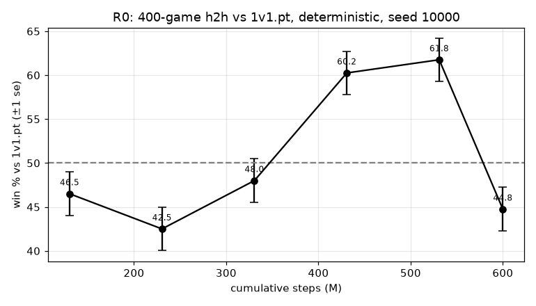
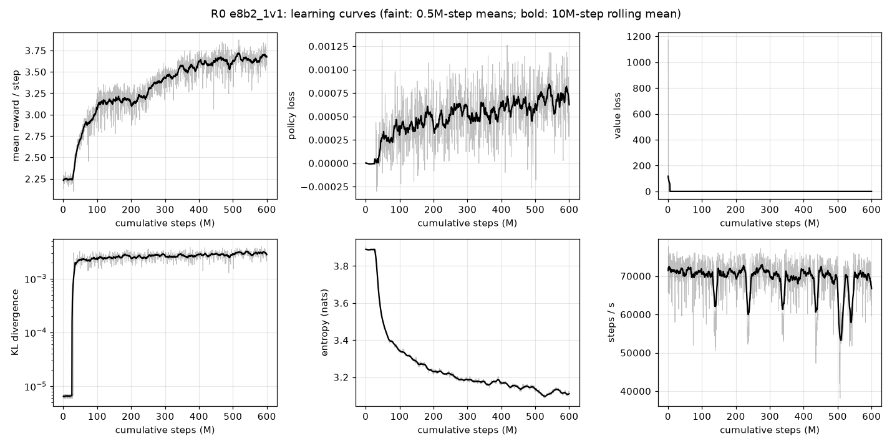

**Analysis of the 600M regression.** This was not overfitting to a fixed target, because the opponent was only the policy and its own past versions. The pattern of rising, collapsing and rising again points to **self-play cycling**. With a constant LR of 1e-4 and no anchor, the policy keeps exploiting its current self and forgets how to beat other styles. The Python-stack run of the previous days had already shown the same oscillation against 1v1.pt: 51.0, 61.8, 33.5, 50.5, 32.5, 60.3 and 42.5% at roughly 100M intervals (`training_checkins.md`). The learning curves show no NaNs or KL spikes at 600M, so the regression was strategic rather than an optimisation failure. The skill tracker (`Rating/1v1`) is a self-play rating and does not show it.

**Fixes adopted for R1:**
1. a **fixed opponent pool**: in 25% of iterations the opponent is drawn from `1v1.pt`, the 430M checkpoint and saved past versions;
2. an **LR schedule**: flat, then cosine to 0.2×;
3. **keep-best**: promotion needs a higher pool score and an h2h win, so a regression can never overwrite the deliverable.

R1 continued from 430.8M, not from 600M.

## 3. R1: X0 / FR / ADB (430.8M → 880.8M, 450M steps each)

### 3.1 Motivation from Discord (read-only research, RLGym and bot-dev channels)

- **Flip resets.** A public FlipResetReward pays when the car touches the ball, `has_flip` goes from false to true and the ball is within 45° of the car's down vector. It pays again on the next touch after the reset flip is used.
  - RocketSim reports `on_ground` while the wheels touch the ball, so "airborne" has to be a height test (z > 150).
  - **State setters matter more than the reward.** One bot did not learn resets by 11B steps without setters. With reset/random setters, another reported "ELO jumped faster in 500M than the last 30B".
  - **Farming risk:** a high reset weight dropped one bot to Nexto level until it was lowered.
- **Air dribble bumps.** Touch height plus aerial distance is enough for air dribbles. For bumps and demos, use a zero-sum reward gated so the victim isn't paid (one author found 12% of bumps rewarded the loser), with about +30% while the opponent is demoed. One bot learned air dribble bumps about 5B steps after a demo/bump reward was added.
- **Balancing tension:** lowering the reset reward was reported to make bots spam air dribble bumps, so FR and ADB were run as separate arms.

### 3.2 Design

All arms warm-started from the full 430.8M checkpoint (actor, critic and optimizer) with the same learner settings (`experiments/train_template.toml`):

- LR 1e-4, held flat until 580M (150M into the run), then cosine to 0.2× over 300M;
- opponent pool chance 0.25;
- setter mix: kickoff 0.30, random 0.10 + 0.10, `air_near_ball` 0.25 (car under the ball, wheels toward it, flip spent) and `wall_air_dribble` 0.25.

| arm | change on top of E8B2 + victim gate | file |
|---|---|---|
| **X0** | none (control) | `x0.toml` |
| **FR** | `flip_reset_gated` w=100 for 150M steps, then w=40. obtain 1.0 and hit 1.0, ball > 300 uu, car z > 150, max distance 220, use window 2.5 s | `fr_ramp.toml` → `fr.toml` (switch at 580.8M) |
| **ADB** | `air_touch_height` w=30 (ball > 250, decay 0.8, goal bonus 1.0) and `air_dribble_bump` w=40 (bump 0.3, demo 1.0, 0.1/s while demoed, air dribble bonus 2.0, goal bonus 1.0, possession window 1.25 s) | `adb.toml` |

Sizing came from a 4M-step dry run of 430M with every new term at weight 1:

- the dense positive reward is about 3.8/step;
- `air_touch_height` is 0.0078/step at w=1, so w=30 is about 6%;
- resets came at 0.007 per car-minute on the old detector, so `flip_reset_gated` was sized per event: 50–100 per reset at w=100;
- a bump pays 12, an air dribble bump 36 (up to 2×), and a demo 40–120.

**Keep criteria:** an arm is kept only if it beats X0-best over 1000+ games (>52%), keeps its pool score within about 2 points of X0's, and clearly raises its targeted event rate.

### 3.3 Results

**Periodic pool evals** (100 games/opponent, ±≈5 pts; `data/pool_evals.csv`). ✔ = promoted to best.

| run | step | pool | 1v1.pt | 430M | Nexto | Necto | Element | Immortal | best |
|---|---|---|---|---|---|---|---|---|---|
| X0 | 531.0M | 78.8 | 48 | 59 | 75 | 96 | 96 | 99 | ✔ |
| X0 | 631.2M | 80.0 | 54 | 59 | 73 | 99 | 99 | 96 | ✔ |
| X0 | 731.4M | 82.2 | 54 | 60 | 84 | 98 | 100 | 97 | |
| X0 | 831.6M | 82.7 | 69 | 58 | 80 | 96 | 99 | 94 | ✔ |
| X0 | 880.8M | **83.5** | 58 | 65 | 86 | 97 | 98 | 97 | ✔ |
| FR | 430.8M | 81.5 | 66 | 49 | 87 | 96 | 96 | 95 | ✔ (start) |
| FR | 531.0M | 77.8 | 52 | 53 | 82 | 89 | 99 | 92 | |
| FR | 630.9M | 79.5 | 51 | 56 | 78 | 99 | 98 | 95 | |
| FR | 731.1M | 79.5 | 49 | 65 | 77 | 97 | 98 | 91 | |
| FR | 831.3M | 81.3 | 58 | 62 | 82 | 92 | 96 | 98 | |
| FR | 880.8M | **83.0** | 62 | 66 | 84 | 93 | 98 | 95 | ✔ |
| ADB | 430.8M | 80.8 | 65 | 48 | 85 | 96 | 96 | 95 | ✔ (start) |
| ADB | 531.0M | 76.3 | 49 | 48 | 72 | 96 | 98 | 95 | |
| ADB | 631.2M | 78.5 | 54 | 53 | 75 | 96 | 100 | 93 | |
| ADB | 731.4M | 79.3 | 62 | 62 | 78 | 91 | 94 | 89 | |
| ADB | 831.6M | **82.8** | 53 | 70 | 87 | 95 | 97 | 95 | ✔ |
| ADB | 880.8M | 81.0 | 62 | 63 | 81 | 92 | 93 | 95 | |

X0's start eval at 430.8M is not in its evals.jsonl (not recorded). The 430.8M evals of FR and ADB, 81.5 and 80.8, are the same checkpoint and show the 100-game noise: 79.0 over 400 games.

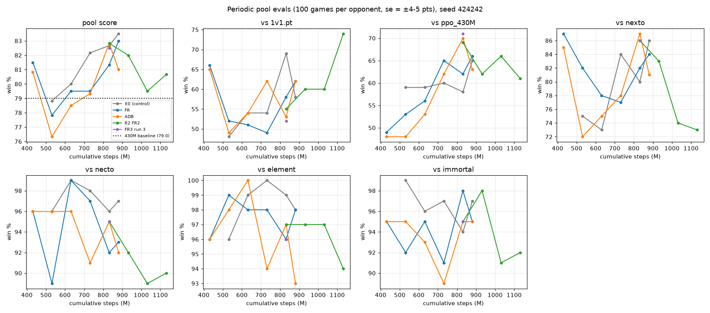

**Final analysis** (`final_analysis/`, seed 424242). Bests: X0 = trainer dir `1793405254` (~881M), FR = `1793412690` (~881M), ADB = `ckpt_831600000` (831.6M).

| 1000-game h2h | W-L | win % | ±se |
|---|---|---|---|
| FR-best vs X0-best | 502-498 | 50.2 | 1.6 |
| ADB-best vs X0-best | 521-479 | 52.1 | 1.6 |
| X0-best vs 430M | 634-366 | 63.4 | 1.5 |
| FR-best vs 430M | 634-366 | 63.4 | 1.5 |
| ADB-best vs 430M | 636-364 | 63.6 | 1.5 |

| 400-game pool | 1v1.pt | 430M | Nexto | Necto | Element | Immortal | **Pool** |
|---|---|---|---|---|---|---|---|
| X0-best | 59.2 | 62.5 | 86.0 | 98.5 | 97.5 | 96.2 | 83.3 |
| FR-best | 63.0 | 64.2 | 84.8 | 96.5 | 98.0 | 96.0 | 83.8 |
| ADB-best | 65.2 | 65.0 | 85.5 | 95.8 | 99.0 | 97.5 | **84.7** |
| *430M (baseline)* | 57.2 | 51.0 | 80.5 | 94.2 | 96.2 | 94.8 | 79.0 |

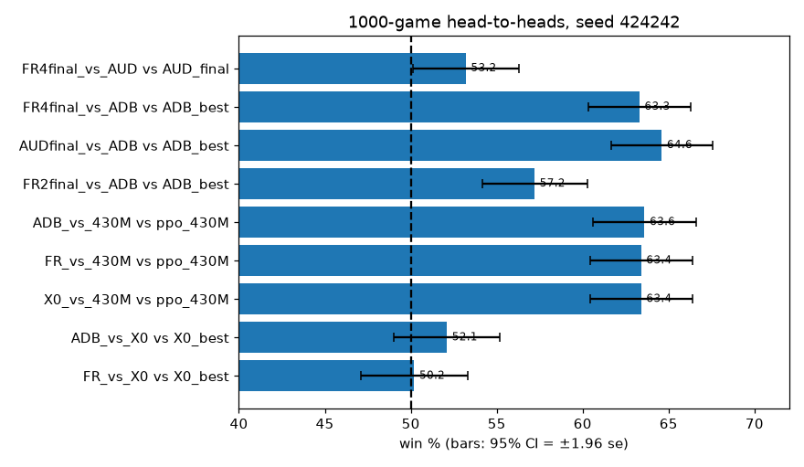
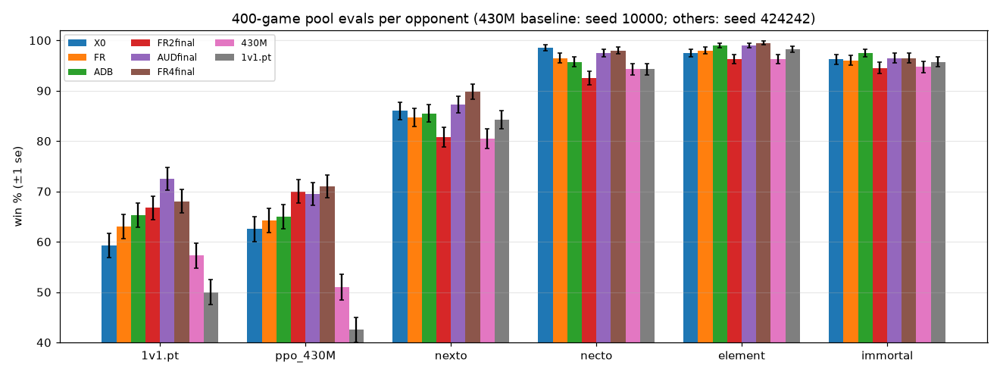

**Training event rates** (per car-minute, mean of the last 100M steps, with the first 50M in brackets). Flip resets here are counted by the **old detector** (see §4).

| arm | flip resets | air dribble bumps | all bumps | demos |
|---|---|---|---|---|
| X0 | 0.0085 (0.0088) | 0.644 (0.562) | 1.66 | 0.450 |
| FR | 0.0109 (0.0088) | 0.633 (0.553) | 1.68 | 0.460 |
| ADB | 0.0094 (0.0081) | 0.568 (0.546) | 1.59 | 0.440 |

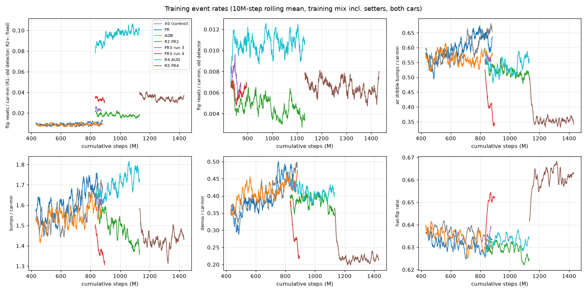

**Reward shares.** R1 logged only the signed per-step mean `Reward/<term>`. For zero-sum terms that mean cancels across the two cars: `goal` and `air_dribble_bump` log as exactly 0. The R1 share charts therefore show |signed mean| and overweight non-zero-sum shaping. Over the last 100M steps:

- `flip_reset_gated` was 0.04% of the dense positive reward. It was non-zero in 62% of iterations, at 0.0043/step at w=100 and 0.0017/step at w=40.
- The base `flip_reset` was 0.14–0.16%.
- `air_touch_height` was 6.55%.

Over the last 20 iterations, `airdribble_seq` alone was 47–52% of |signed mean| in every arm.

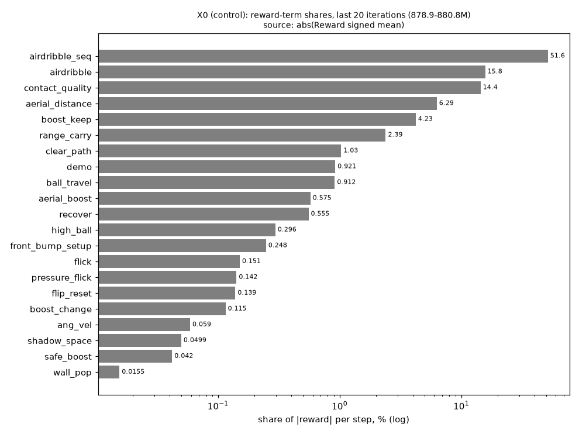 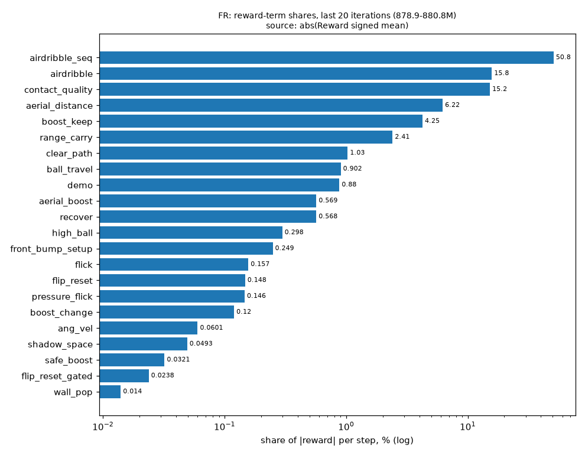 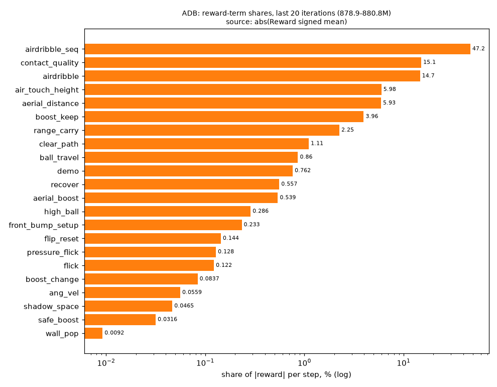

Learning curves: [X0](figures/learning_exp_X0.png), [FR](figures/learning_exp_FR.png), [ADB](figures/learning_exp_ADB.png), and [all runs overlaid](figures/learning_all_runs.png).

### 3.4 Analysis and verdict

- **The infrastructure fixes, not the rewards, made the gain.** All three arms beat 430M by the same margin, 63.4–63.6% (Δ ≤ 0.2 pts, well inside 1 se), and all raised the pool score by 4–6 points over 430M's 79.0.
- **FR: not kept.** It tied X0 at 50.2%. Its reset rate went from 0.0085 to 0.0109 per minute, about one every 90 minutes.
- **ADB: the best bot, but not for the hypothesised reason.** It won 52.1% against X0, which is +1.3 se, p ≈ 0.09 and so not significant. It has the best pool score (84.7) and the best result against `1v1.pt` (65.2). But air dribble bumps **fell**, from 0.644 to 0.568, so the targeted-rate criterion fails. The gain most likely comes from the `air_touch_height` shaping and the victim-gated demo.
- **Diagnosis:**
  1. the reset detector was broken (§4);
  2. `flip_reset_gated` was far too sparse to give gradient;
  3. 89% of `air_near_ball` setups give a reset with **no input**, so the reward paid for something the policy does not control;
  4. the ADB event is too loose (it flags about 40% of all bumps) and symmetric in self-play, so the victim learns avoidance as fast as the attacker learns to bump.

**Deliverable:** ADB-832M, packaged as `rlbot_indococo_ppo_adb_832M`. It is in GitHub release [`adb-832m`](https://github.com/SentientPlatypus/indonesian_coconut/releases/tag/adb-832m) and `checkpoints_to_test/adb_832M.bpk`.

## 4. The flip-reset detection bug

**Cause.** When three or more wheels touch anything, including the ball, RocketSim sets `is_on_ground` and on that tick re-arms the jump and clears `has_flipped` / `has_double_jumped`. The R1 counter (`events.rs is_flip_reset`) and the base `flip_reset` reward bailed out, or cleared their state, whenever `on_ground()` was true. They also required a `CarHitBall` touch, which wheel contact does not raise. With 8-tick steps, `has_flip` is already true by the next step, so the rising edge was never seen. A RocketSim probe of zero-input `air_near_ball` setups found the flip regained in 268 of 300, usually with `on_ground()` true on that step.

**Fix** (`src/resets.rs`, run per physics tick through `SharedInfoProvider::on_tick`):

```
every physics tick, for each car:
    flags_now = (has_jumped, has_double_jumped, has_flipped)
    regained  = some flag was set last tick and is cleared now   # sim gave the jump/flip back
    wheels_on_ball   = wheels whose contact is the ball
    wheels_elsewhere = wheels touching floor, wall, ceiling or another car
    if regained and wheels_on_ball > 0 and wheels_elsewhere == 0
       and car.z > 150 and ball.z > 250 and car clear of walls and ceiling:
        mark flip_reset for this car this step
    prev_flags = flags_now
end of each 8-tick step: any marked tick -> event counter, rewards
step-level fallback (no tick data): same regain + airborne rule, plus underside facing the ball within 300 uu
```

The simulator decides whether the flip comes back, using its own ≥3-wheel ground rule. The detector only adds that nothing but the ball was touched and that the car and ball were airborne. Ceiling, wall and rolling-ball landings are excluded.

**Tests** (`tests/flip_reset_sim.rs`, RocketSim):
- a scripted reset under the ball is detected by both the tick and step rules;
- a reset followed by a jump inside the same step is detected;
- floor and wall landings are not;
- the two rules agree on every step of 400 setter episodes.

**True baselines** (`fr2_baseline/rates.jsonl`, 1M steps each, against 430M or self, `rates_mix.toml`; `data/flip_reset_rates.csv`):

| policy (vs) | old detector /min | **fixed /min** | ratio | `air_near_ball` /min | `air_reset` /min | kickoff /min | uses |
|---|---|---|---|---|---|---|---|
| X0-best (430M) | 0.0099 | **0.0639** | 6.5× | 0.271 | 0.000 | 0.000 | 0 |
| FR-best (430M) | 0.0054 | **0.0711** | 13× | 0.278 | 0.000 | 0.007 | 0 |
| ADB-best (430M) | 0.0126 | **0.0783** | 6.2× | 0.332 | 0.000 | 0.002 | 0 |
| ADB-best (self) | 0.0117 | 0.0576 | 4.9× | 0.255 | 0.004 | 0.003 | 0 |
| 430M (self) | 0.0099 | 0.0666 | 6.7× | 0.279 | 0.004 | 0.000 | 0 |

On these 1M-step measurements the old detector undercounted 5–13×. The earlier "10–30×" estimate was against the per-step training counters. **No policy used a reset (0 uses), and resets from kickoff play are essentially zero.** Almost every reset came from the passive `air_near_ball` setter. For X0, 64 of its 66 reset episodes were "early" resets in `air_near_ball` (inside 3 s, mostly passive).

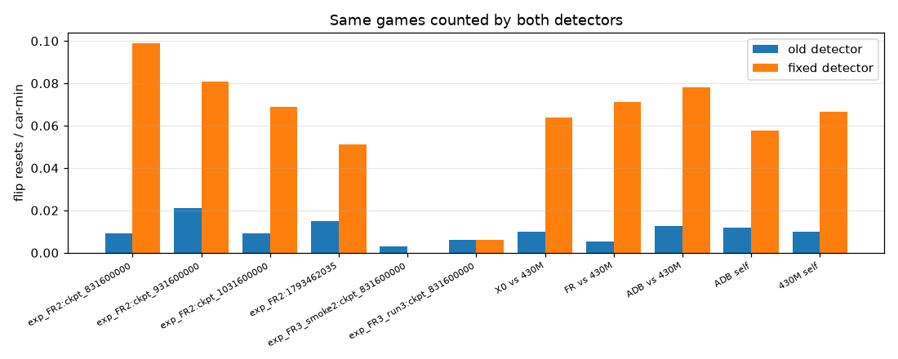

## 5. R2: FR2, rewarding the *use* of a reset (831.6M → 1131.6M)

**Hypothesis.** With correct detection, a reward that pays mainly for *using* a reset, plus a setter where a reset needs effort, will produce intentional resets.

**Design** (`experiments/fr2.toml`, `train_fr2_template.toml`):

- **Base:** ADB rewards, warm-started from ADB-best `ckpt_831600000`. The base `flip_reset` is set to 0, since with the fix it would pay 70 per reset plus dense shaping.
- **`flip_reset_use`, w=80:**
  - obtain 0.1, i.e. 8 points, decaying 0.5× per repeat, at most 3 per flight, ball > 300 uu, underside cos ≥ 0.5, and nothing in the first 0.5 s of an episode;
  - use 1.0, i.e. 20–80: a dodge within 1.5 s of the reset, then within 0.6 s a goalward touch, scaled by speed up to 2000 uu/s;
  - shot 0.5 (40) if the ball heads on target at ≥ 500 uu/s within 3 s;
  - goal 1.0 (80) on top of the goal term.
- **New setter `air_reset`:** the car starts 400–800 uu from the ball, up to 50° off directly underneath, with a 200–700 uu/s velocity mismatch and its wheels up to 90° off. With no input it resets in **0 of 200** episodes, against 89% for `air_near_ball`.
- **Setter shares** in three 100M stages:
  - `air_reset` 0.15 → 0.23 → 0.30, with `air_near_ball` 0.05;
  - kickoff 0.35 → 0.27 → 0.20;
  - random 0.1 + 0.1 and `wall_air_dribble` 0.25.
- **LR** 5e-5, held 100M, then cosine to 0.4× by 300M.
- **Logging** adds `RewardAbs/`, `RewardNonzero/`, `Setters/` and per-setter reset events. Each 100M eval runs `rates`.

**Results.** Training finished at 11:53 AM ET on Oct 31. Keep-best never promoted past the warm start, so the final checkpoint `1793462035` (1131.6M) was evaluated directly.

| periodic eval | pool | 1v1.pt | 430M | Nexto | Necto | Element | Immortal | resets/min (fixed) | old det. | uses |
|---|---|---|---|---|---|---|---|---|---|---|
| 831.6M (start) | 82.8 | 55 | 69 | 86 | 95 | 97 | 95 | 0.099 | 0.009 | 0 |
| 931.6M | 82.0 | 60 | 62 | 83 | 92 | 97 | 98 | 0.081 | 0.021 | 0 |
| 1031.6M | 79.5 | 60 | 66 | 74 | 89 | 97 | 91 | 0.069 | 0.009 | 0 |
| 1131.6M | 80.7 | 74 | 61 | 73 | 90 | 94 | 92 | 0.051 | 0.015 | 0 |

| final | result |
|---|---|
| h2h FR2-1132M vs ADB-best (1000 games) | **572-428, 57.2% ± 1.6** |
| pool (400/opponent) | **83.5**: 1v1.pt 66.8, 430M 70.0, Nexto 80.8, Necto 92.5, Element 96.2, Immortal 94.5 (ADB-best 84.7, Nexto 85.5) |
| resets (fixed detector, vs 430M) | 0.051/min overall; `air_near_ball` 0.198, `air_reset` **0**, kickoff **0**; **0 uses**; 1 goal after a reset |

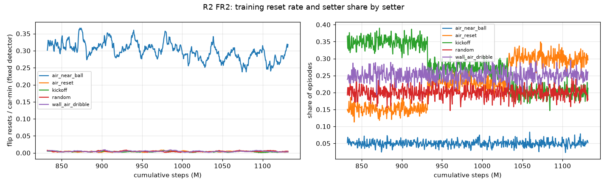
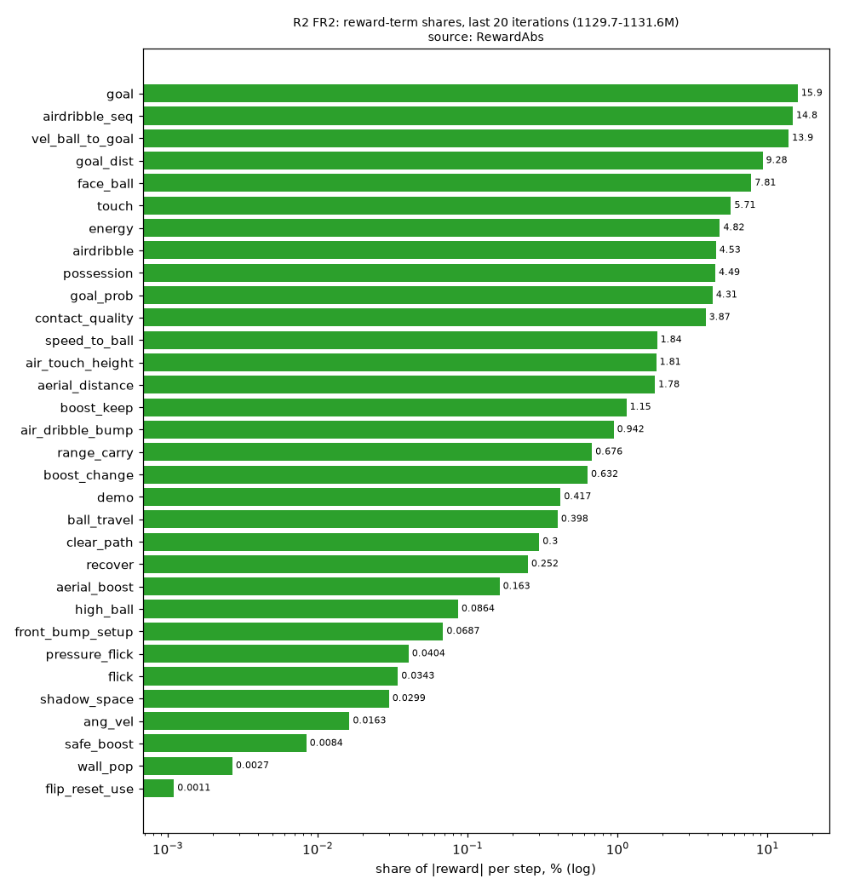
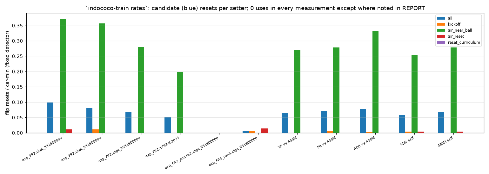

Over the last 20 iterations, `flip_reset_use` was **0.001%** of |reward| and `airdribble_seq` was 14.8%. The aerial terms together (aerial_distance/boost, airdribble, airdribble_seq, air_touch_height, air_dribble_bump, high_ball, wall_pop, flick, pressure_flick) were 24.2%. Goal, vel_ball_to_goal and goal_dist were 39.1%. Learning curves: [FR2](figures/learning_exp_FR2.png).

**Analysis and verdict.**
- FR2 is a **stronger 1v1 bot** than ADB-832M head to head, with a significant +7.2 pts at 1000 games. It is weaker against Nexto (−4.7 pts at 400 games, about 2 se) and slightly lower on pool score.
- On flip resets it **failed**. The rate in the periodic evals **fell** steadily from 0.099 to 0.051, it never earned a reset from `air_reset`, and it made no uses.
- The policy almost never reaches a reset position on its own, so a reward conditioned on a reset almost never pays. There is no gradient to follow.
- Shipped as `checkpoints_to_test/fr2_1132M.bpk`.

## 6. R3: FR3, staged reset curriculum (stopped)

**Hypothesis.** An adaptive curriculum that starts with the ball almost on the wheels, plus dense potential-based alignment shaping, will let the policy find resets and then move out to `air_reset` difficulty.

**Design** (`experiments/fr3.toml`, `train_fr3_template.toml`, `src/curriculum.rs`, `src/rewards/reset_align.rs`):

- **Setter `reset_curriculum`** (28% of episodes): levels 0–9, blended by t = (level/9)^1.5.
  - Level 0: a 40–80 uu wheel gap, wheels within 10°, closing at 60–120 uu/s while spinning at 1.5–2.5 rad/s. Without input the wheels usually turn away before contact.
  - Level 9: a 500–800 uu gap, wheels up to 90° off, and a 200–700 uu/s mismatch, i.e. `air_reset` difficulty.
  - Success is an *earned* reset: after 0.33 s of control and within 3 s.
  - After 200 attempts, success above 60% advances a level and below 25% backs off one. 20% of episodes replay an easier level.
- **`reset_align`, w=400:** while airborne above 300 uu and within 400 uu of a ball above 300 uu, φ = max(0, underside cos) · (1 − dist/400). Each step pays φ − φ_prev, so loops sum to zero, and positive pay is capped at 1 (400 points) per episode.
- **`flip_reset_use`, w=600**, with FR2's parameters and the obtain grace cut to 0.3 s:
  - obtain 60 → 30 → 15;
  - use 150–600;
  - shot 300;
  - goal 600.
- **Setter mix:**
  - kickoff 0.32 for the first 100M steps, then 0.30;
  - random 0.1 + 0.1;
  - `air_near_ball` 0.05;
  - `reset_curriculum` 0.28;
  - `wall_air_dribble` 0.15;
  - `air_reset` dropped.
- **Training:** warm-started from ADB-best (831.6M). LR 5e-5, held 100M, then cosine to 0.4× by 300M (200M decay). Pool and keep-best as in FR2. The rates eval uses `rates_fr3.toml` (kickoff/open play, `air_reset`, and the curriculum pinned at level 2).

**Baselines per level** (150 setups each, `tests/reset_curriculum_sim.rs`; `data/fr3_level_baselines.csv`):

| level | no input | random input | scripted wheel alignment (pitch/roll only) |
|---|---|---|---|
| 0 | 0.073 | 0.000 | 0.547 |
| 1 | 0.047 | 0.000 | 0.440 |
| 2 | 0.007 | 0.000 | 0.127 |
| 3 | 0.007 | 0.000 | 0.053 |
| 4–9 | ≤0.007 | 0.000 | ≤0.027 |

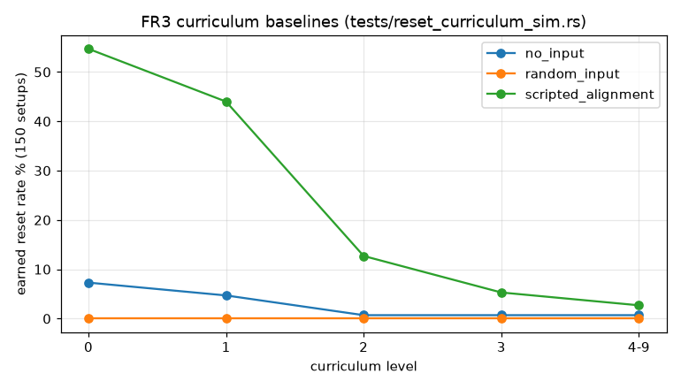

**Smoke runs and runs so far** (all warm-started at 831.6M; `data/metrics_exp_FR3_*.csv`):

| run | change | steps | L0 success | `reset_align` \|reward\| share | sps |
|---|---|---|---|---|---|
| smoke 1 | first design: align w=10, improvement-only shaping, use w=80, L0 spin 2–3.5 rad/s | 22.8M logged (to 854.4M; EXPERIMENTS.md quotes 17M) | 0.8%, ended at 0 | 0.016% | 45–57k incl. start eval |
| smoke 2 | spin 1.5–2.5, ease 1.5, align w=400, use w=600 | 27.8M logged (to 859.4M; EXPERIMENTS.md quotes 23M) | 1.2% (no-input 7%) | 0.64% | 58–69k |
| run 3 | potential-based `reset_align`, obtain grace 0.3 s | 41.5M (to 873.1M), then stopped | 0–2.5% per 0.5M window, flat; **level stayed 0** | 1.69% (last 20 it.), 1.79% (whole run) | 49–67k |
| run 4 | run 3 + **easier level 0** (gap 30–60 uu, spin 1–2 rad/s; no-input 18%, scripted alignment 56%; level window 200 → 100 attempts; commit d57f47c) + **aerial terms zeroed in curriculum episodes** (`setter_scale.reset_curriculum`: airdribble, airdribble_seq, air_touch_height, aerial_distance, contact_quality = 0) + **entropy 0.01 → 0.025** | 63.5M (832.1M to 895.6M), then stopped | about 4.7% over the last 20M steps, against an 18% no-input baseline; **level stayed 0** | see `data/reward_shares.csv` | see `figures/learning_exp_FR3_run4.png` |

Run 3's first eval at 831.6M: pool 82.5 (1v1.pt 52, 430M 71, Nexto 86, Necto 95, Element 96, Immortal 95). On `rates_fr3.toml` it got 0.006 resets/min, curriculum L2 earned share 0, and 0 uses. That mix differs from `rates_mix.toml`, so it cannot be compared with the §4 table.

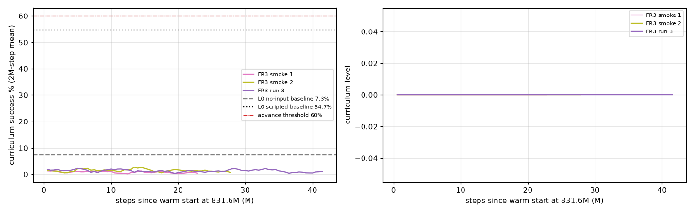
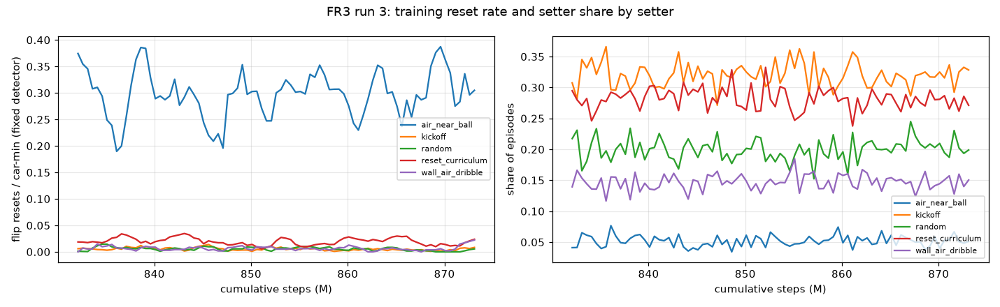

**Is the aerial reward dominating?** Share of |reward| per step in FR3 run 3 over the last 20 iterations (871.2–873.1M, `RewardAbs/`; `data/reward_shares.csv`):

| term | share |
|---|---|
| goal | 17.5% |
| **airdribble_seq** | **13.3%** (largest dense term) |
| vel_ball_to_goal | 13.2% |
| goal_dist | 9.0% |
| all aerial / air dribble terms | 22.3% |
| `reset_align` | 1.69% |
| `flip_reset_use` | **0.018%** |

So the air dribble shaping pays about 700× more than the reset payoff (13.3 / 0.018). In curriculum episodes the car starts under a raised ball, where nudging it with the nose or roof pays `airdribble`/`airdribble_seq` at once, while a wheel landing pays almost nothing unless it is completed and used. This motivated run 4's per-setter zeroing. `reset_align`'s signed mean was −0.06 (run 3's first 20M steps), so it was not being farmed.

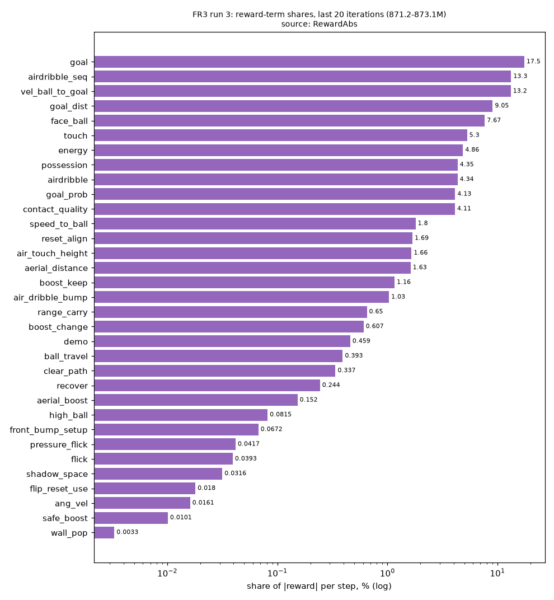

**Status: stopped.** The decision rule was: if level-0 success is still under 5% at about 900M, make it easier and explore more. Run 3 was stopped at 873.1M and run 4 started. Run 4 also stayed at level 0, below even the easier no-input baseline, and was stopped at 895.6M so the air rewards could be audited first (R4). The curriculum was then retried on the audited rewards as FR4 (R5).

## 7. R4: AUD, air reward audit (831.6M → 1131.6M)

**Why.** The four air dribble terms (`airdribble`, `airdribble_seq`, `air_touch_height`, `aerial_distance`) were about 73–77% of positive shaping and 21–23% of |reward| in every run since R0. One goalward touch under the ball paid all four, `airdribble_seq` paid every chained touch in any direction with no decay or cap, and `airdribble` paid for flying near the ball without touching it. Full audit table: `EXPERIMENTS.md`, Round 4.

**Design** (`experiments/aud.toml`, extends ADB):

- `air_touch_height` 30 → 0.
- `airdribble_seq` 55 → 50: touch and chain bonus scaled by max(0.1, goalward ball speed), 0.8 decay per touch, capped at 6 touches, carry counts only ball progress toward goal.
- `airdribble` 40 → 50: direction and push floors removed, pays only within 0.5 s of the carrier's last touch.
- `aerial_distance` 40 → 38: ball progress toward goal only.
- A first try at weights 20/20/15 gave only 3.8% of |reward| (target 8–12%) and was stopped at 846.2M; the run uses ×2.5.
- New metric `Events/Aerial Goals per min`.
- 300M steps from ADB-best with `train_template.toml`, the same pool and LR schedule as ADB. The planned CTRL arm (unchanged ADB rewards) was dropped at the user's request, so AUD is compared against ADB-best only. Trained about 2:20–3:46 PM ET Oct 31.

**Results** (`aud_final/`, seed 424242):

| measure | AUD-final (1131.6M) | ADB-832M |
|---|---|---|
| h2h, 1000 games | **64.6%** (646-354, ±1.5) vs ADB-832M | — |
| pool score (400 games per opponent) | **87.0** | 84.7 |
| vs 1v1.pt / 430M / Nexto | 72.5 / 69.5 / 87.2 | 65.2 / 65.0 / 85.5 |
| vs Necto / Element / Immortal | 97.5 / 99.0 / 96.5 | 95.8 / 99.0 / 97.5 |

- **Air term share** (last 20 iterations, `RewardAbs/`): `airdribble` 4.96%, `airdribble_seq` 2.69%, `aerial_distance` 0.70%, `air_touch_height` 0, so 8.35% for the four, inside the 8–12% target (FR3 run 3 had about 21%). `air_dribble_bump` 1.24%. The goal term is now the largest at 23.7%.
- **Training events**, mean of the last 100M steps (ADB's last 100M in brackets): aerial goals 0.40/min (not logged for ADB), goals 1.04/min, air dribble bumps 0.55 (0.57), bumps 1.75 (1.59), demos 0.41 (0.44), in-air ratio 0.52 (0.52).
- **Flip resets** (`rates_mix.toml`, 300k steps vs 430M): 0.111 resets/min, earned-reset share of flier episodes 8.3%, almost all from the `air_near_ball` setter (0.50/min), **0 uses**.
- Periodic 100-game pools: 82.0 at 831.6M, 86.5 at 931.8M, 85.2 at 1032.0M, 86.8 at 1131.6M.

**Verdict.** Pass on everything measurable: the air terms are in the target band, aerial goals are logged and steady, and AUD beats ADB-832M clearly with a higher pool score. Without CTRL, the gain can't be split between the reward change and 300M more steps; for scale, FR2 with 300M more steps on different rewards beat ADB-832M 57.2%. Shipped as `checkpoints_to_test/aud_1132M.bpk`.

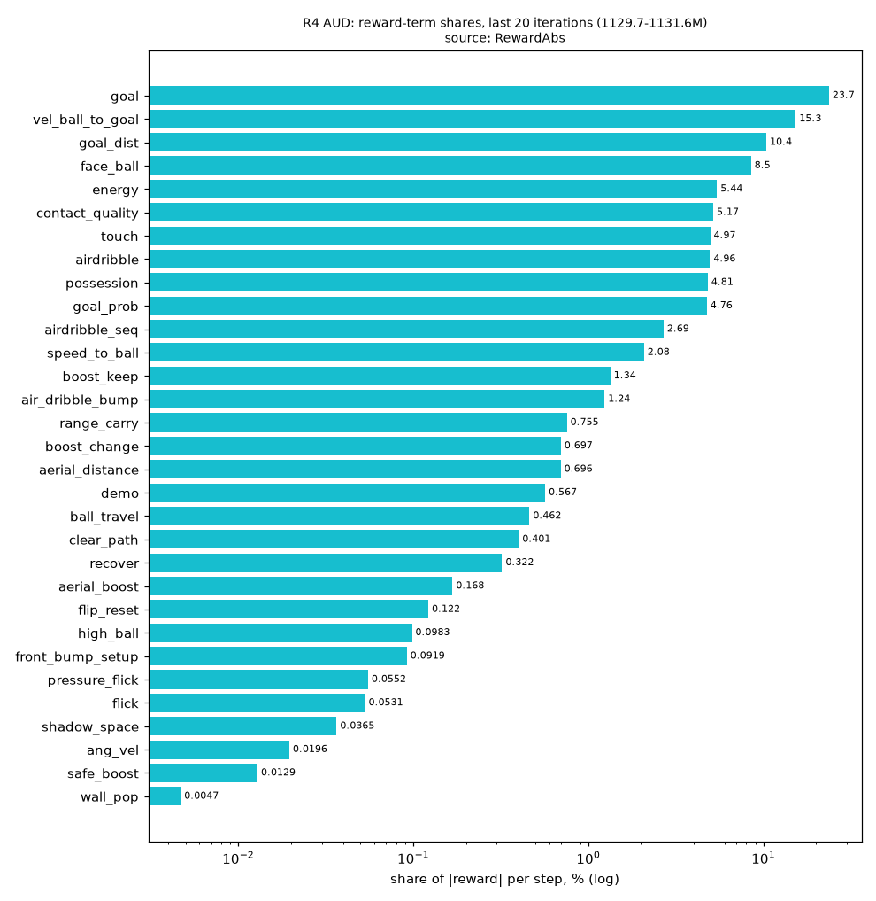

## 8. R5: FR4, flip resets on the audited rewards (1131.6M → 1431.6M)

**Design** (`experiments/fr4.toml`, `train_fr4_template.toml`): `aud.toml` plus FR3 run 4's reset setup. That is `flip_reset_use` 600 (obtain grace 0.3 s), potential-based `reset_align` 400, the `reset_curriculum` setter at 28% with the easier level 0, entropy 0.025, LR 5e-5 held to 1231.6M then cosine to 0.4×, and the aerial terms and `contact_quality` zeroed in curriculum episodes. Warm-started from AUD-final, 300M steps, trained about 3:46–5:23 PM ET Oct 31 at about 61k steps/s. The chain's FR4 driver exited before training ended, so the final 1000-game h2hs and the 400-game pool were run by hand (`fr4_final/run.sh`); the 1431.6M checkpoint's periodic eval (pool and rates) had already run.

**Results** (`fr4_final/`, seed 424242):

| measure | FR4-final (1431.6M) |
|---|---|
| h2h vs ADB-832M, 1000 games | **63.3%** (633-367, ±1.5) |
| h2h vs AUD-final, 1000 games | **53.2%** (532-468, ±1.6) |
| pool score (400 games per opponent) | **87.1**, the best so far |
| vs 1v1.pt / 430M / Nexto | 68.0 / 71.0 / **89.8** |
| vs Necto / Element / Immortal | 98.0 / 99.5 / 96.5 |

- **Curriculum:** the level never left 0. Level-0 success averaged 4.1% over the run and 3.8% over the last 100M, against 18% for no input and 56% for the scripted aligner.
- **Flip resets** (`rates_fr3.toml`, 300k steps vs 430M, at 1431.6M): 0.003 resets/min, 0 earned resets, **0 uses**; 0 resets from the curriculum pinned at level 2. Every periodic eval (1131.6M to 1431.6M) was between 0.003 and 0.009 resets/min with 0 uses.
- **Reward share** (last 20 iterations): `reset_align` 2.25%, `flip_reset_use` 0.03%, the four air terms 5.3%.
- **Training events**, last 100M steps (AUD in brackets): aerial goals 0.27/min (0.40), goals 1.03 (1.04), air dribble bumps 0.36 (0.55), bumps 1.45 (1.75), demos 0.22 (0.41), in-air ratio 0.50 (0.52). The curriculum episodes take 28% of training, so these training-mix rates are not directly comparable.
- Periodic 100-game pools: 86.7, 86.5, 87.2, 87.5; keep-best promoted 1331.8M (51.0% vs best over 400) and 1431.6M (53.5%).

**Verdict.** A stronger bot, but not for the targeted reason. FR4 beats AUD-final by about 2 se and has the best pool and Nexto scores, which most likely comes from 300M more steps at a low, decaying LR. It learned no flip resets, and the curriculum failed for the third time even with the air shaping cut to about 5%. Shipped as `checkpoints_to_test/fr4_1432M.bpk`.

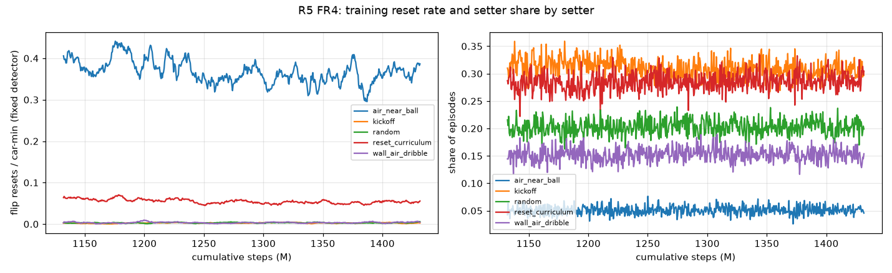
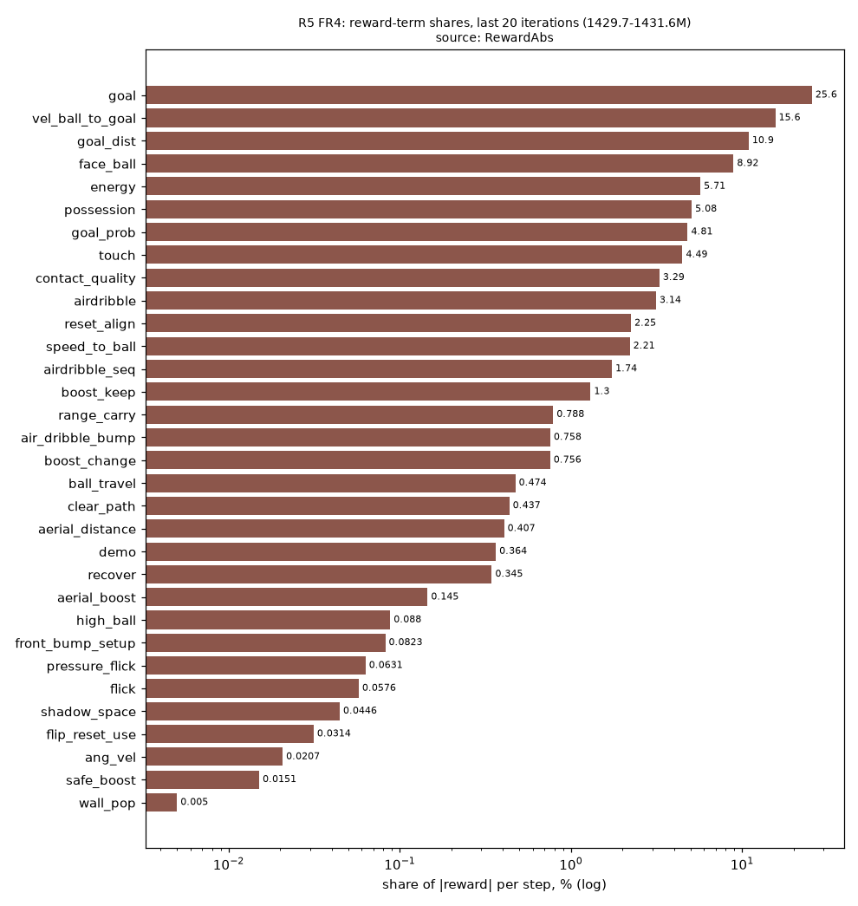

## 9. R6: FR5, behaviour-cloned flip resets, then PPO (1431.6M → 1731.6M)

**Why.** FR2–FR4 never left curriculum level 0. The PPO policy earned a reset in about 4% of level-0 episodes, against 18% for no input and 56% for the continuous scripted aligner. Two causes: (a) the old advance bar (60% over the window) was above even the scripted expert, and (b) PPO never found the skill by exploration. FR5 teaches the skill by imitation first, then lets PPO refine it. The design details are in `EXPERIMENTS.md`, Round 6, and commits `1806811` and `9304207`.

### 9.1 Phase A: a discrete scripted expert (`src/expert.rs`)

The policy acts through the 90-action lookup table, held for 8 ticks, so the continuous aligner can't be cloned directly. The expert is a one-step look-ahead over the table plus a 4-step aligner rollout. Level-0 earned success (480 episodes):

| policy | L0 success | uses per success |
|---|---|---|
| no input | 17.9% | 0 |
| aligner, nearest table action | 39.6–43.3% | 0 |
| one-step look-ahead, alignment score | 31.0–34.2% | 0 |
| **look-ahead + 4-step aligner rollout (final expert)** | **51.7–55.4%** | **98%** |
| continuous aligner (per tick, reference) | 56% | — |

Expert by level: L1 44.5%, L2 15.4%, L3 5.3%, L4 3.1%, L5 1.2% (no input: 10.2, 3.1, 0.6, 0.2, 0%).

**Two simulator fixes** were needed before the expert could *use* a reset:

1. RocketSim treats wheels on the ball as ground, so the first jump press after a reset jumps off the ball (a normal jump). The dodge needs a *second* press, so the expert double-presses.
2. Every directional-jump action in the lookup table has `handbrake = true`. The expert's use phase has to pick those actions knowing that.

**Curriculum thresholds:** advance 60% → **35%**, back off → **12%**, set from the expert's own L0/L1 rates.

### 9.2 Behaviour-cloning pretraining (`tools/bc/bc_pretrain.py`)

Data: 712k expert-labelled flier states (L0–L3, 10–15% random executed actions) plus 600k normal-play observations from FR4-final. Loss: expert cross-entropy on curriculum states + KL(FR4-final ‖ student) on normal play.

| actor | L0 greedy | L0 sampled | uses/success | 200-game h2h vs FR4-final |
|---|---|---|---|---|
| FR4-final | 1.9% | 2.9% | 11% | — |
| bc_v1 (3k steps) | 19.6% | 10.2% | 81% | — |
| **bc_v2 (10k steps)** | **31.5%** | 18.3% | 89% | 47.0% ± 3.5 |
| bc_v3 (+DAgger) | 28.3% | 18.3% | 93% | 44.5% |

bc_v2 was used for phase B: 16× FR4's greedy level-0 success, and it uses the regained flip on about 90% of its resets.

### 9.3 Phase B: PPO from the BC actor

`experiments/train_fr5.toml`, `experiments/fr5_launch.sh`. bc_v2 actor, FR4-final critic and return stats, 10M steps of critic-only warm-up, then PPO with the `fr4.toml` rewards, entropy 0.015, curriculum about 30% of episodes, fixed opponents 1v1.pt and FR4-final. Trained at about 63k steps/s.

**First attempt, plain PPO (stopped).** During the critic warm-up, training L0 success held at 13–14%. In the first ~15M PPO steps it fell to about 8% while entropy also fell (3.66 → 3.53), so PPO was actively moving away from the cloned skill. Stopped at 1461.5M and restarted from the warmed-up 1441.6M checkpoint (red in the figures below).

**Restart, chunked PPO + BC refresh.** PPO runs in 25M-step chunks. After each chunk, a 1500-step BC refresh (lr 5e-5, expert CE + KL to the chunk's own PPO actor on normal play) replaces the actor. Both actors are scored on 480 level-0 episodes at every refresh (`logs/bc_refresh.jsonl`, `data/fr5_bc_refresh.csv`):

| steps | PPO greedy | PPO sampled | BC greedy | BC sampled |
|---|---|---|---|---|
| 1466.6M | 7.9% | 10.8% | 31.0% | 19.6% |
| 1491.6M | 11.9 | 8.7 | 29.2 | 21.7 |
| 1516.6M | 15.0 | 10.4 | 30.2 | 19.0 |
| 1541.6M | 16.3 | 15.6 | 26.0 | 20.2 |
| 1566.6M | 11.5 | 9.6 | 31.2 | 14.0 |
| 1591.6M | 19.6 | 15.2 | 32.5 | 22.5 |
| 1616.6M | 17.7 | 15.4 | 29.6 | 18.3 |
| 1641.6M | 20.2 | 18.1 | 30.8 | 21.7 |
| 1666.6M | 14.2 | 12.5 | 29.2 | 17.3 |
| 1691.6M | 20.2 | 15.8 | 33.5 | 19.4 |
| 1716.6M | **25.2** | 17.3 | 31.2 | 21.2 |

The PPO actor's *post-chunk* success climbed from 7.9% to 25.2% greedy, and its uses per success from 58% to 92%. So each chunk now loses less of the skill than the one before: the skill increasingly survives PPO rather than being re-injected each time. The BC actor stayed flat at about 30% greedy, which is the ceiling the BC data gives. The last chunk (1716.6M → 1731.6M) had no refresh after it, so the final checkpoint is a pure PPO actor.

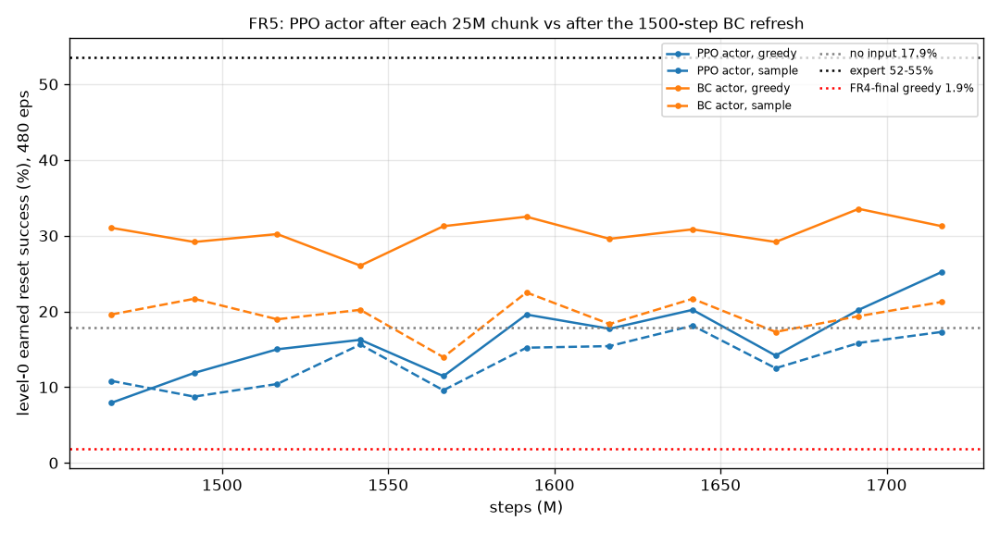
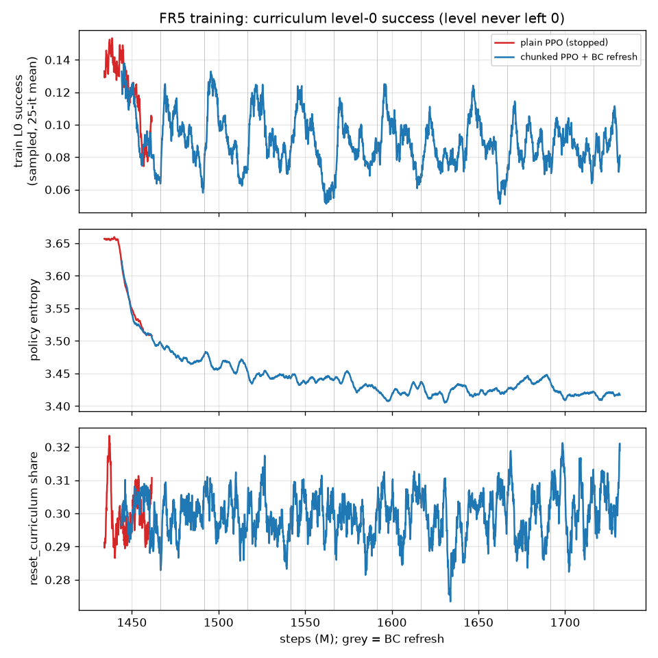

**The curriculum level never left 0.** Training L0 success (sampled, against the opponent mix) averaged 8.7% over the last 100M steps, below the 35% advance bar. The setter share was 30% (27.5% in the last report). Note that the eval-time greedy numbers are much higher than these training numbers.

### 9.4 Final evaluation (`~/ippo_runs/fr5_final/`, seed 424242)

Final checkpoint: `exp_FR5/checkpoints/1793494122` (the directory name is a timestamp; `cumulative_timesteps = 1731600000`).

**Curriculum skill** (`indococo-train curr`, 960 episodes per row, valid for 1731.6M):

| level | greedy | sampled | used/success (greedy) | expert | no input |
|---|---|---|---|---|---|
| L0 | **27.4%** | 19.1% | 92% | 52–55% | 17.9% |
| L1 | 18.4% | 12.3% | 95% | 44.5% | 10.2% |
| L2 | 8.5% | 4.6% | 88% | 15.4% | 3.1% |

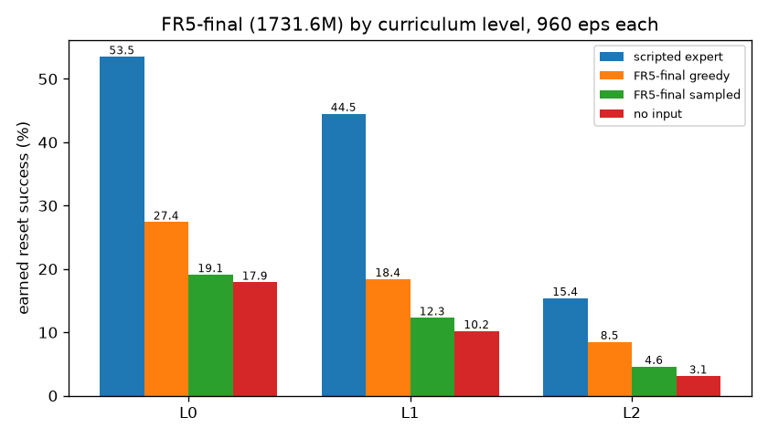

**Real play** (`rates_fr3.toml`, 300k steps, self-play, 1731.6M): 1067 episodes, **7 resets** (0.021/min; 6 in `reset_curriculum` episodes, 1 at kickoff, 0 in `air_reset`), earned-reset share of flier episodes 1.8%, **0 uses**, 0 goals after a reset. FR4 measured 0.003/min with 0 uses on the same mix.

**Strength.** ⚠️ **These numbers measure the wrong actor; see 9.5.**

| measure | value | (FR4-final, for reference) |
|---|---|---|
| h2h vs FR4-final, 1000 games | 44.8% (448-552, ±1.6) | — |
| h2h vs AUD-final, 1000 games | 44.1% (441-559, ±1.6) | 53.2% |
| pool score (400 games/opponent) | 82.8 | 87.1 |
| vs 1v1.pt / 430M / Nexto | 59.2 / 61.8 / 85.5 | 68.0 / 71.0 / 89.8 |
| vs Necto / Element / Immortal | 97.2 / 98.5 / 94.8 | 98.0 / 99.5 / 96.5 |

### 9.5 Eval bug: h2h and pool scored the warm start, not 1731.6M

`fr5_launch.sh` exports the final checkpoint to `logs/final_policy.safetensors` and then hands that file to `pool_eval.py`. That file already existed from launch (6:10 PM ET Oct 31). burn-store's `SafetensorsStore` refuses to overwrite by default, so `indococo-train export` panicked *after* training had saved the final checkpoint. Its stderr went to the tmux pane, and the script didn't check the exit code. The evals then ran on the stale file.

Checked on the box: `logs/final_policy.safetensors` has sha256 `1f78503a…`, the same as an export of `checkpoints/1431600000` (the bc_v2 warm start). A fresh export of the 1731.6M checkpoint is `aa05d62d…`. So **the 44.8% / 44.1% / 82.8 numbers belong to the bc_v2 actor at 1431.6M**. That fits bc_v2's earlier 47.0% ± 3.5 over 200 games vs FR4. `rates` and `curr` load the checkpoint directory directly, so they are valid for 1731.6M.

Fixes in this commit:
- `indococo-train export` now calls `.overwrite(true)`.
- `fr5_launch.sh` deletes the target first and aborts if export fails.

**Re-run** (fresh export of `checkpoints/1793494122`, results in `~/ippo_runs/fr5_final_fixed/`): 1731.6M scores **44.9% vs FR4-final** and **46.6% vs AUD-final** over 1000 games each (seed 424242), **pool400 83.0** with **82.8% vs Nexto**. Real-game reset uses remain 0.

### 9.6 Training-side numbers

**Reward share** (last 20 iterations): goal 25.2%, vel_ball_to_goal 15.6%, goal_dist 11.0%, face_ball 8.8%; the air terms are airdribble 3.0%, airdribble_seq 1.7%, aerial_distance 0.4%; reset_align 2.6%, **flip_reset_use 0.06%**. That last figure confirms the use reward almost never fires in the training mix.

**Events**, last 100M steps (FR4's last 100M in brackets): goals 1.05/min (1.03), aerial goals 0.28 (0.27), air dribble bumps 0.42 (0.36), bumps 1.59 (1.45), demos 0.28 (0.22), in-air ratio 0.49 (0.50), entropy 3.43.

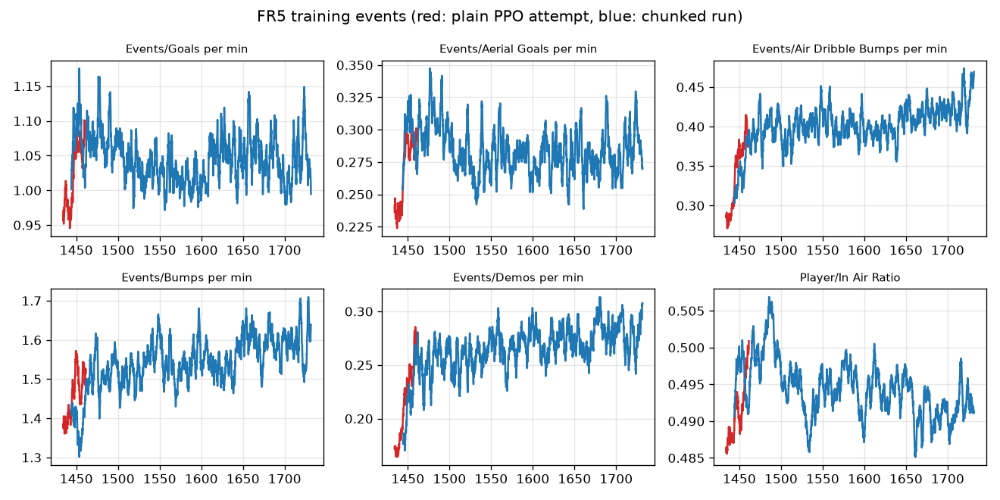
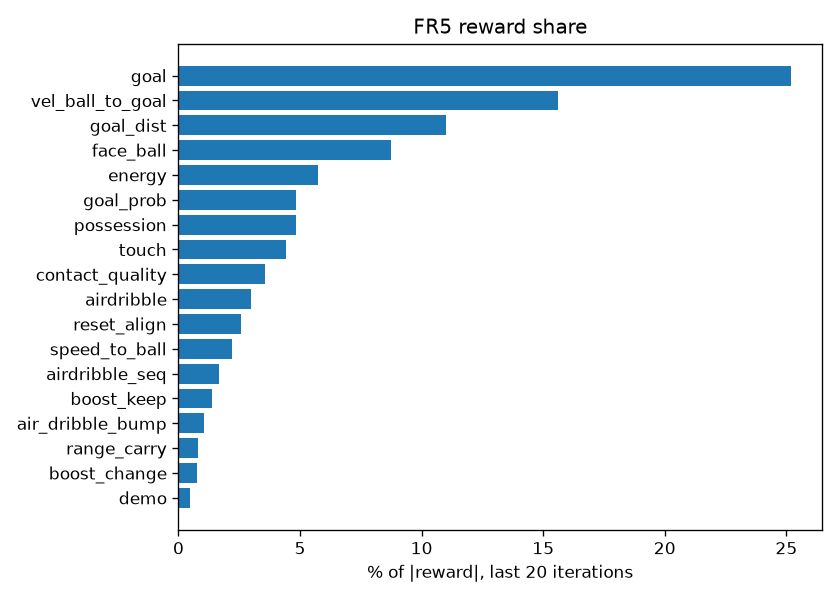

### 9.7 Verdict

- **Progress:** for the first time the reset skill **survives PPO** in the curriculum. L0 is 27.4% greedy (FR4: 1.9%), above no input at every level, with about 90% of resets used.
- **No transfer:** it does **not transfer to real games**. There were 0 uses in 300k steps, and the 7 resets came almost all from curriculum spawns.
- **Strength:** the measured strength (44.8% vs FR4, pool 82.8) is for the warm start (9.5). The re-run 1731.6M strength is **44.9% vs FR4, 46.6% vs AUD (1000 games, seed 424242), pool400 83.0, 82.8% vs Nexto**: weaker than FR4 (pool 87.1).
- **Shipping rule:** a checkpoint ships if it uses resets in games while staying ≥48% vs FR4, or if it beats FR4 >50%. FR5 fails the first clause on transfer alone, whatever its strength. It also fails the second (44.9% vs FR4). **No `.bpk` was pushed to `checkpoints_to_test/`.**

**Next ideas:**
1. A BC/KL term inside the PPO loss (framework change), instead of alternating chunks, so the skill isn't eroded between refreshes.
2. More curriculum levels near real game states (car and ball from real aerial situations: off a wall, from a pop), bridging L2 and kickoff play.
3. A reset-use reward paid only when the use leads to a shot or goal, so resets become goal-directed rather than a curriculum trick.
4. Lowering the `reset_curriculum` setter share (27–30%) to protect normal play.

## 10. R7: FR6, keep FR4's strength and anchor the cloned skill to FR4 (1431.6M → 2631.6M)

**Why.** FR5 (§9) learned the reset in the curriculum but never used one in real play and lost strength (44.9% vs FR4). Three likely causes: the adaptive curriculum never left level 0 while `rates_fr3.toml` spawns level-2 states; each BC refresh distilled toward the *current* actor, so normal play drifted; and 27–30% of episodes were reset practice. Full design in `indococo_ppo_bot/EXPERIMENTS.md`, Round 7 (commit `20e4e2e`).

### 10.1 Design

- **Start:** FR4-final, behaviour-cloned for 3000 steps on the FR5 expert data plus DAgger sets, with KL 5 to the *fixed* FR4-final on normal play (`fr6_bc/t_fr4_kl5`): 52.5% vs FR4 (200 g), L0 20.6% / L2 4.4% greedy, 0 resets in 100k rates steps. Starting from FR5 instead kept more skill but lost too much strength (33–40.5% vs FR4).
- **Training:** `fr4.toml` rewards, reset practice cut to 15% (fixed curriculum levels 1/2/3 at 4/5/3% plus `air_reset` 3%), FR4-final opponent weight 1.5, entropy 0.015, LR held to 2131.6M then cosine to 0.4×. 24 PPO chunks of 50M steps; after each, a 1500-step BC refresh whose KL teacher is always FR4-final, then a mid-run check (100k-step `rates_fr3.toml` + 200-game h2h vs FR4-final) into `logs/mid.jsonl`.
- About 62.8k steps/s; training ran 2:40 AM → 8:50 AM ET Nov 1, final evals finished 9:09 AM ET.

### 10.2 Mid-run checks (`data/fr6_mid.csv`)

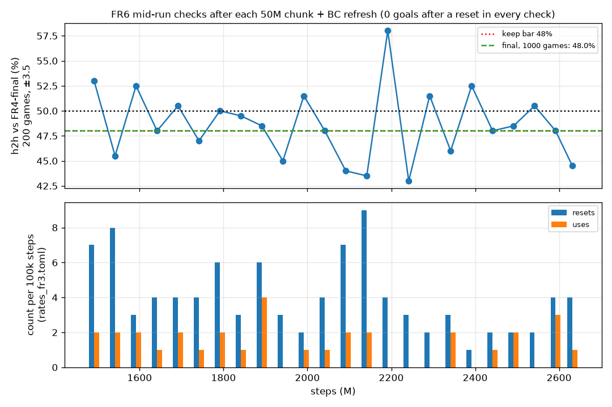

Every chunk's rates check had 1–9 resets per 100k steps and 20 of 24 had at least one use (0–4 per chunk), but **0 goals after a reset in every check**. The 200-game h2h vs FR4-final wandered between 43.0% and 58.0% (mean 48.8%, ±3.5 per point) with no trend: the FR4 anchor held strength roughly flat rather than improving it. The 58% point at 2191.6M had 0 uses.

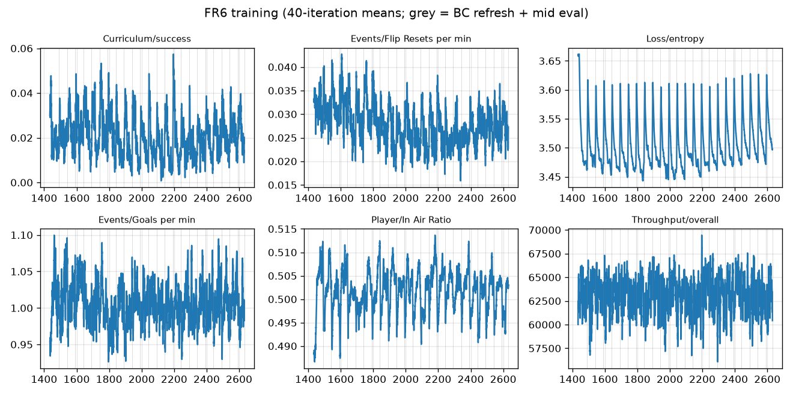

Training-side, the reset rate drifted down slowly (about 0.033 → 0.027/min), entropy jumps after each BC refresh and decays back within the chunk, and goals per min and air ratio stayed flat.

### 10.3 Final evaluation (`~/ippo_runs/fr6_final/`, seed 424242)

Final checkpoint `exp_FR6/checkpoints/1793540902` (`cumulative_timesteps = 2631600000`), whose `actor.bpk` is the post-chunk BC-refreshed actor (the pure PPO actor is kept as `actor_ppo.bpk`). The export was deleted and rewritten before evaluation (`final_policy.safetensors`, sha256 `36142c12…ed3ab`, written 8:50 AM ET), so the §9.5 stale-export bug does not apply.

**Strength:**

| measure | FR6-final | FR4-final | FR5-final (re-run) |
|---|---|---|---|
| h2h vs FR4-final, 1000 games | **48.0%** (480-520, ±1.6) | — | 44.9% |
| h2h vs AUD-final, 1000 games | 47.6% (476-524, ±1.6) | 53.2% | 46.6% |
| pool score (400 games/opponent) | 85.0 | 87.1 | 83.0 |
| vs 1v1.pt / 430M / Nexto | 65.8 / 69.3 / 85.8 | 68.0 / 71.0 / 89.8 | — / — / 82.8 |
| vs Necto / Element / Immortal | 96.5 / 98.3 / 94.5 | 98.0 / 99.5 / 96.5 | — |

**Real play** (`rates_fr3.toml`, 300k steps, self-play): 1073 episodes, **9 resets (0.027/min), 4 uses (0.012/min)**, 0 goals after a reset. By setter: `reset_curriculum` 8 resets / 4 uses, kickoff 1 reset / 0 uses, `air_reset` 0 / 0. Earned-reset share of flier episodes 2.5% (FR5: 1.8%). This is the first checkpoint with nonzero uses on this mix (FR4: 0.003/min, 0 uses; FR5: 0.021/min, 0 uses). Caveat: all 4 uses start from curriculum-style spawns, so the bot still does not set up and use a reset from kickoff play.

**Curriculum skill** (960 episodes per row):

| level | greedy | sampled | used/success (greedy) | FR5-final greedy | no input |
|---|---|---|---|---|---|
| L0 | **29.8%** | 18.5% | 94% | 27.4% | 17.9% |
| L1 | 22.0% | 12.0% | 93% | 18.4% | 10.2% |
| L2 | 9.5% | 6.4% | 93% | 8.5% | 3.1% |

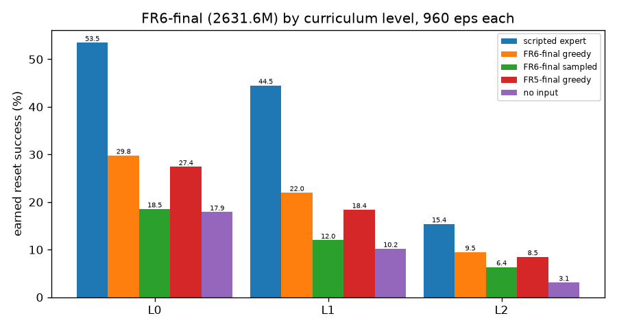

### 10.4 Verdict

- **Keep rule met, just:** real-game uses > 0 (4) and 48.0% vs FR4-final over 1000 games (bar ≥ 48%). Pushed as `checkpoints_to_test/fr6_2632M.bpk` (sha256 `4fe4736e…cefb5`).
- **Strength:** statistically level with FR4 (48.0 ± 1.6), slightly behind AUD and 2.1 pool points below FR4 (Nexto 85.8 vs 89.8). Anchoring every BC refresh to FR4 fixed FR5's strength loss but 1.2B more steps bought no improvement.
- **Skill:** the cloned skill survives and is slightly better than FR5 at every level, and the bot now completes the reset-then-dodge sequence in game-like spawns, but it is rare (0.012 uses/min), never from kickoff play, and never yet leads to a goal.

**Next ideas:** a use reward paid only when the use leads to a shot or goal; curriculum spawns derived from real aerial situations (wall pops, ground-to-air) to bridge into kickoff play; a BC/KL term inside the PPO loss instead of alternating chunks.

## 11. R8: FR7, resets from real-play states with an outcome-gated reward (2631.6M → 3631.6M)

**Why.** FR6 (§10) used resets only from curriculum-style spawns, never from kickoff play, and never scored off one. FR7 adds practice episodes that start from real aerial situations and pays the reset mostly when it leads to a shot or goal. Full design in `indococo_ppo_bot/EXPERIMENTS.md`, Round 8 / FR7 (commits `3bd80a5`, launcher fix `883d28a`).

### 11.1 Design

- **Start:** FR6-final (actor + critic, 2631.6M), no extra BC.
- **Real-play practice:** a new `replay` setter starts 18% of episodes from 11,786 aerial-near-ball states recorded from 1M steps of FR6-final self-play (0–1 s before the car is under the ball). Evals replay a separate set of 5,758 states from FR4-final self-play.
- **Reward:** `flip_reset_use` use weight 1.0 → 0.4, shot bonus 0.5 → 1.5, goal bonus 1.0 → 3.0; earned resets pay ×2 in kickoff/random/replay episodes and ×0.5 in drills. Synthetic drills cut from 15% to 8%. FR6-final added as a fixed opponent.
- Kept from FR6: 20 PPO chunks of 50M, each followed by a 1500-step BC refresh with KL 5 to the fixed FR4-final, then a mid-run check (150k-step `rates_fr7.toml` split by setter + 200-game h2h vs FR4-final).
- A first attempt (9:18–11:10 AM ET Nov 1) retrained chunk 1 five times because of a checkpoint-naming bug (kept in `exp_FR7_bugged`, fixed in `883d28a`). The real run trained 11:12 AM → 4:30 PM ET Nov 1 (about 60k steps/s); final evals finished 4:51 PM ET.

### 11.2 Mid-run checks (`data/fr7_mid.csv`)

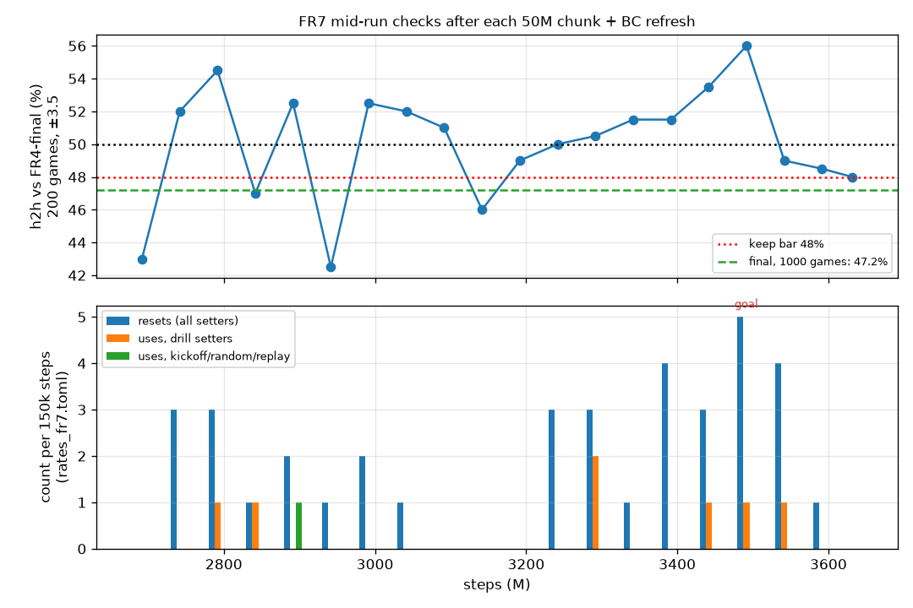

Across 20 checks (150k steps each): 37 resets, 8 uses, and **1 goal after a reset** (the first in any of our runs), at 3491.6M. Seven uses and the goal came from `reset_curriculum` spawns; the only normal-play use was one kickoff-episode use at 2891.6M (0 goals). `replay` episodes, the new real-play states, never produced a reset in any check. The 200-game h2h vs FR4-final ranged 42.5–56.0% (mean 50.0%), highest at the 3491.6M goal chunk, and ended at 48.0%.

### 11.3 Final evaluation (`~/ippo_runs/fr7_final/`, seed 424242)

Final checkpoint `exp_FR7/checkpoints/1793568505` (`cumulative_timesteps = 3631600000`, post-BC actor), fresh export `final_policy.safetensors` (sha256 `f39dbce1…82417`, written 4:30 PM ET). The best mid chunk, 3491.6M (`exp_FR7/checkpoints/1793565816`, copied to `~/ippo_runs/fr7_keep/3492M`), got the same 1000-game and 300k-step evals from a fresh export (sha256 `36c7f651…56914`) in `fr7_keep/3492M/eval/`.

**Strength:**

| measure | FR7-final (3631.6M) | FR7 3491.6M | FR6-final |
|---|---|---|---|
| h2h vs FR4-final, 1000 games | 47.2% (472-528, ±1.6) | **52.5%** (525-475, ±1.6) | 48.0% |
| h2h vs FR6-final, 1000 games | 48.6% (486-514, ±1.6) | **51.3%** (513-487, ±1.6) | — |
| pool score (400 games/opponent) | 84.9 | **85.9** | 85.0 |
| vs 1v1.pt / 430M / Nexto | 66.0 / 67.5 / 85.3 | 64.5 / 75.3 / 85.3 | 65.8 / 69.3 / 85.8 |
| vs Necto / Element / Immortal | 98.0 / 97.8 / 94.8 | 97.0 / 98.0 / 95.3 | 96.5 / 98.3 / 94.5 |

**Real play** (300k steps, self-play; resets / uses / goals after a reset):

| mix | FR7-final | FR7 3491.6M | FR6-final |
|---|---|---|---|
| `rates_fr3.toml` (FR6-comparable) | 9 / 2 / 0 (uses: 2 `reset_curriculum`) | 9 / 1 / 0 (1 `reset_curriculum`) | 9 / 4 / 0 |
| `rates_fr7.toml` all | 4 / 1 / 0 | 2 / 0 / 0 | 2 / 0 / 0 |
| `rates_fr7` kickoff + random + replay | 0 / 0 / 0 | 0 / 0 / 0 | 1 / 0 / 0 (replay) |

**Curriculum skill** (FR7-final, 960 episodes per row): L0 29.0% greedy / 20.2% sampled, L1 22.6% / 15.5%, L2 10.2% / 4.6%, uses on 90–95% of greedy successes. Level with FR6-final (29.8 / 22.0 / 9.5% greedy).

### 11.4 Verdict

- **Not pushed.** FR7-final misses the strength bar (47.2% vs FR4). The 3491.6M chunk is the strongest checkpoint of the FR line (52.5% vs FR4, 51.3% vs FR6, pool 85.9), but on the 300k-step checks it has no normal-play uses and no goals after a reset, and fewer uses than FR6, so it fails the reset half of the push rule. Its mid-run goal was a single event from a curriculum spawn.
- **Skill transfer did not improve.** Recorded real-play states and the outcome-gated reward did not make the bot start resets from normal play: `replay` episodes produced 0 resets in every check, and uses stayed rare and curriculum-only.
- **Strength held**, as in FR6: the fixed FR4 anchor keeps h2h vs FR4 around 50%, and some chunks are slightly stronger than FR6.

**Follow-up (running):** the driver continued automatically as FR7b from the chunk with the most normal-play uses (2891.6M, 1 kickoff use, 52.5% vs FR4 in 200 games), same config, 1.0B steps (4:51 PM ET Nov 1, about 7 h), then FR7c and FR7d. **Next ideas:** spawn `replay` states later in the sequence (car already under the ball with the reset available) so practice is closer to the reset; a reset-specialist policy distilled into the main one; GalactusV2 as an opponent or benchmark target.

### 11.5 FR7b: same config from the 2891.6M chunk (2891.6M → 3891.6M)

**Why.** 2891.6M was the FR7 chunk with the only normal-play use (one kickoff-episode use). FR7b continued from it with the unchanged FR7 config for 1.0B more steps to see whether normal-play uses would grow. It trained 4:51 PM → 10:29 PM ET Nov 1 (about 64.8k steps/s alone, about 43k while the 2v2 run TV2 shared the L4 from 8:43 to 9:10 PM ET); final evals finished 10:51 PM ET, the botpack5 pool (`fr7b_final/bp5/`, 400 games per bot) at 11:23 PM ET.

**Mid-run checks** (`data/fr7b_mid.csv`, 20 checks of 150k steps):

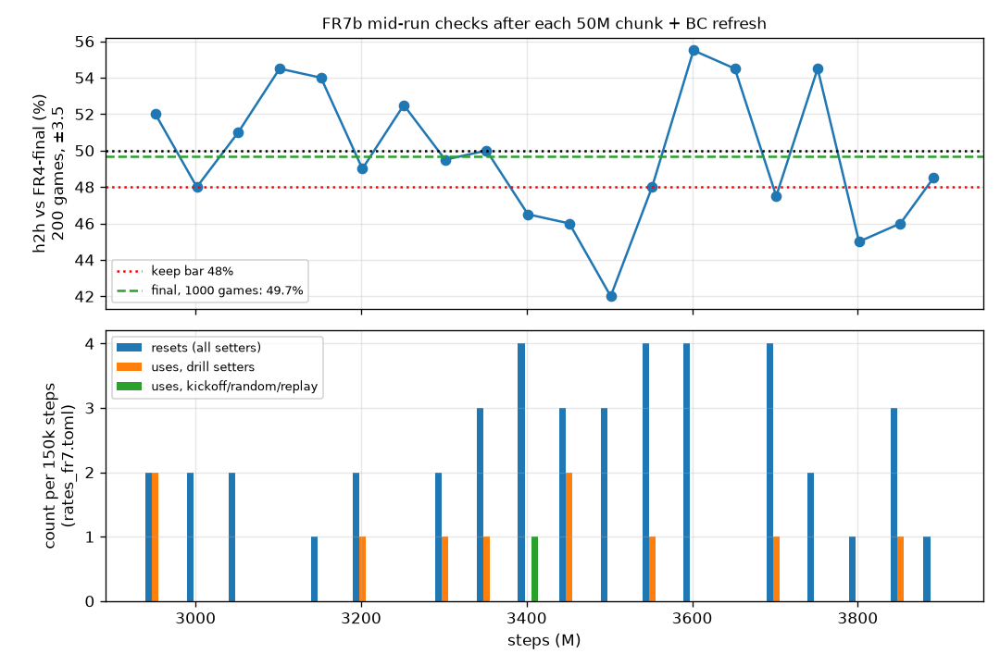

43 resets, 11 uses, **0 goals after a reset**. Ten uses came from `reset_curriculum` spawns; the only normal-play use was one `random`-episode use at 3401.6M (h2h 46.5%). `replay` episodes made 8 resets and 0 uses. The 200-game h2h vs FR4-final ranged 42.0–55.5% (mean 49.7%) and ended at 48.5%.

**Final evaluation** (`~/ippo_runs/fr7b_final/`, seed 424242). Final checkpoint `exp_FR7b/checkpoints/1793590116` (`cumulative_timesteps = 3891600000`, post-BC actor), fresh export `final_policy.safetensors` (sha256 `315a2586…0d691`, written 10:31 PM ET).

| measure | FR7b-final (3891.6M) | FR7 3491.6M | FR7-final | FR6-final |
|---|---|---|---|---|
| h2h vs FR4-final, 1000 games | 49.7% (497-503, ±1.6) | **52.5%** | 47.2% | 48.0% |
| h2h vs FR6-final, 1000 games | 50.8% (508-492, ±1.6) | **51.3%** | 48.6% | — |
| pool score (400 games/opponent) | **86.5** | 85.9 | 84.9 | 85.0 |
| vs 1v1.pt / 430M / Nexto | 70.0 / 70.3 / 87.8 | 64.5 / 75.3 / 85.3 | 66.0 / 67.5 / 85.3 | 65.8 / 69.3 / 85.8 |
| vs Necto / Element / Immortal | 97.3 / 98.0 / 95.8 | 97.0 / 98.0 / 95.3 | 98.0 / 97.8 / 94.8 | 96.5 / 98.3 / 94.5 |
| botpack5: Ripple / Kira / Dice / Chronos / GalactusV2 | 51.5 / 52.5 / 48.2 / 68.2 / 14.5 | — | — | 55.8 / 53.0 / 53.0 / 67.2 / 15.5 |

**Real play** (`rates_fr7.toml`, 300k steps, self-play; resets / uses / goals after a reset): FR7b-final 3 / 1 / 0 (the use from a `reset_curriculum` spawn; `replay` 2 resets, 0 uses; kickoff, random and air_reset 0 / 0 / 0). FR6-final on the same mix: 5 / 0 / 0. On the FR6-comparable `rates_fr3.toml` (300k steps): 5 / 2 / 0, both uses from `reset_curriculum` (kickoff 2 resets, 0 uses), against FR6-final's 9 / 4 / 0.

**Curriculum skill** (960 episodes per row, greedy / sampled success): L0 31.6% / 19.5%, L1 26.8% / 15.8%, L2 10.1% / 5.6%. Slightly above FR7-final (29.0 / 22.6 / 10.2% greedy).

**Verdict.**
- **Not pushed.** The strength half of the push rule holds (49.7% vs FR4 ≥ 48%), but the reset half does not in the reading §11.4 used: no kickoff/random use and no goal after a reset, and the only uses are from curriculum spawns. It has one more use than FR6 on `rates_fr7` (1 vs 0) but half as many on `rates_fr3` (2 vs 4). It has the best pool score of the FR line (86.5, Nexto 87.8%); the weights are kept on the box at `~/ippo_runs/fr7_keep/fr7b_3892M/1793590116/actor.bpk` (md5 `80b808bc…5c9405`).
- **Botpack5:** level with FR6 (within about 2 se on each bot; GalactusV2 still wins about 6:1).
- **Not a new best:** 49.7% vs FR4 is below FR7 3491.6M (52.5%), so FR7c started from 3491.6M, as its launcher decides.
- Resets from normal play stayed at about one use per 3M steps of checks, and no goal after a reset. FR7c (Round 9 in `indococo_ppo_bot/EXPERIMENTS.md`) changes the recipe: 20% drills paid x3 then ramped down, `air_touch_height` 8, entropy 0.012, and the reset-reward audit fixes. It started at 10:51 PM ET Nov 1 from FR7 3491.6M.

### 11.6 FR7c: drill ramp, touch-height reward and reward audit (3491.6M → 4491.6M)

**Why.** FR7 and FR7b used resets almost only in curriculum spawns. FR7c (Round 9 in `indococo_ppo_bot/EXPERIMENTS.md`) followed the Discord recipe: 20% reset drills paid x3 at first and ramped down (x1 at 300M, x0.5 at 600M), `air_touch_height` 8, entropy 0.012, a farming alarm and a 48% rollback guard, plus the reset-reward audit fixes (commits `cc3e890`, `a59ee8b`). It started from FR7 3491.6M (best 1000-game h2h vs FR4-final), trained 10:51 PM ET Nov 1 → 4:08 AM ET Nov 2 alone on the L4; final evals finished 4:28 AM ET and the botpack5 pool (`fr7c_final/bp5/`) at 5:30 AM ET. Neither the farming alarm nor the 48% guard fired. The ramp never triggered early (no chunk had ≥ 2 normal-play uses or ≥ 5 normal-play resets), so drills went x3 → x1 at 3851.6M and x0.5 at 4151.6M on the step schedule.

**Mid-run checks** (`data/fr7c_mid.csv`, 20 checks of 150k steps):

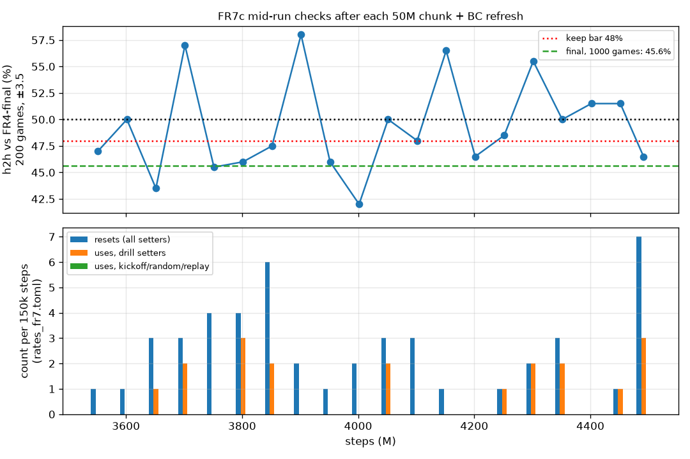

48 resets, 19 uses, **0 goals after a reset**. All 19 uses came from drill setters (`reset_curriculum`, `air_reset`); kickoff, random and replay episodes made 18 resets and **0 uses**. The 200-game h2h vs FR4-final ranged 42.0–58.0% (mean 49.3%), highest at 3901.6M, and ended at 46.5%.

**Final evaluation** (`~/ippo_runs/fr7c_final/`, seed 424242). Final checkpoint `exp_FR7c/checkpoints/1793610395` (`cumulative_timesteps = 4491600000`, post-BC actor), fresh export `final_policy.safetensors` (sha256 `db77d897…d3b30`, written 4:08 AM ET).

| measure | FR7c-final (4491.6M) | FR7b-final | FR7 3491.6M | FR6-final |
|---|---|---|---|---|
| h2h vs FR4-final, 1000 games | 45.6% (456-544, ±1.6) | 49.7% | **52.5%** | 48.0% |
| h2h vs FR6-final, 1000 games | 49.2% (492-508, ±1.6) | 50.8% | **51.3%** | — |
| pool score (400 games/opponent) | 85.4 | **86.5** | 85.9 | 85.0 |
| vs 1v1.pt / 430M / Nexto | 68.0 / 69.0 / 83.2 | 70.0 / 70.3 / 87.8 | 64.5 / 75.3 / 85.3 | 65.8 / 69.3 / 85.8 |
| vs Necto / Element / Immortal | 97.8 / 98.8 / 95.5 | 97.3 / 98.0 / 95.8 | 97.0 / 98.0 / 95.3 | 96.5 / 98.3 / 94.5 |
| botpack5: Ripple / Kira / Dice / Chronos / GalactusV2 | 49.2 / 53.0 / 46.2 / 63.2 / 16.2 | 51.5 / 52.5 / 48.2 / 68.2 / 14.5 | — | 55.8 / 53.0 / 53.0 / 67.2 / 15.5 |

**Real play** (300k steps, self-play; resets / uses / goals after a reset): on `rates_fr7.toml` FR7c-final made 3 / 0 / 1, one reset each in kickoff, random and `replay` episodes, and **the `replay` reset was followed by a goal** (the first goal after a reset outside curriculum spawns in a final eval), but without a dodge use. FR6-final on the same mix: 5 / 0 / 0. On the FR6-comparable `rates_fr3.toml`: 6 / 1 / 0, the use from `reset_curriculum` (kickoff 1 reset), against FR6-final's 9 / 4 / 0.

**Curriculum skill** (960 episodes per row, greedy / sampled success): L0 30.3% / 18.8%, L1 22.4% / 13.6%, L2 11.0% / 4.6%. Level with FR7b (31.6 / 26.8 / 10.1% greedy).

**Verdict.**
- **Not pushed.** The final misses the strength bar (45.6% vs FR4 < 48%). No mid chunk qualifies either: chunks at ≥ 48% (200 games) had 0 normal-play uses and 0 goals after a reset.
- **The recipe did not move uses into normal play.** Drills x3 raised curriculum-spawn uses (19 vs 11 in FR7b) but normal-play uses stayed at 0 across all 20 checks. The single goal after a `replay` reset at the finals is one event with no use, so it is not evidence of the skill yet.
- **Strength drifted down** at the end (45.6% vs FR4, pool 85.4, Nexto 83.2), within the noise of the FR line but below FR7b and FR7 3491.6M. Best model is still FR7 3491.6M.
- **Follow-up (running):** the driver started FR7d at 4:28 AM ET Nov 2 from the FR7c chunk with the best 200-game h2h among chunks ≥ 48% (3901.6M, 58.0%; no chunk had normal-play uses), same FR7c config with the drill ramp restarting at x3, 1.0B steps, then FR7e.


### 11.7 FR7d: FR7c config again from the 3901.6M chunk (3901.6M → 4901.6M)

**Why.** FR7c ended below the 48% bar, so the driver restarted the same FR7c config (drill ramp reset to x3, `air_touch_height` 8, entropy 0.012, farming alarm and 48% guard) from its best chunk, 3901.6M (58.0% vs FR4-final in 200 games). It trained 4:28 AM ET → 9:46 AM ET Nov 2 alone on the L4; final evals finished 10:05 AM ET and the botpack5 pool (`fr7d_final/bp5/`) at 10:32 AM ET. Neither the farming alarm nor the 48% guard fired. Drills went x3 → x1 at 4261.6M and x0.5 at 4561.6M on the step schedule.

**Mid-run checks** (`data/fr7d_mid.csv`, 20 checks of 150k steps):

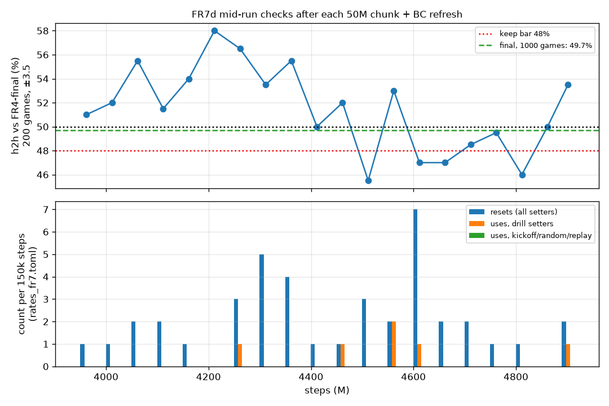

41 resets, 6 uses, **0 goals after a reset**. All 6 uses came from `reset_curriculum` spawns; kickoff, random and replay episodes made 20 resets and **0 uses**. The 200-game h2h vs FR4-final ranged 45.5–58.0% (mean 51.5%), highest at 4211.6M, and ended at 53.5%.

**Final evaluation** (`~/ippo_runs/fr7d_final/`, seed 424242). Final checkpoint `exp_FR7d/checkpoints/1793630629` (`cumulative_timesteps = 4901600000`), fresh export `final_policy.safetensors` (sha256 `017b3b2c…77e02d0`, written 9:46 AM ET).

| measure | FR7d-final (4901.6M) | FR7c-final | FR7b-final | FR7 3491.6M |
|---|---|---|---|---|
| h2h vs FR4-final, 1000 games | 49.7% (497-503, ±1.6) | 45.6% | 49.7% | **52.5%** |
| h2h vs FR6-final, 1000 games | **52.4%** (524-476, ±1.6) | 49.2% | 50.8% | 51.3% |
| pool score (400 games/opponent) | 86.4 | 85.4 | **86.5** | 85.9 |
| vs 1v1.pt / 430M / Nexto | 66.5 / 71.8 / 87.2 | 68.0 / 69.0 / 83.2 | 70.0 / 70.3 / 87.8 | 64.5 / 75.3 / 85.3 |
| vs Necto / Element / Immortal | 98.2 / 98.5 / 96.0 | 97.8 / 98.8 / 95.5 | 97.3 / 98.0 / 95.8 | 97.0 / 98.0 / 95.3 |
| botpack5: Ripple / Kira / Dice / Chronos / GalactusV2 | 52.2 / 58.8 / 46.8 / 66.2 / 16.2 | 49.2 / 53.0 / 46.2 / 63.2 / 16.2 | 51.5 / 52.5 / 48.2 / 68.2 / 14.5 | — |

**Real play** (300k steps, self-play; resets / uses / goals after a reset): on `rates_fr7.toml` FR7d-final made 0 / 0 / 0 in every setter. On the FR6-comparable `rates_fr3.toml`: 5 / 1 / 0, all from `reset_curriculum`, against FR6-final's 9 / 4 / 0.

**Curriculum skill** (960 episodes per row, greedy / sampled success): L0 27.0% / 20.6%, L1 27.8% / 15.8%, L2 11.8% / 5.4%.

**Verdict.**
- **Not pushed.** Strength passes the bar (49.7% vs FR4) but the reset half fails: 0 uses in normal play, 0 goals after a reset, and fewer uses than FR6 on `rates_fr3`.
- **Strongest all-round FR7c-config checkpoint so far** (best h2h vs FR6, best botpack5 numbers against Ripple and Kira, pool 86.4), but it does not beat FR7 3491.6M vs FR4 (49.7% vs 52.5%), so the best model is unchanged.
- **Normal-play resets are still absent.** Two full FR7c-config runs (2.0B steps, 40 checks) produced 0 normal-play uses. More of the same config is unlikely to change that.
- **Follow-up (running):** FR7e started 10:05 AM ET Nov 2 from the FR7d chunk with the best 200-game h2h (4211.6M, 58.0%), same config, 1.0B steps. It is the last run of the auto-chain.


### 11.7b FR7e: FR7c config a third time from the 4211.6M chunk (4211.6M → 5211.6M)

**Why.** FR7d ended at 49.7% vs FR4 with 0 normal-play uses, so the last run of the auto-chain restarted the FR7c config (drill ramp reset to x3) from FR7d's best chunk, 4211.6M (58.0% vs FR4-final in 200 games). It trained 10:05 AM ET → 3:22 PM ET Nov 2 alone on the L4; final evals finished 3:42 PM ET, and the extra 1000-game h2h vs FR7 3491.6M and the botpack5 pool (`fr7e_final/bp5/`) finished 4:40 PM ET while FR8 trained. Neither the farming alarm nor the 48% guard fired. Drills went x3 → x1 at 4521.6M and x0.5 at 4821.6M.

**Mid-run checks** (`data/fr7e_mid.csv`, 20 checks of 150k steps):

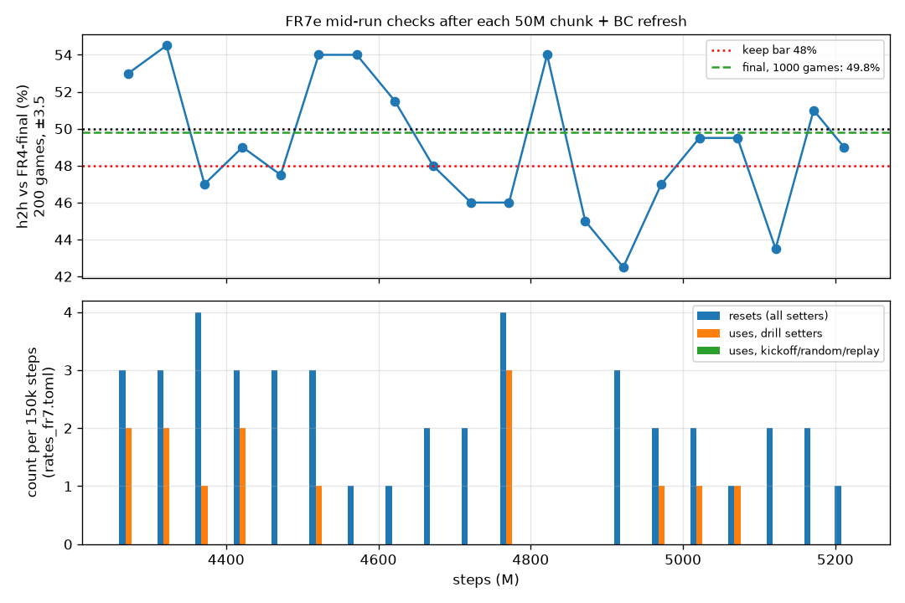

42 resets, 14 uses, **0 goals after a reset**. All 14 uses came from `reset_curriculum` spawns; kickoff, random and replay episodes made 9 resets and **0 uses**. The 200-game h2h vs FR4-final ranged 42.5–54.5% (mean 49.1%), highest at 4321.6M, and ended at 49.0%.

**Final evaluation** (`~/ippo_runs/fr7e_final/`, seed 424242). Final checkpoint `exp_FR7e/checkpoints/1793650831` (`cumulative_timesteps = 5211600000`), fresh export `final_policy.safetensors` (sha256 `fbe72b29…aa96466`, written 3:22 PM ET).

| measure | FR7e-final (5211.6M) | FR7d-final | FR7c-final | FR7 3491.6M |
|---|---|---|---|---|
| h2h vs FR4-final, 1000 games | 49.8% (498-502, ±1.6) | 49.7% | 45.6% | **52.5%** |
| h2h vs FR6-final, 1000 games | 49.4% (494-506, ±1.6) | **52.4%** | 49.2% | 51.3% |
| h2h vs FR7 3491.6M, 1000 games | 49.3% (493-507, ±1.6) | — | — | — |
| pool score (400 games/opponent) | 86.2 | **86.4** | 85.4 | 85.9 |
| vs 1v1.pt / 430M / Nexto | 69.5 / 69.8 / 85.2 | 66.5 / 71.8 / 87.2 | 68.0 / 69.0 / 83.2 | 64.5 / 75.3 / 85.3 |
| vs Necto / Element / Immortal | 98.0 / 99.0 / 95.5 | 98.2 / 98.5 / 96.0 | 97.8 / 98.8 / 95.5 | 97.0 / 98.0 / 95.3 |
| botpack5: Ripple / Kira / Dice / Chronos / GalactusV2 | 57.0 / 53.2 / 48.5 / 66.0 / 15.8 | 52.2 / 58.8 / 46.8 / 66.2 / 16.2 | 49.2 / 53.0 / 46.2 / 63.2 / 16.2 | — |

**Real play** (300k steps, self-play; resets / uses / goals after a reset): on `rates_fr7.toml` FR7e-final made 4 / 1 / 0, the one use from `reset_curriculum` (kickoff 1 / 0 / 0, random and replay 0 / 0 / 0). On the FR6-comparable `rates_fr3.toml`: 9 / 2 / 0, both uses from `reset_curriculum` (kickoff 2 / 0 / 0), against FR6-final's 9 / 4 / 0.

**Curriculum skill** (960 episodes per row, greedy / sampled success): L0 33.3% / 18.8%, L1 26.7% / 14.6%, L2 10.5% / 5.0%.

**Verdict.**
- **Not pushed.** Strength passes the bar (49.8% vs FR4) but the reset half fails again: 0 uses in normal play, 0 goals after a reset, and fewer uses than FR6 on `rates_fr3`.
- **Not a new best.** It loses to FR7 3491.6M head to head (49.3%) and stays below it vs FR4 (49.8% vs 52.5%). Best model unchanged.
- **The FR7c config is exhausted.** Three runs (3.0B steps, 60 checks) produced 0 normal-play reset uses. The chain ends here.
- **Follow-up (running):** FR8 (§11.8) started 3:43 PM ET Nov 2 from FR7 3491.6M widened to the 106-input obs, FR7c config, 1.0B steps, then FR8b.


### 11.8 Attention encoders: research note, and FR8 (previous action + car-frame obs)

Question (2026-11-02): would an attention policy, as some Discord bots use, help
normal-play reset use? Findings (full note with benchmarks: `attention_research.md`
on the box workspace):

- Necto / Nexto use a Perceiver-style cross-attention: the own car is the single
  query; ball, boost pads and other players are keys/values with a padding mask; 2
  preprocessing MLP layers, 2 cross-attention blocks, separate actor and critic
  copies ([Necto](https://github.com/Rolv-Arild/Necto); Lucy-SKG paper §4.2-4.3,
  [arXiv 2305.15801](https://arxiv.org/pdf/2305.15801v1.pdf); RLBot's Necto bot.toml:
  "attention ... to support any number of players",
  [link](https://github.com/RLBot/python-interface/blob/master/tests/necto/bot.toml)).
  The Seer thesis describes them the same way
  ([Seer](https://nevillewalo.ch/assets/docs/MA_Neville_Walo_Seer_RLRL.pdf)).
- GigaLearn has MLP policies only (configurable layer sizes, shared head, layer
  norm; [GigaLearnCPP](https://github.com/ZealanL/GigaLearnCPP-Leak)), and
  GigaLearn / RLGym-PPO 1v1 bots use large MLPs
  ([PISTY](https://bugss05.github.io/PISTY_CL_DRL_in_Rocket_League/PISTY__Ground_and_Aerial_Striking_Bot_in_Rocket_League.pdf),
  [RLGym-PPO guide](https://rlgym.org/Rocket%20League/training_an_agent)).
  Our FR runs already beat Nexto 83-87%.
- Verdict: attention mainly buys permutation invariance and variable player counts,
  a 2v2/3v3 win. Our 1v1 entity set is fixed and small. Reset *use* looks like
  a credit-assignment / memory problem: CPU cost per tick of a 256-wide, 2-layer, 4-head encoder
  is 0.6-0.9 ms vs 1.2 ms for our MLP (1 thread, PyTorch proxy), so cost is not the
  blocker, but the expected gain in 1v1 is small. Lucy-SKG adds the last 5 actions to
  the query; our obs had no previous action and no car-relative ball terms.
- So FR8 tries the cheap step first: the previous action (8 held controls) and the
  ball position/velocity relative to the car in the car frame, appended to the obs
  (92 -> 106), warm-started from FR7 3491.6M with zero weights for the new inputs
  (identical start, max |logit diff| 0.0), FR7c config otherwise (EXPERIMENTS.md FR8).
  An attention actor (distilled from FR7 3491.6M, then PPO) is deferred to team play.


### 11.8b FR8 results: 106-input obs from FR7 3491.6M (3491.6M → 4491.6M)

**Run.** FR8 started 3:43 PM ET Nov 2 from `fr8_init/1793565816` (FR7 3491.6M widened with zero weights), FR7c config, 1.0B steps. It crashed at 5:38 PM ET when the EC2 root disk filled during an optimizer save at 3851.6M; old run dirs were moved off the root disk and FR8 resumed at 6:19 PM ET from the 3801.6M checkpoint (about 40 min lost). Training finished 10:00 PM ET and the finals 10:29 PM ET. Drills went x3 → x1 at 3851.6M and x0.5 at 4151.6M. Neither the farming alarm nor the 48% guard fired.

**Mid-run checks** (`data/fr8_mid.csv`, 20 checks of 150k steps):

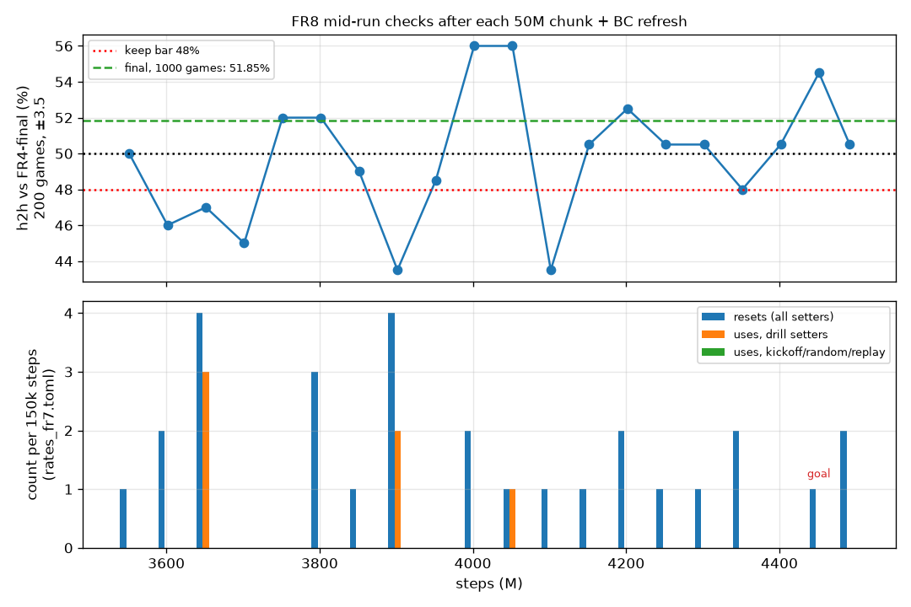

29 resets, 6 uses, 1 goal after a reset. All 6 uses came from `reset_curriculum` spawns, and the one goal after a reset (4451.6M) was also a `reset_curriculum` episode with no use. Kickoff, random and replay episodes made **0 uses**. The 200-game h2h vs FR4-final ranged 43.5–56.0% (mean 49.8%), highest at 4001.6M and 4051.6M, and ended at 50.5%.

**Final evaluation** (`~/ippo_runs/fr8_final/`, seed 424242). Final checkpoint `exp_FR8/checkpoints/1793674697` (`cumulative_timesteps = 4491600000`), fresh export `final_policy.safetensors` (sha256 `e55cfd32…f55c907`, written 10:00 PM ET).

| measure | FR8-final (4491.6M) | FR7e-final | FR7 3491.6M |
|---|---|---|---|
| h2h vs FR4-final, 1000 games | 51.85% (518-481-1, ±1.6) | 49.8% | **52.5%** |
| h2h vs FR7 3491.6M, 1000 games | **53.3%** (533-467, ±1.6) | 49.3% | — |
| pool score (400 games/opponent) | **87.0** | 86.2 | 85.9 |
| vs 1v1.pt / 430M / Nexto | 68.0 / 71.5 / 88.5 | 69.5 / 69.8 / 85.2 | 64.5 / 75.3 / 85.3 |
| vs Necto / Element / Immortal | 98.5 / 99.2 / 96.0 | 98.0 / 99.0 / 95.5 | 97.0 / 98.0 / 95.3 |
| botpack5: Ripple / Kira / Dice / Chronos / GalactusV2 / Seer | 56.0 / 60.2 / 51.0 / 67.0 / 14.8 / 99.0 | 57.0 / 53.2 / 48.5 / 66.0 / 15.8 / — | — |

**Real play** (300k steps, self-play; resets / uses / goals after a reset): on `rates_fr7.toml` FR8-final made 3 / 0 / 0 (kickoff 1 / 0 / 0, `reset_curriculum` 2 / 0 / 0, random and replay 0 / 0 / 0). On the FR6-comparable `rates_fr3.toml`: 6 / 1 / 0, the use from `reset_curriculum` (kickoff 3 / 0 / 0), against FR6-final's 9 / 4 / 0.

**Curriculum skill** (960 episodes per row, greedy / sampled success): L0 30.2% / 20.1%, L1 25.6% / 14.4%, L2 10.3% / 4.5%.

**Verdict.**
- **New best model by strength.** FR8-final beats FR7 3491.6M head to head (53.3%, about 2 standard errors above 50%) and has the best pool score so far (87.0, Nexto 88.5%). Against FR4-final it is level with FR7 3491.6M (51.85% vs 52.5%, inside the noise).
- **Not pushed.** The push rule's reset half fails: 0 uses in normal play, the only goal after a reset came from a curriculum spawn without a use, and fewer uses than FR6 on `rates_fr3`. The extra inputs helped strength, not reset use.
- **2v2 stays paused.** One gate (a 1v1 checkpoint beats FR7 3491.6M) now holds; the other (normal-play flip resets) does not.
- **Follow-up (running):** FR8b started 10:29 PM ET Nov 2 from FR8's 4001.6M chunk (56.0% vs FR4 in 200 games), same config, drill ramp restarted at x3.

### 11.8c FR8b results: FR8 continued from its 4001.6M chunk (4001.6M → 5001.6M)

**Run.** FR8b started 10:29 PM ET Nov 2 from `exp_FR8/checkpoints/1793665275` (FR8 4001.6M, 56.0% vs FR4 in 200 games), FR8 config (106-input obs, FR7c rewards), drill ramp restarted at x3. It trained without a crash and finished at 3:49 AM ET Nov 3; the finals were done at 4:17 AM ET. Drills went x3 → x1 at 4361.6M and x0.5 at 4661.6M. Neither the farming alarm nor the 48% guard fired.

**Mid-run checks** (`data/fr8b_mid.csv`, 20 checks of 150k steps):

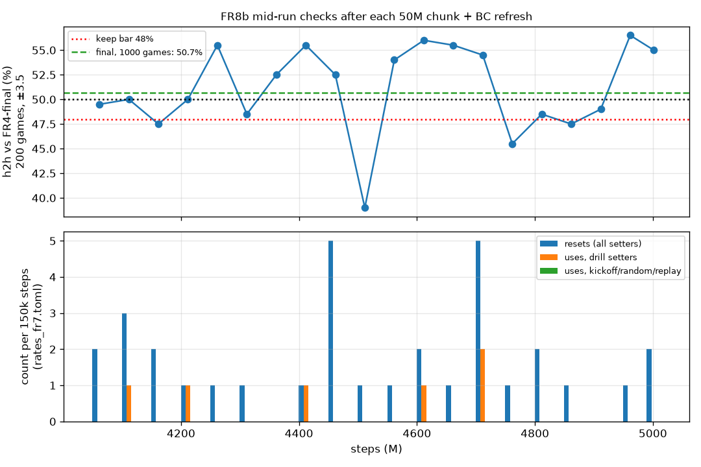

33 resets, 6 uses, 0 goals after a reset. All 6 uses came from `reset_curriculum` spawns; kickoff, random and replay episodes made **0 uses**. The 200-game h2h vs FR4-final ranged 39.0–56.5% (mean 51.1%); the one dip to 39.0% at 4511.6M recovered to 54.0% in the next chunk.

**Final evaluation** (`~/ippo_runs/fr8b_final/`, seed 424242). Final checkpoint `exp_FR8b/checkpoints/1793695617` (`cumulative_timesteps = 5001600000`), fresh export `final_policy.safetensors` (sha256 `14ca55dd…be634cb5`, written 3:49 AM ET).

| measure | FR8b-final (5001.6M) | FR8-final (4491.6M) | FR7 3491.6M |
|---|---|---|---|
| h2h vs FR4-final, 1000 games | 50.7% (507-493, ±1.6) | 51.85% | **52.5%** |
| h2h vs FR7 3491.6M, 1000 games | 51.7% (517-483, ±1.6) | **53.3%** | — |
| h2h vs FR8-final, 1000 games | 49.7% (497-503, ±1.6) | — | — |
| pool score (400 games/opponent) | 85.7 | **87.0** | 85.9 |
| vs 1v1.pt / 430M / Nexto | 66.5 / 71.8 / 85.5 | 68.0 / 71.5 / 88.5 | 64.5 / 75.3 / 85.3 |
| vs Necto / Element / Immortal | 95.2 / 98.8 / 96.5 | 98.5 / 99.2 / 96.0 | 97.0 / 98.0 / 95.3 |
| botpack5: Ripple / Kira / Dice / Chronos / GalactusV2 / Seer | 55.0 / 56.2 / 45.0 / 61.8 / 18.5 / 99.2 | 56.0 / 60.2 / 51.0 / 67.0 / 14.8 / 99.0 | — |

**Real play** (300k steps, self-play; resets / uses / goals after a reset): on `rates_fr7.toml` FR8b-final made 4 / 1 / 0 (`reset_curriculum` 2 / 1 / 0, kickoff 1 / 0 / 0, `air_reset` 1 / 0 / 0, random and replay 0 / 0 / 0). On `rates_fr3.toml`: 7 / 2 / 0, both uses from `reset_curriculum` (kickoff 1 / 0 / 0, `air_reset` 1 / 0 / 0).

**Curriculum skill** (960 episodes per row, greedy / sampled success): L0 29.5% / 17.9%, L1 25.3% / 15.1%, L2 8.3% / 6.3%.

**Verdict.**
- **Not better than FR8-final.** FR8b-final is level with FR8-final head to head (49.7%), slightly weaker against FR4 and FR7 3491.6M, and lower on the pool (85.7 vs 87.0). FR8-final stays the best model.
- **Not pushed.** 0 normal-play uses again; every use came from a curriculum spawn. This is the fifth run in a row on the FR7c reward recipe without a normal-play use, so more steps on this recipe are not producing flip resets in real games.
- **2v2 stays paused** (normal-play reset gate not met).
- **Follow-up (running):** FR8c started 4:17 AM ET Nov 3 from FR8-final (4491.6M → 5491.6M), same config, then FR8d.

### 11.8d FR8c results: FR8-final continued (4491.6M → 5491.6M)

**Run.** FR8c started 4:17 AM ET Nov 3 from FR8-final (`exp_FR8/checkpoints/1793674697`, 4491.6M), FR8 config (106-input obs, FR7c rewards), drill ramp restarted at x3. It trained without a crash and finished at 9:43 AM ET; the finals were done at 10:11 AM ET and the extra h2h vs FR8-final at 10:19 AM ET. Drills went x3 → x1 from 4801.6M and x0.5 from 5101.6M. Neither the farming alarm nor the 48% guard fired.

**Mid-run checks** (`data/fr8c_mid.csv`, 20 checks of 150k steps):

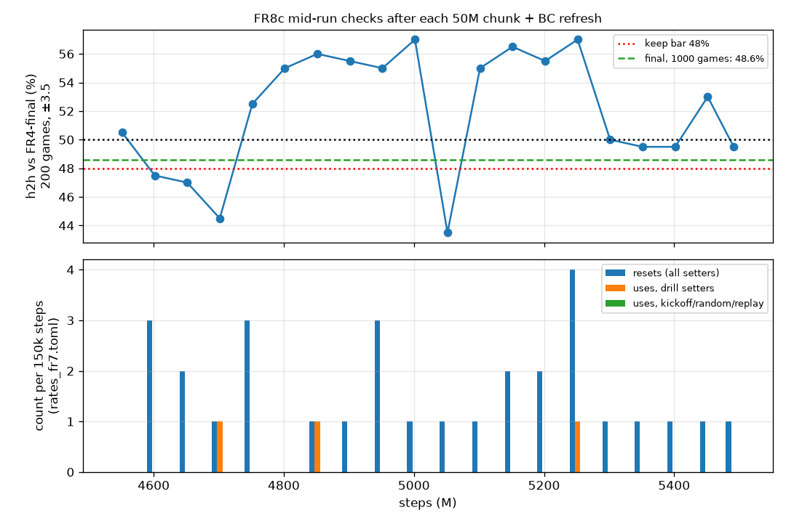

30 resets, 3 uses, 0 goals after a reset. All 3 uses came from `reset_curriculum` spawns (18 of the 30 resets too); kickoff, random and replay episodes made 9 resets and **0 uses**. The 200-game h2h vs FR4-final ranged 43.5–57.0% (mean 52.0%); the one dip to 43.5% at 5051.6M recovered to 55.0% in the next chunk.

**Final evaluation** (`~/ippo_runs/fr8c_final/`, seed 424242). Final checkpoint `exp_FR8c/checkpoints/1793716845` (`cumulative_timesteps = 5491600000`), fresh export `final_policy.safetensors` (sha256 `66ca146e…608c9bd0c`, written 9:43 AM ET).

| measure | FR8c-final (5491.6M) | FR8-final (4491.6M) | FR8b-final (5001.6M) |
|---|---|---|---|
| h2h vs FR4-final, 1000 games | 48.6% (486-514, ±1.6) | **51.85%** | 50.7% |
| h2h vs FR7 3491.6M, 1000 games | 51.3% (513-487, ±1.6) | **53.3%** | 51.7% |
| h2h vs FR8-final, 1000 games | 50.5% (505-495, ±1.6) | — | 49.7% |
| pool score (400 games/opponent) | **87.9** | 87.0 | 85.7 |
| vs 1v1.pt / 430M / Nexto | 74.0 / 71.0 / 88.5 | 68.0 / 71.5 / 88.5 | 66.5 / 71.8 / 85.5 |
| vs Necto / Element / Immortal | 98.2 / 98.8 / 97.0 | 98.5 / 99.2 / 96.0 | 95.2 / 98.8 / 96.5 |
| botpack5: Ripple / Kira / Dice / Chronos / GalactusV2 / Seer | 47.5 / 50.0 / 52.5 / 64.5 / 19.0 / 99.8 | 56.0 / 60.2 / 51.0 / 67.0 / 14.8 / 99.0 | 55.0 / 56.2 / 45.0 / 61.8 / 18.5 / 99.2 |

**Real play** (300k steps, self-play; resets / uses / goals after a reset): on `rates_fr7.toml` FR8c-final made 3 / 1 / 0, all from `reset_curriculum` (kickoff, random, replay and `air_reset` 0 / 0 / 0). On `rates_fr3.toml`: 3 / 2 / 0, all from `reset_curriculum`.

**Curriculum skill** (960 episodes per row, greedy / sampled success): L0 24.4% / 19.3%, L1 22.7% / 14.0%, L2 9.6% / 5.4%.

**Verdict.**
- **Not better than FR8-final.** FR8c-final is level with FR8-final head to head (50.5%, inside ±1.6), weaker against FR4-final (48.6%, just above the 48% bar) and FR7 3491.6M, and slightly higher on the pool (87.9 vs 87.0, mostly from 1v1.pt 74.0 vs 68.0). FR8-final stays the best model.
- **Not pushed.** 0 normal-play uses again. This is the sixth run in a row on the FR7c reward recipe without a normal-play use, which is why FR9 changes the recipe.
- **2v2 stays paused** (normal-play reset gate not met).
- **Follow-up (running):** FR9 started 10:11 AM ET Nov 3 from FR8-final (4491.6M, 1.0B steps) with the changed recipe (EXPERIMENTS.md FR9), then FR9b.

### 11.8e FR9 results: changed recipe from FR8-final (4491.6M → 5491.6M)

**Run.** FR9 started 10:11 AM ET Nov 3 from FR8-final (`exp_FR8/checkpoints/1793674697`, 4491.6M) with the changed recipe (EXPERIMENTS.md FR9: `reset_replay` setter at about 15% built from the bot's own near-reset states, use reward 1.0 plus `dodge_aim` 0.1, flip-reset pay x4 in normal play, x3 in `reset_replay`, x0.5 flat in drills). It trained without a crash and finished at 3:30 PM ET; the finals were done at 3:58 PM ET and the extra h2h vs FR8-final at 4:16 PM ET. Neither the farming alarm nor the 48% guard fired.

**Mid-run checks** (`data/fr9_mid.csv`, 20 checks of 150k steps on `rates_fr7.toml`, which has no `reset_replay` spawns):

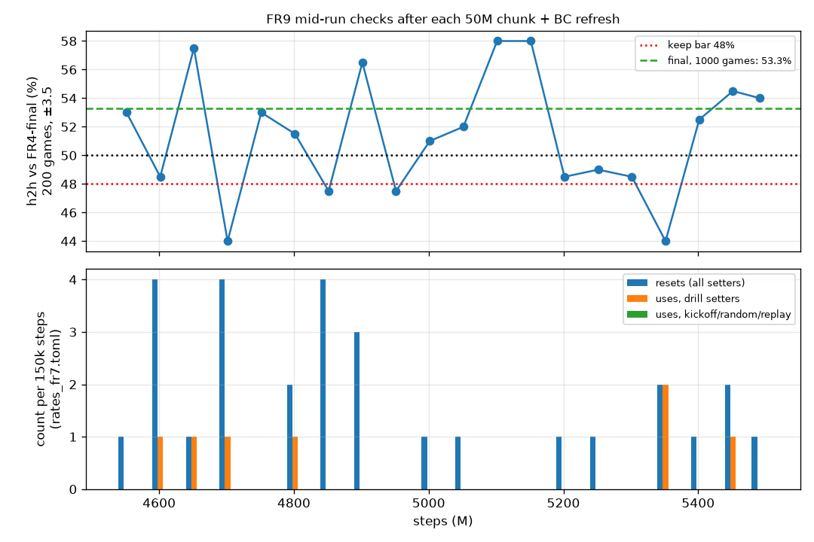

29 resets, 7 uses, 0 goals after a reset. All 7 uses came from `reset_curriculum` spawns (18 of the 29 resets too); kickoff, random and replay episodes made 10 resets and **0 uses**. The 200-game h2h vs FR4-final ranged 44.0–58.0% (mean 51.5%).

**Final evaluation** (`~/ippo_runs/fr9_final/`, seed 424242). Final checkpoint `exp_FR9/checkpoints/1793737699` (5491.6M), fresh export `final_policy.safetensors` (sha256 `a71757a2…a9605e59f`, written 3:30 PM ET).

| measure | FR9-final (5491.6M) | FR8-final (4491.6M) | FR8c-final (5491.6M) |
|---|---|---|---|
| h2h vs FR4-final, 1000 games | **53.3%** (533-467, ±1.6) | 51.85% | 48.6% |
| h2h vs FR7 3491.6M, 1000 games | **54.1%** (541-459, ±1.6) | 53.3% | 51.3% |
| h2h vs FR8-final, 1000 games | 48.3% (483-517, ±1.6) | — | 50.5% |
| pool score (400 games/opponent) | 87.5 | 87.0 | **87.9** |
| vs 1v1.pt / 430M / Nexto | 73.2 / 71.5 / 87.2 | 68.0 / 71.5 / 88.5 | 74.0 / 71.0 / 88.5 |
| vs Necto / Element / Immortal | 97.0 / 98.2 / 97.5 | 98.5 / 99.2 / 96.0 | 98.2 / 98.8 / 97.0 |
| botpack5: Ripple / Kira / Dice / Chronos / GalactusV2 / Seer | 49.5 / 53.5 / 53.0 / 64.5 / 16.2 / 100.0 | 56.0 / 60.2 / 51.0 / 67.0 / 14.8 / 99.0 | 47.5 / 50.0 / 52.5 / 64.5 / 19.0 / 99.8 |

**Real play** (300k steps, self-play; resets / uses / goals after a reset): on `rates_fr7.toml` FR9-final made 0 / 0 / 0 in every setter (2 resets on the old detector, both `reset_curriculum`). On `rates_fr3.toml`: 3 / 0 / 0, all from `reset_curriculum` (kickoff and `air_reset` 0 / 0 / 0).

**Curriculum skill** (960 episodes per row, greedy / sampled success): L0 28.5% / 20.1%, L1 25.2% / 14.3%, L2 9.0% / 6.1%.

**Verdict.**
- **Mixed on strength; FR8-final stays the best model.** FR9-final has the best 1000-game results yet against FR4-final (53.3%) and FR7 3491.6M (54.1%), but it loses to FR8-final head to head (48.3%, about one standard error under 50%), and its pool score is level (87.5 vs 87.0).
- **Not pushed.** 0 normal-play uses again. The `reset_replay` setter and the x4 normal-play pay did not move real-game reset use: the mid checks found more curriculum uses than FR8c (7 vs 3) but none in kickoff, random or replay play.
- **2v2 stays paused** (normal-play reset gate not met).
- **Follow-up (running):** FR9b started 3:58 PM ET Nov 3 from the FR9 5101.6M chunk (58% vs FR4 in 200 games), same FR9 recipe, 500 iterations per chunk.

### 11.8f FR9b results: FR9 continued from its 5101.6M chunk (5101.6M → 6101.6M)

**Run.** FR9b started 3:58 PM ET Nov 3 as FR9's automatic follow-up, from the FR9 5101.6M chunk (`exp_FR9/checkpoints/1793730224`, 58% vs FR4 in 200 games), with the same FR9 recipe. It trained without a crash and finished at 9:17 PM ET; the finals were done at 9:45 PM ET and the extra h2h vs FR8-final at 10:21 PM ET. Neither the farming alarm nor the 48% guard fired. FR9b was the last run of the chain, so the GPU sat idle from 9:45 PM to 10:15 PM ET until the hourly check started FR9c.

**Mid-run checks** (`data/fr9b_mid.csv`, 20 checks of 150k steps on `rates_fr7.toml`):

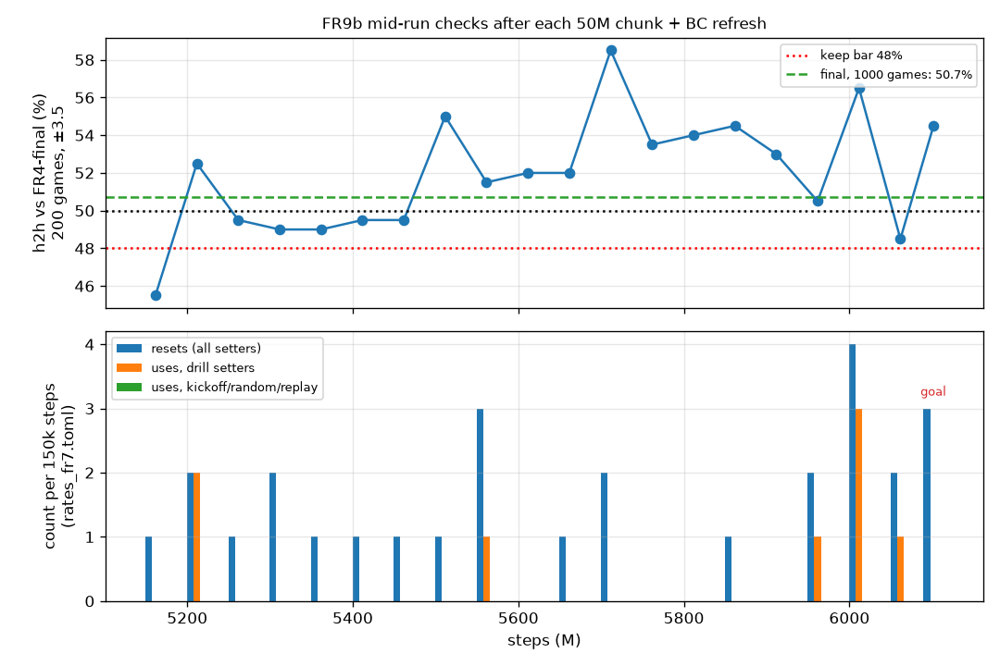

28 resets, 8 uses, 1 goal after a reset. All 8 uses came from `reset_curriculum` spawns (19 of the 28 resets too). Kickoff, random and replay episodes made 8 resets and **0 uses**, but the last check (6101.6M, the final checkpoint) logged the **first normal-play goal after a reset** of the FR9 line: a `replay` episode in which the bot got a reset and its side scored afterwards, with no flip-reset use counted. The 200-game h2h vs FR4-final ranged 45.5–58.5% (mean 51.9%).

**Final evaluation** (`~/ippo_runs/fr9b_final/`, seed 424242). Final checkpoint `exp_FR9b/checkpoints/1793758509` (6101.6M), fresh export `final_policy.safetensors` (sha256 `d05f5acb…74efcc8728`, written 9:17 PM ET).

| measure | FR9b-final (6101.6M) | FR9-final (5491.6M) | FR8-final (4491.6M) |
|---|---|---|---|
| h2h vs FR4-final, 1000 games | 50.7% (507-493, ±1.6) | **53.3%** | 51.85% |
| h2h vs FR7 3491.6M, 1000 games | 53.7% (537-463, ±1.6) | **54.1%** | 53.3% |
| h2h vs FR8-final, 1000 games | **50.4%** (504-496, ±1.6) | 48.3% | — |
| pool score (400 games/opponent) | 86.8 | **87.5** | 87.0 |
| vs 1v1.pt / 430M / Nexto | 72.0 / 66.5 / 86.5 | 73.2 / 71.5 / 87.2 | 68.0 / 71.5 / 88.5 |
| vs Necto / Element / Immortal | 97.8 / 99.5 / 98.2 | 97.0 / 98.2 / 97.5 | 98.5 / 99.2 / 96.0 |
| botpack5: Ripple / Kira / Dice / Chronos / GalactusV2 / Seer | 51.8 / 54.5 / 48.0 / 64.5 / 15.5 / 99.8 | 49.5 / 53.5 / 53.0 / 64.5 / 16.2 / 100.0 | 56.0 / 60.2 / 51.0 / 67.0 / 14.8 / 99.0 |

**Real play** (300k steps, self-play; resets / uses / goals after a reset): on `rates_fr7.toml` FR9b-final made 5 / 1 / 0 in total: random 1 / 0 / 0, replay 1 / 0 / 0, `reset_curriculum` 3 / 1 / 0, kickoff and `air_reset` 0 / 0 / 0. On `rates_fr3.toml`: 5 / 1 / 0 (kickoff 1 / 0 / 0, `reset_curriculum` 4 / 1 / 0). The mid-run replay goal did not recur.

**Curriculum skill** (960 episodes per row, greedy / sampled success): L0 30.5% / 18.4%, L1 23.9% / 12.5%, L2 9.4% / 5.2%.

**Verdict.**
- **Level with FR8-final; FR8-final stays the best model.** FR9b-final ties FR8-final head to head (50.4%, well inside one standard error) and is slightly behind it vs FR4-final (50.7% vs 51.85%) and in the pool (86.8 vs 87.0), so it is not a clear improvement.
- **Not pushed.** The push rule needs normal-play uses on the 1000-game/300k checks; the final made 0 normal-play uses, and the one mid-run replay goal after a reset (without a use) did not show up again in 300k steps.
- **2v2 stays paused** (normal-play reset gate not met, no checkpoint beats FR8-final).
- **Follow-up (running):** FR9c started 10:15 PM ET Nov 3 from the FR9b final checkpoint (6101.6M, the chunk with the replay goal after a reset), same FR9 recipe, 1.0B steps to about 7101.6M, then FR9d automatically.

### 11.8g ST1 results: strength-only chain from FR8-final (4491.6M → 5491.6M)

ST1 dropped every flip-reset term and drill, removed the BC refresh + KL anchor to FR4-final, used 100% normal-play setters and a fixed league of past bests (FR4, FR7 3491.6M, FR8-final x2, FR9, FR9b, 1v1.pt). Trained 10:26 PM ET Nov 3 to 3:55 AM ET Nov 4; finals done 4:20 AM ET.

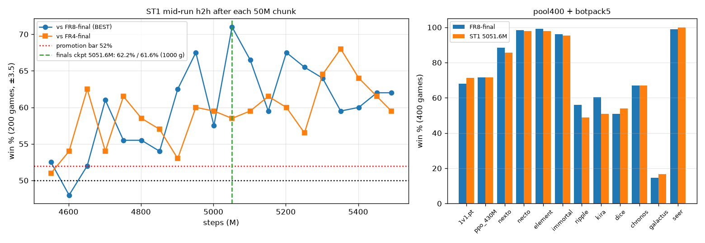

Mid-run checks (200 games, ±3.5): vs FR8-final rose from 48-52.5% in the first 150M to 59.5-71% from 4901.6M on; vs FR4 51-68%. The finals used the best chunk by vs-BEST, **5051.6M** (`exp_ST1/checkpoints/1793773641`, 71% in 200 g).

| finals (seed 424242) | ST1 5051.6M | FR8-final |
|---|---|---|
| h2h vs FR8-final, 1000 g | **62.2%** (622-378, ±1.5) | 50% |
| h2h vs FR4-final, 1000 g | **61.6%** (615-384-1) | 51.85% |
| pool400 mean | 86.62 | 86.95 |
| pool400: 1v1.pt / ppo_430M / Nexto / Necto / Element / Immortal | 71.2 / 71.5 / 85.8 / 98.0 / 98.0 / 95.2 | 68.0 / 71.5 / 88.5 / 98.5 / 99.2 / 96.0 |
| botpack5 mean | 56.25 | 58.0 |
| botpack5: Ripple / Kira / Dice / Chronos / Galactus / Seer | 48.8 / 51.0 / 54.0 / 67.0 / 16.8 / 100 | 56.0 / 60.2 / 51.0 / 67.0 / 14.8 / 99.0 |

`st_promote.py`: **not promoted**. It clears the h2h bar by a wide margin (+12 pt vs FR8-final, +10 pt vs FR4) and pool400 is within tolerance (-0.3), but botpack5 is 1.75 below FR8-final (tolerance 1.0), driven by Ripple (-7.2) and Kira (-9.2, both ±2.5) plus Nexto -2.7 in pool400. Reading: removing the anchor and the reset budget made the policy much stronger against its own lineage, with a small loss against some outside bots, which looks like league overfitting. FR8-final stays best; no bpk pushed.

ST2 (gamma 0.997, 200k/iter, mb 100k) started 4:20 AM ET from ST1 5051.6M (→ 6051.6M); ST3 queued. Data: `data/st1_mid.csv`, script `make_figures_st1.py`.
### 11.8h ST2 results: gamma 0.997 + 2x batch, from ST1 5051.6M (→ 6051.6M). NEW BEST

ST2 is ST1 with a longer horizon (gamma 0.997, about 5.5 s) and twice the batch (200k steps per iteration, 100k minibatch). Same rewards, setters and league as ST1. Started 4:20 AM ET Nov 4 from ST1 5051.6M; trained to 9:42 AM ET; finals done 10:07 AM ET.

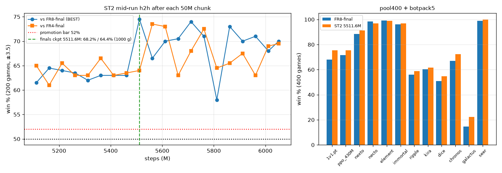

Mid-run checks (200 games, ±3.5): vs FR8-final 58-74.5% in every chunk (61.5-64.5% for the first 400M, then mostly 66-74.5%); vs FR4 61-73.5%. The finals used the best chunk by vs-BEST, **5511.6M** (`exp_ST2/checkpoints/1793792743`, 74.5% in 200 g).

| finals (seed 424242) | ST2 5511.6M | FR8-final |
|---|---|---|
| h2h vs FR8-final, 1000 g | **68.2%** (682-318, ±1.5) | 50% |
| h2h vs FR4-final, 1000 g | **64.4%** (644-356) | 51.85% |
| pool400 mean | **89.12** | 86.95 |
| pool400: 1v1.pt / ppo_430M / Nexto / Necto / Element / Immortal | 75.5 / 75.5 / 91.25 / 96.75 / 99.0 / 96.75 | 68.0 / 71.5 / 88.5 / 98.5 / 99.25 / 96.0 |
| botpack5 mean | **61.58** | 58.0 |
| botpack5: Ripple / Kira / Dice / Chronos / Galactus / Seer | 58.75 / 61.5 / 54.75 / 72.25 / 22.25 / 100 | 56.0 / 60.25 / 51.0 / 67.0 / 14.75 / 99.0 |

`st_promote.py`: **promoted**. It beats FR8-final 68.2% over 1000 games and improves every aggregate: +12.6 pt vs FR4, +2.2 pool400, +3.6 botpack5. Nexto rose to 91.25% (best so far). The only per-opponent drops are Necto (-1.75) and Element (-0.25), both within noise. ST1's outside-bot loss (Ripple, Kira) is gone, so the longer horizon and bigger batch, not more league play, fixed it. **ST2 5511.6M is the new best** and is shipped as `checkpoints_to_test/st2_5512M.bpk` (sha256 `1fc134ee…37bc3`; needs the 106-input RLBot binaries).

ST3 (entropy 0.008, lr 4e-5 cosine to 0.25x) started 10:07 AM ET from ST2 5511.6M and is now measured against ST2. ST4 is queued: the ST2 recipe pushed further (gamma 0.998, 300k/iter, mb 100k). Data: `data/st2_mid.csv`, script `make_figures_st2.py`.

### 11.8i ST3 results: entropy 0.008 + LR cosine, from ST2 5511.6M (→ 6511.6M). NEW BEST (narrow)

ST3 is ST2 with lower entropy (0.008) and a learning rate of 4e-5 decayed by cosine to 0.25x, meant to sharpen the policy. Same rewards, setters and league as ST2. Started 10:07 AM ET Nov 4 from ST2 5511.6M; trained to 3:39 PM ET; finals done 4:09 PM ET. Galactus was tracked by a sidecar (200 games per chunk, 1000 in finals).

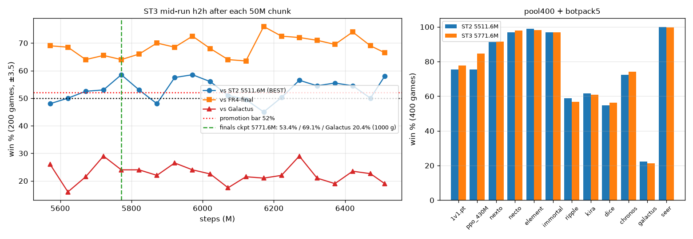

Mid-run checks (200 games, ±3.5): vs ST2 45-58.5% (mostly 50-58%), vs FR4 63.5-76%, vs Galactus 16-29% (mean 22.6%, flat across the run). The finals used the best chunk by vs-BEST, **5771.6M** (`exp_ST3/checkpoints/1793809757`, 58.5% in 200 g).

| finals (seed 424242) | ST3 5771.6M | ST2 5511.6M |
|---|---|---|
| h2h vs ST2 5511.6M, 1000 g | **53.4%** (534-466, ±1.6) | 50% |
| h2h vs FR4-final, 1000 g | **69.1%** (691-309) | 64.4% |
| **Galactus, 1000 g** | 20.4% (204-796, ±1.3) | 20.8% |
| pool400 mean | **91.17** | 89.12 |
| pool400: 1v1.pt / ppo_430M / Nexto / Necto / Element / Immortal | 77.75 / 84.5 / 91.5 / 98.0 / 98.25 / 97.0 | 75.5 / 75.5 / 91.25 / 96.75 / 99.0 / 96.75 |
| botpack5 mean | 61.5 | 61.58 |
| botpack5: Ripple / Kira / Dice / Chronos / Galactus / Seer | 56.75 / 60.75 / 56.25 / 74.25 / 21.25 / 99.75 | 58.75 / 61.5 / 54.75 / 72.25 / 22.25 / 100 |

`st_promote.py`: **promoted**. 53.4% vs ST2 clears the 52% bar by about one standard error, vs FR4 is +4.7 pt, pool400 +2.05 (430M +9), and botpack5 is flat (-0.08). Galactus did not move (20.4% vs 20.8%, within noise): sharpening makes us better against our own lineage and the pool but does nothing against Galactus, so the Galactus gap needs a direct signal. **ST3 5771.6M is the new best** and is shipped as `checkpoints_to_test/st3_5772M.bpk` (sha256 `bd72a8a7…d23b75`; needs the 106-input RLBot binaries).

ST4 (gamma 0.998, 300k/iter, mb 100k, LR 5e-5, entropy 0.012, + Galactus as a league opponent at weight 2.5) started 4:09 PM ET from ST3 5771.6M and is measured against ST3. Queued next: ST5 = ST4 with Galactus weight 6.0 (about 35% of opponent iterations instead of 19%), the one change, to test whether more Galactus exposure moves the Galactus win rate. Data: `data/st3_mid.csv`, script `make_figures_st3.py`.

### 11.8j ST5 results: broader league for generalization, from ST4 6032.3M (→ 7032.3M). NEW BEST

ST5 kept the ST4 recipe (gamma 0.998, 300k/iter, LR 5e-5, entropy 0.012, flip_reset 70) and changed one thing: 7 extra frozen checkpoints of different eras and styles (X0, ADB, AUD, FR6, FR8c, FR9c, ST3-final) joined the league at weight 1.0 each, with Galactus held at 2.5 (~12% of opponent iterations). Trained 10:22 PM to 4:12 AM ET; finals (old 1000-game set) done 4:31 AM ET Nov 5.

Finals checkpoint = best chunk 6192.8M (`exp_ST5/checkpoints/1793851923`):

| Metric | ST5 6192.8M | ST3 5771.6M (prev best) |
|---|---|---|
| H2H vs best (1000 g) | **57.4%** | – |
| vs FR4 (1000 g) | 69.2% | 69.1% |
| pool400 | 91.21 (1v1.pt 80.25, 430M 82.0, Nexto 89.5, Necto 98.5, Element 99.25, Immortal 97.75) | 91.17 (77.75 / 84.5 / 91.5 / 98.0 / 98.25 / 97.0) |
| botpack5 | 63.46 (Ripple 65.25, Kira 61.0, Dice 62.25, Chronos 68.5, Galactus 23.75, Seer 100) | 61.5 (56.75 / 60.75 / 56.25 / 74.25 / 21.25 / 99.75) |
| Galactus (1000 g) | 23.4% | 20.4% |
| Gen panel min / mean | 23.4% / 77.3% | 20.4% / 76.3% |

Promoted on every gate. The broader league lifted the weakest public-bot matchups (Ripple +8.5, Dice +6.0) and Galactus (+3.0), consistent with the generalization goal. Regressions to watch: Chronos −5.75, Nexto −2.0, ppo_430M −2.5. Mid-run (200 g per chunk) vs ST3 was flat around 0.50–0.60 and Galactus 0.18–0.28, so the 6192.8M chunk (0.61 vs best mid) was picked as the finals checkpoint. Shipped as `checkpoints_to_test/st5_6193M.bpk`. ST6 (ST5 + OPPCH 0.50) started from this chunk at 4:31 AM ET and measures against ST5.

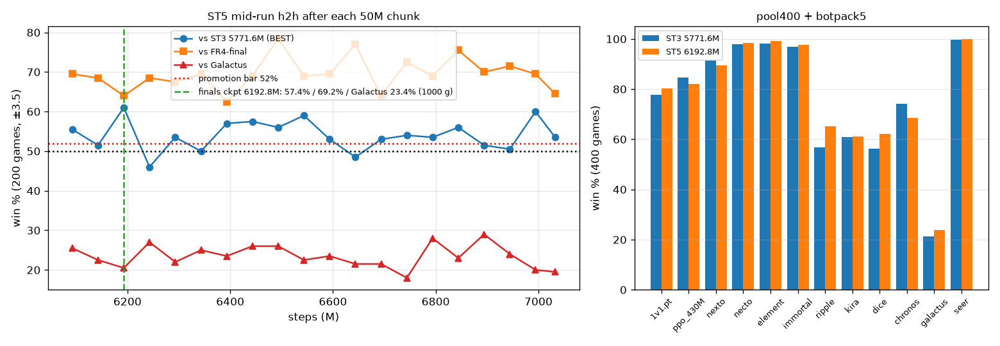

### 11.8k ST6 results: opponent chance 0.50 on the broader league, from ST5 6192.8M (→ 7192.8M). NEW BEST

ST6 kept the ST5 recipe (broader league with 7 extra frozen checkpoints, Galactus weight 2.5, gamma 0.998, 300k/iter, LR 5e-5, entropy 0.012, flip_reset 70) and changed one thing: the chance of facing a league opponent instead of self-play went to 0.50. Trained 4:31 AM to ~10:33 AM ET; finals (new quick set: 500 g h2h/FR4/Galactus + pool400 + botpack5) done 10:56 AM ET Nov 5.

Finals checkpoint = best chunk 6954.5M (`exp_ST6/checkpoints/1793887366`):

| Metric | ST6 6954.5M | ST5 6192.8M (prev best) |
|---|---|---|
| H2H vs best (500 g) | **56.2%** | – |
| vs FR4 (500 g) | 71.2% | 69.2% |
| pool400 | 92.21 (1v1.pt 83.75, 430M 80.75, Nexto 92.75, Necto 98.25, Element 99.25, Immortal 98.5) | 91.21 (80.25 / 82.0 / 89.5 / 98.5 / 99.25 / 97.75) |
| botpack5 | 63.42 (Ripple 61.0, Kira 55.25, Dice 60.25, Chronos 78.5, Galactus 26.0, Seer 99.5) | 63.46 (65.25 / 61.0 / 62.25 / 68.5 / 23.75 / 100) |
| Galactus (500 g) | 23.8% | 23.4% (1000 g) |
| Gen panel min / mean | 23.8% / 77.6% | 23.4% / 77.3% |

Promoted on every gate. More league time recovered Chronos (+10.0) and Nexto (+3.25) and nudged Galactus up, but gave back some of ST5's gains on Kira (−5.75), Ripple (−4.25) and Dice (−2.0), so botpack5 is flat; the panel is broader-better but not uniformly. Mid-run (200 g) vs ST5 sat around 0.44–0.59 and Galactus 0.20–0.31. Shipped as `checkpoints_to_test/st6_6955M.bpk`. ST7 (ST6 + entropy 0.016) started from this chunk at 10:56 AM ET and measures against ST6; ST8 (ST7 + ST4/ST5/ST6 frozen snapshots in the league) is queued.

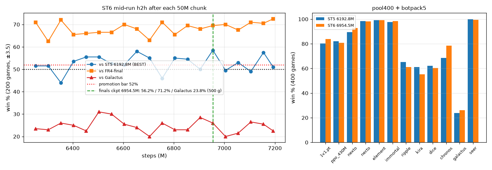

### 11.8l ST8 results: recent frozen ST4/ST5/ST6 in the league, from ST7 mid 7666.1M (→ 8666.3M). NEW BEST

ST8 kept the ST7 recipe (broader league + OPPCH 0.50 + ENT 0.016, Galactus weight 2.5, gamma 0.998, 300k/iter, LR 5e-5, flip_reset 70) and changed one thing: ST4/ST5/ST6 frozen finals joined EXTRA_OPPS at w1.0 each. Trained ~5:26 PM ET Nov 5 to ~11:34 PM ET; finals done 11:57 PM ET Nov 5.

Finals checkpoint = end/best chunk 8666.3M (`exp_ST8/checkpoints/1793939483`):

| Metric | ST8 8666.3M | ST6 6954.5M (prev best) |
|---|---|---|
| H2H vs best (500 g) | **55.4%** | – |
| vs FR4 (500 g) | **73.0%** | 71.2% |
| pool400 | 91.58 (1v1.pt 79.25, 430M 83.25, Nexto 92.0, Necto 97.5, Element 98.75, Immortal 98.75) | 92.21 (83.75 / 80.75 / 92.75 / 98.25 / 99.25 / 98.5) |
| botpack5 | **64.21** (Ripple 58.0, Kira 61.75, Dice 62.75, Chronos 77.25, Galactus 25.5, Seer 100) | 63.42 (61.0 / 55.25 / 60.25 / 78.5 / 26.0 / 99.5) |
| Galactus (500 g) | **25.2%** | 23.8% |
| Gen panel min / mean | **25.2% / 77.87%** | 23.8% / 77.63% |

Promoted on every gate (pool −0.63 within 1.0 tol). Recent-gen league lifted FR4, botpack mean (Kira +6.5, Dice +2.5), and Galactus (+1.4), while giving back some 1v1.pt (−4.5) and a touch of Nexto (−0.75); Chronos −1.25, Ripple −3.0. Mid-run (200 g) peak Galactus 31.5% at 8077.1M; late mid vs ST6 often 0.45–0.60. ST7 finals earlier the same day were not promoted (51.8% vs ST6). Shipped as `checkpoints_to_test/st8_8666M.bpk`. ST9 (OPPCH 0.55) auto-started from this chunk at 11:57 PM ET and measures against ST8; ST10 then ST11 are queued.

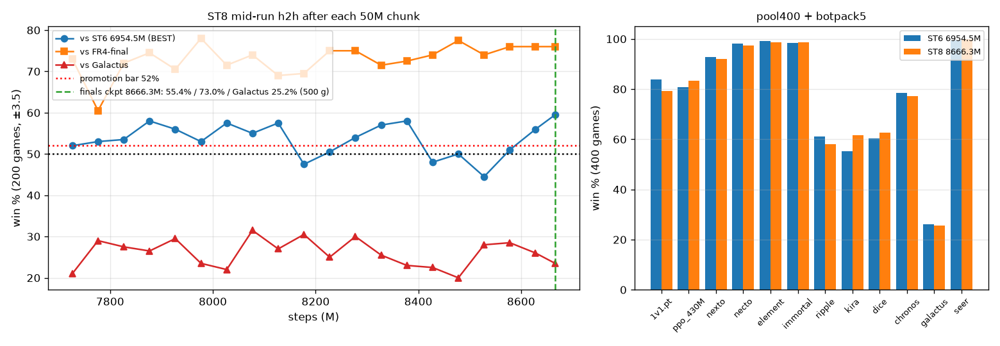

## 12. Summary of checkpoints

| checkpoint | steps | lineage | best evidence | where |
|---|---|---|---|---|
| `1v1.pt` | — | Python E8B2 (master) | pool 77.5 | `master:rlbot_submission/policies/1v1.pt` |
| 430M | 430.8M | R0 | 60.2% vs 1v1.pt (1000 g); pool 79.0 | `checkpoints_to_test/430M.bpk` |
| 531M | 531.0M | R0 | 61.8% vs 1v1.pt (400 g) | not packaged (`e8b2_1v1/checkpoints` on the box, subject to rotation) |
| 600M | 600.0M | R0 | 44.8% vs 1v1.pt (400 g), the regression | not packaged |
| X0-best | ~881M | R1 control | 63.4% vs 430M (1000 g); pool 83.3 | box: `final_analysis/bests/X0` |
| FR-best | ~881M | R1 FR | 50.2% vs X0 (1000 g); pool 83.8 | box: `final_analysis/bests/FR` |
| **ADB-832M** | 831.6M | R1 ADB | 63.6% vs 430M, 52.1% vs X0 (1000 g); **pool 84.7** (best) | `checkpoints_to_test/adb_832M.bpk`; release [`adb-832m`](https://github.com/SentientPlatypus/indonesian_coconut/releases/tag/adb-832m) |
| **FR2-1132M** | 1131.6M | R2 | **57.2% vs ADB-832M** (1000 g); pool 83.5 | `checkpoints_to_test/fr2_1132M.bpk` |
| FR3 | — | R3 | stopped at level 0; no checkpoint kept | box: `exp_FR3_run4` |
| **AUD-1132M** | 1131.6M | R4 | **64.6% vs ADB-832M** (1000 g); pool 87.0 | `checkpoints_to_test/aud_1132M.bpk` |
| **FR4-1432M** | 1431.6M | R5 | **63.3% vs ADB-832M**, **53.2% vs AUD-1132M** (1000 g); **pool 87.1** (best) | `checkpoints_to_test/fr4_1432M.bpk` |
| FR5-1732M | 1731.6M | R6 | L0 reset success 27.4% greedy; 0 uses in real play; 44.9% vs FR4, 46.6% vs AUD, pool400 83.0, Nexto 82.8% (re-run, §9.5) | box: `exp_FR5/checkpoints/1793494122`; not shipped |
| **FR6-2632M** | 2631.6M | R7 | first checkpoint with real-play reset uses (4 per 300k steps, 0 goals after); 48.0% vs FR4, 47.6% vs AUD (1000 g); pool 85.0 | `checkpoints_to_test/fr6_2632M.bpk` |
| FR7-3492M | 3491.6M | R8 (mid chunk) | 52.5% vs FR4, 51.3% vs FR6 (1000 g); pool 85.9; first goal after a reset (mid-run, curriculum spawn); 300k checks: 1 use, 0 goals | box: `fr7_keep/3492M`; not shipped (fails reset half of push rule) |
| FR7-final | 3631.6M | R8 | 47.2% vs FR4, 48.6% vs FR6 (1000 g); pool 84.9; 2 uses / 0 goals per 300k (rates_fr3) | box: `exp_FR7/checkpoints/1793568505`; not shipped |
| FR7b-final | 3891.6M | R8 (FR7b, from 2891.6M) | 49.7% vs FR4, 50.8% vs FR6 (1000 g); pool 86.5 (best of the FR line, Nexto 87.8); 1 use / 0 goals per 300k (rates_fr7, curriculum spawn) | box: `fr7_keep/fr7b_3892M`; not shipped (fails reset half of push rule) |
| FR7c-final | 4491.6M | R9 (FR7c, from FR7 3491.6M) | 45.6% vs FR4, 49.2% vs FR6 (1000 g); pool 85.4; rates_fr7 3 resets / 0 uses / 1 goal after a reset (replay, no use) | box: `exp_FR7c/checkpoints/1793610395`; not shipped (below 48% vs FR4) |
| FR7d-final | 4901.6M | R9 (FR7d, from FR7c 3901.6M) | 49.7% vs FR4, 52.4% vs FR6 (1000 g); pool 86.4 (Nexto 87.2); rates_fr7 0 resets / 0 uses / 0 goals; rates_fr3 5 / 1 / 0 (curriculum) | box: `exp_FR7d/checkpoints/1793630629`; not shipped (fails reset half of push rule) |
| FR7e-final | 5211.6M | R9 (FR7e, from FR7d 4211.6M) | 49.8% vs FR4, 49.3% vs FR7 3491.6M (1000 g); pool 86.2; rates_fr7 4 / 1 / 0 (curriculum) | box: `exp_FR7e/checkpoints/1793650831` (deleted in the Nov 2 cleanup); not shipped |
| **FR8-final** | 4491.6M | R10 (FR8, 106-input obs, from FR7 3491.6M) | **53.3% vs FR7 3491.6M**, 51.85% vs FR4 (1000 g); **pool 87.0** (best, Nexto 88.5); rates_fr7 3 / 0 / 0, rates_fr3 6 / 1 / 0 (curriculum) | box: `exp_FR8/checkpoints/1793674697`, `fr8_final/final_policy.safetensors`; not shipped (fails reset half of push rule); needs the 106-input RLBot binaries |
| FR8b-final | 5001.6M | R10 (FR8b, from FR8 4001.6M) | 50.7% vs FR4, 51.7% vs FR7 3491.6M, 49.7% vs FR8-final (1000 g); pool 85.7 (Nexto 85.5); rates_fr7 4 / 1 / 0, rates_fr3 7 / 2 / 0 (curriculum) | box: `exp_FR8b/checkpoints/1793695617`, `fr8b_final/final_policy.safetensors`; not shipped (fails reset half of push rule) |
| FR8c-final | 5491.6M | R10 (FR8c, from FR8-final 4491.6M) | 48.6% vs FR4, 51.3% vs FR7 3491.6M, 50.5% vs FR8-final (1000 g); pool 87.9 (Nexto 88.5); rates_fr7 3 / 1 / 0, rates_fr3 3 / 2 / 0 (curriculum) | box: `exp_FR8c/checkpoints/1793716845`, `fr8c_final/final_policy.safetensors`; not shipped (fails reset half of push rule) |
| FR9-final | 5491.6M | R11 (FR9, changed recipe, from FR8-final 4491.6M) | **53.3% vs FR4**, **54.1% vs FR7 3491.6M**, 48.3% vs FR8-final (1000 g); pool 87.5 (Nexto 87.2); rates_fr7 0 / 0 / 0, rates_fr3 3 / 0 / 0 (curriculum) | box: `exp_FR9/checkpoints/1793737699`, `fr9_final/final_policy.safetensors`; not shipped (fails reset half of push rule) |
| FR9b-final | 6101.6M | R11 (FR9b, from FR9 5101.6M) | 50.7% vs FR4, 53.7% vs FR7 3491.6M, 50.4% vs FR8-final (1000 g); pool 86.8 (Nexto 86.5); rates_fr7 5 / 1 / 0 (use in curriculum), rates_fr3 5 / 1 / 0; mid-run: first normal-play (replay) goal after a reset, no use | box: `exp_FR9b/checkpoints/1793758509`, `fr9b_final/final_policy.safetensors`; not shipped (fails reset half of push rule) |
| ST1 5051.6M | 5051.6M | ST1 (strength-only, from FR8-final) | 62.2% vs FR8-final, 61.6% vs FR4 (1000 g); pool 86.6; botpack5 56.25 (FR8 58.0) | `checkpoints_to_test/st1_5052M.bpk` (not promoted) |
| ST2 5511.6M | 5511.6M | ST2 (gamma 0.997, 2x batch, from ST1 5051.6M) | **68.2% vs FR8-final**, 64.4% vs FR4 (1000 g); **pool 89.1** (best, Nexto 91.25); **botpack5 61.6** (best) | `checkpoints_to_test/st2_5512M.bpk`; box `exp_ST2/checkpoints/1793792743`, `st2_final/`; needs the 106-input RLBot binaries |
| **ST3 5771.6M** | 5771.6M | ST3 (entropy 0.008, LR cosine, from ST2 5511.6M) | **53.4% vs ST2**, 69.1% vs FR4 (1000 g); **pool 91.2** (best); botpack5 61.5; Galactus 20.4% (1000 g) | `checkpoints_to_test/st3_5772M.bpk`; box `exp_ST3/checkpoints/1793809757`, `st3_final/`; needs the 106-input RLBot binaries |

## 13. Lessons learned and threats to validity

1. **100-game evals are noisy** (±5 pts per opponent). The same 430.8M checkpoint scored 81.5 and 80.8 in two 100-game pool evals and 79.0 over 400 games. Periodic keep-best decisions near the threshold are partly luck, so only the 1000-game h2hs (±1.6) should rank close candidates. ADB vs X0 at 52.1% is not significant.
2. **Self-play zero-sum effects.**
   - A zero-sum bump reward also teaches the victim to avoid bumps, which is why bumps fell in ADB.
   - Logged signed means of zero-sum terms cancel to 0, so R1's reward shares are biased. From R2 on, `RewardAbs/` fixes that.
   - Self-play ratings (`Rating/1v1`) did not show R0's regression. Fixed external opponents are needed.
3. **Passive resets from setters.** 89% of `air_near_ball` setups reset with no input, and nearly every recorded reset in every policy comes from that setter. Any reset "rate" that includes such setters measures the setter, not the policy. Report earned resets (`flier_earned_reset_share`) and kickoff-only rates.
4. **Metric bugs can invalidate whole rounds.** All of R1's flip-reset conclusions rest on a detector that missed 5–13× of resets. Simulator-level tests now pin the definition.
5. **Shaping dominance.** Existing dense aerial terms (about 13–15% of |reward| for `airdribble_seq` alone) compete directly with the behaviour we want in the same states.
6. **Eval harness validity.** Reused engines and missing spawn jitter produced impossible results: a policy beat itself 59%, and 100% against three bots. All R1+ numbers use the fixed harness. The R0 400-game h2h table (logged 2:02–3:17 PM ET Oct 30) predates the fresh-engine/jitter fix (pool baselines logged 4:52–5:45 PM ET); which harness version produced it is not recorded, so treat the R0 curve as indicative.
7. **Single seed per run.** Every training run is one seed, so run-to-run variance is not recorded.
8. **Headless ≠ RLBot.** Headless evals apply actions on the tick they are chosen, while RLBot runs them a few ticks late. Nexto's headless numbers may differ from live matches.

## 14. Future work

- FR7 (§11) kept strength but did not move resets into normal play; see §11.4. FR7b, FR7c and FR7d (§11.5–§11.7) did not either; FR7e (§11.7b) ended the chain with the same result (49.8% vs FR4, 0 normal-play uses); FR8 (§11.8) changes the obs instead.
- FR6 (§10) got the first real-play uses at FR4-level strength, but only from curriculum-style spawns and with no goals after a reset; see §10.4.
- FR5 (§9) solved the curriculum-level skill with behaviour cloning but not transfer to real play; see §9.7 for the next ideas. Earlier notes on the curriculum (failed three times, FR3 runs 3–4, FR4):
  - behaviour cloning or a warm-up from the scripted aligner, which gets 54.7% at L0;
  - a separate reset-specialist policy, distilled later (an idea from Discord);
  - a curriculum-only pretraining phase, or paying only for earned resets above the no-input rate.
- A tight, attacker-only ADB event (≥ 2 attacker air touches in 1.5 s, ball within 250 uu), logged by absolute value, with its share raised to 4–5%.
- Multi-seed reruns of the key comparisons (X0 vs ADB) to measure seed variance.
- Framework: reuse collection values (stage 3), CUDA graphs and a GPU rollout buffer, as in the indococo-ppo README roadmap.


### 11.8m ST9 results: OPPCH 0.55 on ST8 league, from ST8 8666.3M (→ 9628.4M). NEW BEST

ST9 kept the ST8 recipe (broader league + ENT 0.016, Galactus weight 2.5, gamma 0.998, 300k/iter, LR 5e-5, flip_reset 70, ST4/ST5/ST6 in EXTRA_OPPS) and changed one thing: OPPCH 0.50 → 0.55. Trained ~11:57 PM ET Nov 5 to ~6:14 AM ET Nov 6; finals done 6:38 AM ET Nov 6.

Finals checkpoint = best mid chunk 9628.4M (`exp_ST9/checkpoints/1793962509`):

| Metric | ST9 9628.4M | ST8 8666.3M (prev best) |
|---|---|---|
| vs BEST (500 g) | **54.0%** (270-230) | — |
| vs FR4 (500 g) | **72.8%** | 73.0% |
| pool400 | **91.67** | 91.58 |
| botpack5 | **63.21** | 64.21 |
| Galactus (500 g) | **21.8%** | 25.2% |
| gen panel min / mean | 21.8 / 77.5 | 25.2 / 77.87 |

Promoted on every gate (bp5 exactly at −1.0 tol; Galactus −3.4 within −4). OPPCH 0.55 beat ST8 head-to-head and nudged pool up, with Ripple +3.0 and Necto +2.25, while giving back Galactus (−3.4 / bp5 −4.5) and Chronos (−3.25). Mid-run (200 g) peak Galactus 34.5% at 8826.8M; late mid vs ST8 often 0.46–0.59. Shipped as `checkpoints_to_test/st9_9628M.bpk`. ST10 (ST7_final + Megabyte@2.0 via indococo-train-mega) auto-started from this chunk at 6:38 AM ET and measures against ST9; ST11 then ST12 are queued.

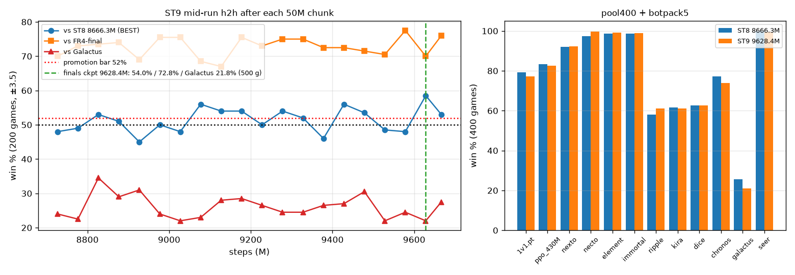

### 11.8n ST10 results: ST7_final + Megabyte@2.0, from ST9 9628.4M (→ 10628.6M). NEW BEST (manual override)

ST10 kept the ST9 recipe (OPPCH 0.55, ENT 0.016, Galactus weight 2.5, gamma 0.998, 300k/iter, LR 5e-5, flip_reset 70, ST4/ST5/ST6 in EXTRA_OPPS) and added ST7_final at w1.0 plus Megabyte at weight 2.0 via `indococo-train-mega`. Trained ~6:38 AM ET to ~1:05 PM ET Nov 6; finals done 1:31 PM ET Nov 6.

Finals checkpoint = best mid chunk 10628.6M (`exp_ST10/checkpoints/1793988079`):

| Metric | ST10 10628.6M | ST9 9628.4M (prev best) |
|---|---|---|
| vs BEST (500 g) | **54.6%** (273-227) | — |
| vs FR4 (500 g) | 71.2% | 72.8% |
| pool400 | **92.29** | 91.67 |
| botpack5 | **66.75** | 63.21 |
| Galactus (500 g) | **24.4%** | 21.8% |
| Megabyte (500 g, report-only) | **71.0%** | — |
| gen panel min / mean | **24.4% / 79.43%** | 21.8% / 77.5% |

`st_promote.py` initially set **promote=false** only on FR4 (−1.6 vs −1.0 tol). User approved a **manual override** at 1:36 PM ET Nov 6: FR4 noise on 500 games is ~±2 pt, and every other gate plus the gen panel improved (Kira +11.75, Chronos +1.75, 1v1.pt +5.0, Nexto +0.75, Galactus +2.6). Mid-run (200 g) peak Galactus 29.5% at 10089.5M; Megabyte mid mostly 0.65–0.75. **ST10 10628.6M is the new best** (manual) and is shipped as `checkpoints_to_test/st10_10629M.bpk`. ST11 (ST10 + ST8_final + Megabyte@2.0) auto-started from this chunk at 1:31 PM ET; after the override, ST11 mid/finals measure against ST10, and ST12 will inherit ST10 as BEST unless ST11 promotes.


### 11.8o ST11 results: ST8_final + Megabyte@2.0 (old mega train), from ST10 10628.6M (→ 11628.8M). NEW BEST

ST11 kept the ST10 recipe (OPPCH 0.55, ENT 0.016, Galactus weight 2.5, gamma 0.998, 300k/iter, LR 5e-5, flip_reset 70, prior EXTRA_OPPS) and added ST8_final at w1.0 plus Megabyte at weight 2.0. Trainer binary was still the **old** `indococo-train-mega` (pre-parity fix); mid/final Megabyte *evals* after ~2:54 PM ET Nov 6 used the fixed Python port. Trained ~1:31 PM ET to ~8:03 PM ET Nov 6; finals done 8:29 PM ET Nov 6.

Finals checkpoint = best mid chunk 11089.7M (`exp_ST11/checkpoints/1794000457`):

| Metric | ST11 11089.7M | ST10 10628.6M (prev best) |
| --- | --- | --- |
| vs BEST (500 g) | **54.8%** | — (vs ST9 54.6%) |
| vs FR4 (500 g) | **73.6%** | 71.2% |
| pool400 | **92.62** | 92.29 |
| botpack5 | 65.83 | 66.75 |
| Galactus (500 g) | **30.0%** | 24.4% |
| Megabyte (500 g, report-only) | 70.4% (fixed Python; sim may be optimistic vs RLBot) | 71.0% INVALID (old port) / fixed baseline ST10 Rust 64.4% Python 64.8% |
| gen panel min / mean | **30.0** / 79.25 | 24.4 / 79.43 |

Auto `promote=true` vs ST10 on every gate (bp5 −0.92 within −1.0 tol; Galactus +5.6). Note: launch BESTF was still `st9_final` (ST11 started before the ST10 manual override); h2h already played ST10 via patched `opp_BEST.toml`. PROMOTE.json was re-scored vs `st10_final` and still promotes. bp5 gave back Kira (−8.5) and Dice (−6.25) while Chronos (+2.5), Galactus-in-bp5 (+4.25), and Ripple (+1.75) rose. Mid-run (200 g) peak Galactus 34.0% at 10889.3M (<40%). Shipped as `checkpoints_to_test/st11_11090M.bpk`. ST12 (ST9_final + mega2@2.0) auto-started from this chunk at 8:29 PM ET measuring against ST11; queue ST13 (ST10+ST11 in EXTRA_OPPS, mega2) then ST14 (OPPCH 0.50).

### 11.8p Ripple v1.1 joins the training split (ST20, 2026-11-09)

Ripple v1.1 (Rolv-Arild/Ripple-RLBot @ 7ca4273a, CC BY-NC-SA 4.0) was an eval-only botpack5 opponent through ST19. ST20, after ST19r, puts the Rust port (`indococo_ppo_bot/src/ripple.rs`) in the training game split. Weights stay outside the repo and load from `RIPPLE_DIR` (default `/home/ubuntu/eval_bots/ripple/bots/v1.1`).

On the EC2 launcher the share is the ripple entry's weight in `train_st20.toml` (`1.286`, about 5% of iterations). Galactus stays 20% and Megabyte 7.8%. `st_ST20.env` exports `RIPPLE_DEVICE=cuda` and does not set `RIPPLE_WEIGHT`, so `st_launch.sh` does not run per-chunk Ripple evals. `RIPPLE_WEIGHT` is an optional trainer-load override: a positive value replaces the toml weight or adds the opponent, `0` removes it, and unset leaves the toml weight. Trainer binary md5 `3c6dbe7c`.

A 10% Ripple share estimates +15% to +28% slower, which is over the 15% slowdown budget. The pre-run estimate at about 5% is +7.6% to +13.8%. The pools=2 trainer smoke measured a Ripple iteration at about 2.1× a normal one and saved a checkpoint. That smoke, and the trainer, have to be started in a working directory that contains `collision_meshes` (RocketSim loads `collision_meshes/soccar` from the cwd). Early ST20 production (346 iterations) does not show that gap: Ripple was the opponent in 17/346 iterations (4.9%), the median Ripple iteration took about 5.5 s (the same as other iterations), and throughput is 51.2k steps/s vs 54.5k for ST19r (about −6%).

GPU-box verification of `e429d1a` (rip33):

| Check | Result |
|---|---|
| Build and link | clean |
| Lib tests | 87/87 on CPU and with Ripple on CUDA |
| GPU vs ONNX actions | 100% agreement |
| Replay | 197/197 blue, 195/197 orange |
| Idle | 100/100 |
| Bench | 0.0118 ms/row at 1024 rows, 0.0237 ms/row at 256; forward about 5 ms per call |
| Trainer smoke | pools=2, checkpoint saved; Ripple iteration about 2.1× normal |

### 11.8q ST20 not promoted; ST21 queued (Galactus 25%, 2026-11-09)

ST19r (`checkpoints_to_test/st19r_15919M.bpk`) was BEST on Nov 9. ST20r replaced it on Nov 10 (§11.8r). ST20 finished and the user declined promotion on Nov 9. No bpk was exported.

Selected checkpoint `exp_ST20/checkpoints/1794253717` at 16880.9M (`st20_final`). Finals vs ST19r:

| Metric | ST20 16880.9M | ST19r (BEST) |
|---|---|---|
| h2h | 54.4 | — |
| FR4 | 73.6 | 71.6 |
| pool | 91.88 | 92.62 |
| botpack5 | 67.0 | 67.38 |
| Galactus | 33.0 | 34.2 |
| Megabyte (report-only) | 78.8 | — |
| gen-panel min / mean | 0.33 / 0.7954 | 0.342 / 0.800 |

The panel is mixed. Ripple's ST20 share was toml weight 1.286. `RIPPLE_WEIGHT` was not in the env.

ST21 kept that recipe (Ripple 5%, Megabyte 7.8%, Galactus 25% via `GAL_WEIGHT` 6.429) and later started from ST20r. See §11.8r. `RIPPLE_DEVICE=cuda` is exported in the env. `RIPPLE_WEIGHT` is not set. Binary `/opt/dlami/nvme/ippo_bins/indococo-train-rip-e429d1a`.

### 11.8r ST20r promoted; ST21 later replaced it (2026-11-10)

ST20r was BEST until ST21 (§11.8s). User-approved manual promote 2026-11-10 00:16 ET. Checkpoint `exp_ST20r/checkpoints/1794276990` at 17642.6M, continued from ST20's selected checkpoint at 16880.9M, same ST20 recipe (Ripple 5%, Galactus 20%, Megabyte 7.8%). Shipped as `checkpoints_to_test/st20r_17643M.bpk` (commit `7504b5a`). ST19r (`st19r_15919M.bpk`) is the previous best.

| Metric | ST20r 17642.6M | ST19r (previous best) |
|---|---|---|
| h2h vs ST20 (auto-gate baseline) | 58.4% | — |
| h2h vs ST19r, 500 g | 56.4% (282-218) | — |
| FR4 | 75.8 | 71.6 |
| pool400 | 92.42 | 92.62 |
| botpack5 | 69.74 | 67.38 |
| Galactus | 34.2 | 34.2 |
| Megabyte (report-only) | 79.2 | 81.0 |
| gen-panel min / mean | 0.342 / 0.8107 | 0.342 / 0.800 |

Gates vs ST19r all pass: h2h 56.4 ≥ 52, FR4 75.8 ≥ 70.6, pool 92.42 ≥ 91.62, bp5 69.74 ≥ 66.38, Galactus 34.2 ≥ 30.2.

ST21 started from ST20r at 17642.6M (2026-11-10 04:44 UTC) and later became BEST. See §11.8s. Recipe unchanged from `cd89eae`: Galactus 25% / Ripple 5% (toml weight 1.286) / Megabyte 7.8%. `RIPPLE_WEIGHT` is not set.

ST22 and ST23 were queued here; their status after the ST21 promote is in §11.8s. Box check of `9d4b2a6`: 88 lib tests passed. A pools=2 smoke from the ST20r checkpoint at setter weight 0.5 gave share 0.386 (expected 0.333), average episode length 346, flip-reset events fired, and no panics.

### 11.8s ST21 manual promote; ST22 later finished unpromoted (2026-11-10)

ST21 was BEST until ST23 (§11.8t). User-approved manual promote 2026-11-10 08:57 ET. Keep-best checkpoint `exp_ST21/checkpoints/1794296692` at 18053.6M, continued from ST20r 17642.6M (training ended at 18642.8M). Same ST21 recipe (Galactus 25%, Ripple 5%, Megabyte 7.8%). Shipped as `checkpoints_to_test/st21_18054M.bpk`. ST20r (`st20r_17643M.bpk`) is the previous best.

| Metric | ST21 18053.6M | ST20r (previous best) |
|---|---|---|
| h2h vs ST20r, 500 g | 52.8% (264-236) | — |
| FR4 | 75.4 | 75.8 |
| pool400 | 92.75 | 92.42 |
| botpack5 | 68.17 | 69.74 |
| Galactus | 35.6 | 34.2 |
| Megabyte (report-only) | 81.6 | 79.2 |
| gen-panel min / mean | 0.356 / 0.8034 | 0.342 / 0.8107 |

Auto gate failed only on bp5 68.17 vs 69.74 (about 1.6 short of the −1.0 tolerance). Other gates pass: h2h 52.8 ≥ 52, FR4 75.4 ≥ 74.8, pool 92.75 ≥ 91.42, Galactus 35.6 ≥ 30.2.

ST22 started from ST21's 18053.6M checkpoint (`st_ST22.env`, `train_st22.toml`): ST21 plus `air_dribble_wall_challenge` at 10% of starts. League and OPPCH stay ST21's (0.60). Binary `/opt/dlami/nvme/ippo_bins/indococo-train-rip-9d4b2a6`. `RIPPLE_WEIGHT` is not set. It launched with BESTF=st20r_final. `exp_ST22/opp_BEST.toml` was re-pointed to st21_final at 2026-11-10 9:00 AM ET. After finals, `PROMOTE.json` was re-scored vs st21_final. Selected checkpoint `exp_ST22/checkpoints/1794327975` at 18564.8M. Panel vs ST21: h2h 50.6%, FR4 76.0, pool 92.58, bp5 68.75, Galactus 35.8, Megabyte 84.8 (report-only). promote stayed false (h2h 50.6% < 52%). No bpk was exported.

### 11.8t ST23 promote (2026-11-10)

ST23 was BEST until ST25 (§11.8v). Auto gate passed; user confirmed 2026-11-10 11:30 PM ET. Keep-best checkpoint `exp_ST23/checkpoints/1794367057` at 19015.7M, continued from ST21 18053.6M (training ended at 19053.8M). Recipe: ST21 + OPPCH 0.70 + 1 PPO epoch, ST21 setters, no `air_dribble_wall_challenge`, binary `9d4b2a6` (user-approved restart 4:07 PM ET Nov 10, from ST21 rather than ST22). The OPPCH bump and the 1-epoch switch are confounded, and the wall-challenge setter was also dropped, so the gain cannot be credited to one change alone. Shipped as `checkpoints_to_test/st23_19016M.bpk`. ST21 (`st21_18054M.bpk`) is the previous best.

| Metric | ST23 19015.7M | ST21 (previous best) |
|---|---|---|
| h2h vs ST21, 500 g | 56.0% (280-220) | — |
| FR4 | 79.6 | 75.4 |
| pool400 | 93.21 | 92.75 |
| botpack5 | 68.67 | 68.17 |
| Galactus | 35.4 | 35.6 |
| Megabyte (report-only) | 83.2 | 81.6 |
| gen-panel min / mean | 0.354 / 0.8087 | 0.356 / 0.8034 |

All auto gates passed: h2h 56.0 ≥ 52, FR4 79.6 ≥ 74.4, pool 93.21 ≥ 91.75, bp5 68.67 ≥ 67.17, Galactus 35.4 ≥ 31.6 (and above the 0.27 floor).

### 11.8u ST24 not promoted; ST25 training; ST26 queued (2026-11-11)

ST24 (`st_ST24.env`, `train_st24.toml`) = restarted ST23 plus `ST20r_final` at weight 2.0, aimed at bp5 / Dice recovery. Realized shares at OPPCH 0.70 / total 17.427: Galactus 25.8%, Ripple 5.2%, Megabyte 8.0%, ST20r 8.0%, other league 23.0%, self-play 30%. It started 2026-11-10 11:18 PM ET from ST23's 19015.7M checkpoint and measured vs ST23. Selected checkpoint `exp_ST24/checkpoints/1794384802` at 19727.3M. Finals 2026-11-11 5:36 AM ET: not promoted.

| Metric | ST24 19727.3M | ST23 (BEST) |
|---|---|---|
| h2h vs ST23, 500 g | 53.6% (268-232) | — |
| FR4 | 77.0 | 79.6 |
| pool400 | 93.0 | 93.21 |
| botpack5 | 67.0 | 68.67 |
| Dice (in botpack5) | 57.75 | 65.25 |
| Galactus | 37.0 | 35.4 |
| Megabyte (report-only) | 83.2 | 83.2 |
| gen-panel min / mean | 0.37 / 0.801 | 0.354 / 0.8087 |

Gates: h2h passes, but FR4 (77.0 < 78.6) and bp5 (67.0 < 67.67) fail. The opponent was meant to restore Dice, and Dice got worse. Mid evals vs FR4 were flat (mean 76.2 vs ST23's 76.1).

ST25 (`st_ST25.env`, `train_st25.toml`) = ST24's config with the demo_threat setter retuned to the diag_gal finding: 59% of goals ST23 concedes to Galactus come within 3.5 s of a demo on us, with Galactus closing from ~2.5k uu. demo_threat goes from 0.05 @ 800-1500 uu to 0.15 @ 1800-3000 uu, normal play ×0.875, aerial_defense 0.15. It started 2026-11-11 5:37 AM ET from ST24's 19727.3M with BESTF=st23_final. It still carries ST20r@2.0.

ST26 (`st_ST26.env`, `train_st26.toml`) is queued after ST25 (`ST_QUEUE` = `ST26 ST26`). It is ST25 with one change: `ST20r_final` is removed, so the league is ST23's again (total 15.427: Galactus 29.2%, Ripple 5.8%, Megabyte 9.1%, other league 26.0%, self-play 30%). Setters and learner settings are ST25's. Start ckpt and BEST follow the launcher (ST25's selected final; BEST is st25_final if it promotes, else st23_final). The rendered config was validated in `/opt/dlami/nvme/st26_validate`: it parses, and `rates` ran 40k steps with no panics.

### 11.8v ST25 manual promote; ST26 training vs ST25 (2026-11-11)

ST25 is the current best. User-approved manual promote 2026-11-11 12:16 PM ET. Selected checkpoint `exp_ST25/checkpoints/1794413355` at 20727.5M (training ended there), continued from ST24 19727.3M. Recipe: ST24's config (ST23 + `ST20r_final` @ 2.0) with demo_threat 0.15 @ 1800-3000 uu. Finals 2026-11-11 11:53 AM ET. Shipped as `checkpoints_to_test/st25_20728M.bpk`. ST23 (`st23_19016M.bpk`) is the previous best.

| Metric | ST25 20727.5M | ST23 (previous best) |
|---|---|---|
| h2h vs ST23, 500 g | 56.2% (281-219) | — |
| FR4 | 78.4 | 79.6 |
| pool400 | 93.33 | 93.21 |
| botpack5 | 69.21 | 68.67 |
| Dice (in botpack5) | 61.75 | 65.25 |
| Galactus | 40.8 | 35.4 |
| Megabyte (report-only) | 84.0 | 83.2 |
| gen-panel min / mean | 0.408 / 0.8132 | 0.354 / 0.8087 |

The auto gate failed only on FR4: 78.4 < 78.6 (ST23 79.6 minus the 1.0 tolerance). h2h, pool, bp5 and Galactus all passed. `PROMOTE.json` was backed up to `PROMOTE.json.bak_auto_false` and set to promote=true with a manual_override note. Galactus 40.8% is the best result so far (ST19 first broke 34%); the anti-demo drill looks like it worked. Demos per 200 kickoff games (cand/opp): vs ST23 85/70, vs FR4 13/99.

ST26 (ST25 without `ST20r_final`) started 2026-11-11 11:54 AM ET from ST25's 20727.5M checkpoint with BESTF=st23_final. `exp_ST26/opp_BEST.toml` was re-pointed to st25_final at 12:17 PM ET, before ST26's first mid eval, so all its mids, final selection and finals h2h measure vs ST25, which is also its start checkpoint. The running launcher keeps BESTF=st23_final in memory, so ST26's `PROMOTE.json` baselines (FR4/pool/bp5/Galactus) and demos_h2h must be re-scored vs st25_final after finals.

### 11.8w ST25 diagnostics; ST27 queued (FR4_final @ 2.0) (2026-11-11)

Diagnostics on ST25 (200 games each, `~/ippo_runs/diag_gal/`, same per-goal method as ST23):

| Metric | ST25 | ST23 |
|---|---|---|
| vs Galactus wr (200 g) | 38.5% (77-123) | 38.0% (76-124) |
| Galactus goals within 3.5 s of a demo on us | 76/123 (62%) | 73/124 (59%) |
| wr when demoed / not demoed | 12.6% (12/95) / 61.9% (65/105) | 9.7% (9/93) / 62.6% (67/107) |
| Galactus aerial goals against (z>300) | 15 | 24 |
| we demo Galactus | 16 | 7 |
| vs FR4 wr (200 g) | 77.0% (154-46) | 74.5% (149-51) |
| kickoffs lost vs FR4 | 88/200 (44%) | 79/200 (40%) |
| FR4 goals: aerial / out of position / after demo | 14 / 14 / 10 | 18 / 9 / 12 |

Botpack5 per-bot for ST25 vs ST23: Dice 61.75 vs 65.25 (still below ST20r's 67.67), Galactus 40.25 vs 36.25, Chronos 78.75 vs 75.25, Ripple 68.25 vs 67.25, Kira 66.5 vs 68.5. Megabyte 500 g: 84.0 (420-80) vs 83.2 (416-84).

The demo drill did not reduce the share of Galactus goals that follow a demo. ST25's Galactus gain comes with fewer aerial goals against. The FR4 gate miss is within noise (ST25 is ahead of ST23 vs FR4 on the 200-game diagnostic and on mid evals). FR4 wins mainly off its kickoff and aerial play, which only FR4 produces.

ST27 (`st_ST27.env`, `train_st27.toml`) = ST26 with one change: `FR4_final` league weight 0.816 -> 2.0 (realized 3.7% -> 8.4%; Galactus 29.2% -> 27.1%). It is queued after ST26 (`ST_QUEUE` = `ST27 ST27`) and validated in `/opt/dlami/nvme/st27_validate` (parse, setter sum 1.0, `rates` 40k steps, no panics).

### 11.8x ST26 not promoted; ST27 baseline OK; ST28 queued (demo penalty x3) (2026-11-11)

ST26 (ST25 without `ST20r_final`) finals, 2026-11-11 6:19 PM ET, selected 21639.5M:

| Metric | ST26 | ST25 (BEST) |
|---|---|---|
| h2h (500 g) | 49.0% vs ST25 | — |
| FR4 | 72.2 | 78.4 |
| pool400 | 93.21 | 93.33 |
| bp5 (Dice) | 68.33 (68.25) | 69.21 (61.75) |
| Galactus (500 g) | 34.6 | 40.8 |
| Megabyte | 82.6 | 84.0 |
| gen min / mean | 0.346 / 0.8061 | 0.408 / 0.8132 |

Not promoted: h2h, FR4 and Galactus all miss the gate vs ST25 (`st26_final/PROMOTE_vs_st25.json`). Across ST23-ST26, Dice is about 7 pts higher without ST20r and Galactus about 4 pts lower, each about 2 SE or less and confounded with the chain.

ST27 baseline check: the launcher's BESTF is st25_final, `exp_ST27/opp_BEST.toml` points at st25_final, and ST27 started from ST26's selected final (`exp_ST26/checkpoints/1794434780`, 21639.5M). Nothing was changed.

ST28 (`st_ST28.env`, `train_st28.toml`, `st28.toml`) = ST27 with one change: `demo.victim_punishment` 1.0 -> 3.0, so a demo on us costs 150 instead of 50 (attacker reward and everything else unchanged). Target: Galactus, where 62% of goals against follow a demo on us and the ST25 demo drill did not move that share. Rejected: Dice (no Rust port, so no league or drill lever), re-adding ST20r (weak, confounded evidence), more Galactus weight or OPPCH (never moved Galactus), TPI 600k (collection-bound, no target), opponent perturbations (needs code), entropy (no evidence). Queued (`ST_QUEUE` = `ST28 ST28`) and validated in `/opt/dlami/nvme/st28_validate` (parse, setter sum 1.0, reward merge diff = victim_punishment only, `rates` 40k steps with no panics).

### 11.8y ST27 and ST28 not promoted; ST29 training; ST30 queued (Galactus pre-demo replay) (2026-11-12)

| Metric | ST28 | ST27 | ST25 (BEST) |
|---|---|---|---|
| h2h vs ST25 (500 g) | 51.4% | 48.8% | — |
| FR4 | 75.4 | 73.0 | 78.4 |
| pool400 | 93.29 | 92.17 | 93.33 |
| bp5 | 72.04 | 69.37 | 69.21 |
| Galactus (500 g) | 40.4 | 38.8 | 40.8 |
| Megabyte | 83.2 | 85.2 | 84.0 |
| gen min / mean | 0.404 / 0.827 | 0.388 / 0.809 | 0.408 / 0.8132 |

ST27 (FR4 weight 2.0) did not bring FR4 back. ST28 (ST27 league + demo victim_punishment 3.0, started from ST25) raised bp5 and the panel mean, but on diag_gal it was demoed more by Galactus (127 vs 115 per 200 g), and 68% of Galactus goals followed a demo (ST25 62%). Before those demos we are a grounded keeper about 600 uu from our own goal line, and 89-92% of them become goals. ST29 (ST25 league + the same penalty) is training from ST25.

Revised after the Discord/research/code cross-exam: ST30 now keeps 0.05 of the synthetic `demo_threat` drill and gives 0.10 to `replay` over `gal_demo_v2.f32` (2073 states, 792 distinct Galactus demos, 1/3 from 2.0-3.0 s before the demo; validated in `/opt/dlami/nvme/st30v2_validate`). Original plan: ST30 replaces the synthetic `demo_threat` drill, which never puts the target near its goal, with a `replay` setter (same 0.15) over 1382 real states recorded 0.75-1.5 s before Galactus demoed ST25/ST28 within 3000 uu of our goal line (86% followed by a goal within 3.5 s). The base is ST25's recipe, or ST29's if ST29 promotes. Validated in `/opt/dlami/nvme/st30_validate` (render + parse, setter sum 1.0, reward diff, snapshot sanity, `rates` with no panics; the drill gives about 2x the demo events of `demo_threat`).

### 11.8z ST29 not promoted: the demo penalty fails twice; ST30 training (2026-11-12)

| Metric | ST29 | ST28 | ST25 (BEST) |
|---|---|---|---|
| h2h vs ST25 (500 g) | 48.4% | 51.4% | — |
| FR4 | 77.0 | 75.4 | 78.4 |
| pool400 | 93.46 | 93.29 | 93.33 |
| bp5 | 69.42 | 72.04 | 69.21 |
| Galactus (500 g) | 39.4 | 40.4 | 40.8 |
| Megabyte | 84.2 | 83.2 | 84.0 |
| gen min / mean | 0.394 / 0.8133 | 0.404 / 0.827 | 0.408 / 0.8132 |
| demos in h2h vs ST25 (against / by us, 200 g) | 56 / 70 | 76 / 64 | — |
| demos vs FR4 (against / by us, 200 g) | 17 / 104 | 10 / 88 | — |

ST29 is ST25's recipe and league with ST28's demo victim penalty (`demo.victim_punishment` 3.0), started from ST25. It missed the gate on h2h (48.4 < 52) and FR4 (-1.4), so it was not promoted. On diag_gal the post-demo share of Galactus goals fell from 62% to 57% (about 1 SE), but we were demoed as often as before (121 vs 115 per 200 g) and the Galactus final fell 1.4 points. Together with ST28 (share up to 68%), the reward penalty for being demoed has failed on both leagues and is dropped. The weakest gen-panel slots are still Galactus (39.4), Dice (60.75), Kira (68.0) and Ripple (68.75). Against FR4, aerial goals (32%) and out-of-position goals (22%) are the biggest share of goals conceded. ST30 (0.05 synthetic `demo_threat` + 0.10 replay over real Galactus pre-demo states, from ST25, reward `st.toml`) started training at 1:49 PM ET.

### 11.8aa ST30 and ST31 not promoted; ST32 training; ST33 staged (Galactus-conditioned threat starts) (2026-11-13)

| Metric | ST31 | ST30 | ST25 (BEST) |
|---|---|---|---|
| h2h vs ST25 (500 g) | 48.8% | 56.0% | — |
| FR4 | 73.4 | 77.4 | 78.4 |
| pool400 | 93.29 | 93.08 | 93.33 |
| bp5 | 69.37 | 70.25 | 69.21 |
| Galactus (500 g) | 39.6 | 36.2 | 40.8 |
| Megabyte | 86.8 | 82.2 | 84.0 |
| gen min / mean | 0.396 / 0.8155 | 0.362 / 0.8166 | 0.408 / 0.8132 |
| diag_gal post-demo concedes | 87/126 (69%) | 76/123 (62%) | 76/123 (62%) |
| diag_gal demos on us (200 g) | 136 | 112 | 115 |

ST30 (pre-demo replay) lost 4.6 Galactus points. ST31 (pre-concede replay over six opponents) cut non-demo concedes against Galactus from 47 to 38 but gave the demos back, and it lost 5 FR4 points, with aerial concedes against FR4 rising from 14 to 25. Neither was promoted.

The late-game drop is the demo effect. Games end at the first goal, so a long game is one with more time for Galactus to land a demo. Without a demo on us we win 50-72% at every game length; with one we win 4-21%.

ST32 (recoverable `demo_threat`, from ST25) has been training since 3:31 AM ET. ST33 is staged after a three-way cross-exam (code, research on MAESTRO-style joint opponent × start curricula, and Discord read-only). It conditions the setter mix on the rollout's opponent. Against Galactus only, the threat drill runs at 0.30 with the learner as keeper and a ball driven at our net. Everything else is unchanged. It runs on a new binary (`indococo-train-st33`; rlgymppo opponent-pick hook, `opp_weights`, `learner_keeper`), which passed 98/98 lib tests and a smoke run that measured a 25% Galactus drill share.

### 11.8ab ST32 not promoted (user declined); ST33 restarted from ST25 (2026-11-13)

| Metric | ST32 | ST25 (BEST) |
|---|---|---|
| h2h vs ST25 (500 g) | 52.6% | — |
| FR4 | 78.8 | 78.4 |
| pool400 | 93.54 | 93.33 |
| bp5 | 70.29 | 69.21 |
| Galactus (500 g) | 39.0 | 40.8 |
| Megabyte | 82.8 | 84.0 |
| gen min / mean | 0.390 / 0.8179 | 0.408 / 0.8132 |

ST32 (recoverable `demo_threat`, from ST25; keep-best checkpoint 21238.7M, `exp_ST32/checkpoints/1794568806`) passed the automatic gate, including the 4-point Galactus rule, but the user declined to promote it. BEST stays ST25. `st32_final/PROMOTE.json` was overridden to `promote=false` (original kept as `PROMOTE.auto.json`). The ST33 run the launcher had auto-started from ST32 was stopped and kept as `exp_ST33_fromST32_aborted`. ST33 restarted at 10:13 AM ET from ST25 (`exp_ST25/checkpoints/1794413355`) with `train_st33.toml` and the `indococo-train-st33` binary, measured against st25_final.

### 11.8ac ST34 queued: `face_ball` 1.0 -> 0.1 and off the zero-sum path (2026-11-13)

A `diag_gal` run on ST32's keep-best checkpoint (200 g) showed the recoverable drill did not reduce goals conceded after a demo: 74 (ST25 76, ST31 87). The post-demo share fell to 59% only because aerial concedes rose to 25 (ST25 15). Demos on us were 125 (ST25 115). In all three runs, 95-97% of these demos hit us parked on the ground about 0.5-0.6k uu off our goal line, facing a supersonic Galactus carrying the ball.

| `diag_gal` vs Galactus (200 g) | ST25 | ST31 | ST32 |
|---|---|---|---|
| decisive win rate | 38.5% | 37.0% | 37.0% |
| conceded after a demo on us | 76 (62%) | 87 (69%) | 74 (59%) |
| demos on us / by us | 115 / 16 | 136 / 13 | 125 / 9 |
| aerial goals against | 15 | 17 | 25 |

ST34 is queued after a three-way cross-exam (code, research, Discord read-only). All three reviews picked the same single change: `face_ball` 1.0 -> 0.1 and removed from the zero-sum list (`experiments/st34.toml`, config only). `face_ball` was 9% of all |reward| (11% of the non-goal reward) against `shadow_space` at about 1/250 of that. Public bots either keep it tiny or not zero-summed (Zealan's guide, Necto, Kaiyo, Seer). ST34 runs from ST25 (`train_st34.toml`, binary 9d4b2a6), or from ST33 if it promotes (`train_st34p.toml`, `indococo-train-st33`). Watch items: FR4 and aerial goals against, kickoff and pursuit wobble, and energy/boost behaviour (rocking).

## Appendix A: data and figures

**Data files** (`data/`, about 0.8 MB):

| file | contents |
|---|---|
| `metrics_<run>.csv` | per-run training metrics, every 5 iterations averaged (0.5M steps per row) |
| `pool_evals.csv` | periodic 100-game pool evals and keep-best |
| `pool_400.csv` | 400-game pools, including harness baselines |
| `h2h_1000.csv` | 1000-game h2hs |
| `r0_h2h_vs_1v1.csv` | R0 h2h vs 1v1.pt |
| `flip_reset_rates.csv` | `rates` measurements: baselines and per-eval, by setter |
| `reward_shares.csv` | per-term \|reward\| shares, last 20 and last 1000 iterations |
| `fr3_level_baselines.csv` | FR3 per-level baselines |
| `sps_benchmark.csv` | throughput benchmark |
| `metrics_exp_FR5.csv` | FR5 training metrics (both attempts, column `attempt`) |
| `fr5_bc_refresh.csv` | FR5 level-0 success of the PPO and BC actors at every refresh |
| `reward_shares_FR5.csv` | FR5 \|reward\| shares, last 20 iterations |
| `metrics_exp_FR6.csv` | FR6 training metrics, 10-iteration means |
| `fr6_mid.csv` | FR6 mid-run checks: rates counts and 200-game h2h vs FR4-final per chunk |
| `fr7_mid.csv` | FR7 mid-run checks: rates_fr7 counts (all and per setter) and 200-game h2h vs FR4-final per chunk |
| `fr7b_mid.csv`, `fr7c_mid.csv`, `fr7d_mid.csv` | the same for FR7b and FR7c |
| `metric_keys_used.txt` | the metric keys used |

**Metric keys used:**

- `Cumulative/steps`;
- learning: `Collect/avg step reward`, `Loss/policy`, `Loss/value`, `Loss/KL divergence`, `Loss/entropy`, `Loss/clip fraction`, `Throughput/overall`, `Collect/episode length`, `Player/In Air Ratio`, `Player/Ball Touch Ratio`, `Rating/1v1`;
- events: `Events/Flip Resets per min`, `Events/Flip Resets (old detector) per min`, `Events/Flip Resets per min @<setter>`, `Events/Air Dribble Bumps per min`, `Events/Bumps per min`, `Events/Demos per min`, `Events/Has Flip Ratio`;
- setters and curriculum: `Setters/<kind> share`, `Curriculum/level`, `Curriculum/success`, `Curriculum/success @L0`, `Curriculum/episode level`;
- rewards: `Reward/<term>`, `RewardAbs/<term>` and `RewardNonzero/<term>`.

**Smoothing:** the faint lines are 0.5M-step means. The bold lines are a centred rolling mean over 20 rows (10M steps), or 4 rows for runs shorter than 100M steps.

**Not recorded:**

- the LR value per iteration (only the schedule config);
- X0's 430.8M start eval;
- per-opponent pool numbers for 531M and 600M;
- the old detector in R1 runs (R1's `Events/Flip Resets per min` *is* the old detector);
- signed-vs-abs reward shares for R0/R1;
- seed variance;
- a CTRL arm for AUD (dropped), so AUD's reward effect can't be separated from more training;
- FR5-final (1731.6M) h2h and pool400: the run scored the stale warm-start export (§9.5).

FR5 figures (`fr5_*.png`, `reward_share_exp_FR5.png`) and the three FR5 CSVs are made by [`make_figures_fr5.py`](make_figures_fr5.py) from `exp_FR5/logs/{metrics,bc_refresh}.jsonl`.

FR6 figures (`fr6_*.png`) and the two FR6 CSVs are made by [`make_figures_fr6.py`](make_figures_fr6.py) from `exp_FR6/logs/{metrics,mid}.jsonl` and `fr6_final/curr.jsonl`.
The FR7 figure (`fr7_mid.png`) and `fr7_mid.csv` are made by [`make_figures_fr7.py`](make_figures_fr7.py) from `exp_FR7/logs/mid.jsonl`.
FR7b and FR7c figures and CSVs are made the same way by [`make_figures_fr7b.py`](make_figures_fr7b.py) and [`make_figures_fr7c.py`](make_figures_fr7c.py); FR7d by [`make_figures_fr7d.py`](make_figures_fr7d.py).
